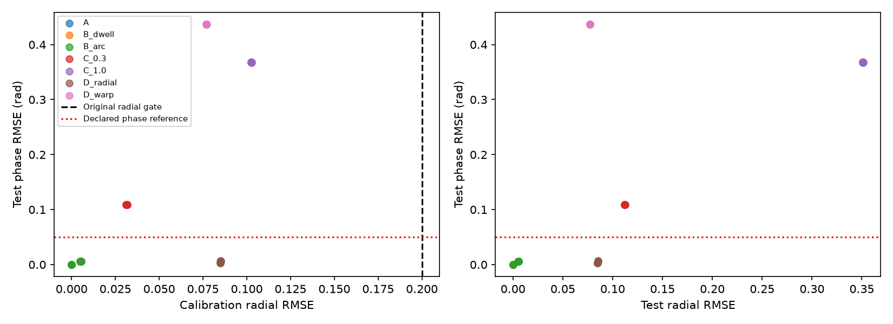

# 固定椭圆几何诊断与已知相位对照

2026-11-06。结果前冻结提交 `23655e4`，沿用 `b796077` 的固定椭圆求解器和几何迁移诊断。

**本轮出现了校准径向门控通过、测试相位明显偏离已知真值的组合。** 两档中心漂移的测试相位RMSE约0.109和0.368 rad。固定非椭圆角度扭曲条件约0.437 rad，同时几何迁移被判为稳定。仅改变静态椭圆采样的B组没有触发漂移标签。现有指标对强中心漂移有响应，但无法统一判定相位可靠性，按冻结出口将其用途限定为几何质量控制，结束本轮机制归因。

## 冻结输入与评分

四组落实为7个固定子条件，每个使用3个种子和2档噪声，共42次执行。子条件、噪声和工程精度参考由本次实现预先指定，见 [protocol.json](protocol.json)。无噪声下三个种子的输入完全相同，重复运行只核对确定性，统计汇总中不作为独立重复。各组共享配对噪声，C、D还共享A的真实相位。

信号采样率100Hz，总长60秒。前30秒校准，后30秒测试。该采样率对应既有校准点云的取样节奏。基础相位和观测仿射矩阵为

\[
\phi(t)=0.2+2\pi\cdot0.17t+0.08\sin(2\pi\cdot1.2t),\qquad
M=\begin{bmatrix}1.7&0.35\\0.35&0.8\end{bmatrix}.
\]

A的观测为 \([\cos\phi,\sin\phi]M+[2,-1]+\epsilon\)。噪声为两坐标独立高斯，标准差固定为0或0.005，种子为20261106、20261107、20261108。

| 子条件 | 固定生成变化 |
| --- | --- |
| A | 静态椭圆 |
| B_dwell | 同一椭圆，真实相位变为 \(\phi+0.9\sin\phi\)，改变停留分布 |
| B_arc | 前15秒相位为 \(0.2+0.75\sin(2\pi\cdot0.2t)\)，随后接基础相位 \(\phi(t-15)\)，改变局部覆盖 |
| C_0.3 / C_1.0 | 保持A相位与形状，在圆坐标加入 \(a(t/60)[0.8,0.6]\) 的中心位移，\(a=0.3,1.0\) |
| D_radial | 固定中心，半径 \(\rho=1+0.12\cos4\phi\)，角度为 \(\phi\) |
| D_warp | 与D_radial相同半径，观测角度为 \(\psi=\phi+0.6\sin2\phi\) |

D的观测由 \(\rho[\cos\psi,\sin\psi]M+[2,-1]+\epsilon\) 生成。D_warp将生成相位与复数观测角分开，表示一种已知、固定的非线性观测规律。其角度映射导数可局部为负，点云存在小回环。对该人为观测规律的恢复误差只能约束几何指标的逻辑用途。真实雷达是否具有这种观测规律仍需单独证据。D的两个条件关于固定中心对称，形变本身没有随时间变化。

生产入口使用原 `ellipse_phase`，初始30秒、径向RMSE上限0.2及其余接受规则按冻结版本执行。每次同时保存4个诊断拟合区间、全部广义特征对、初始6个5秒块和2组迁移。完整候选见 [candidate_diagnostics.json](candidate_diagnostics.json)。

固定符号与常数偏移通过校准段的展开相位最小均方误差确定。测试段沿用该变换，保留全部系统偏差。增量误差使用两个端点均位于测试段的相邻样本。预定工程参考为相位RMSE≤0.05 rad、增量RMSE≤0.01 rad/sample以及零周期索引错配。这些数值用于本次仿真诊断，连续误差同时保存。

周期索引定义为 \(\operatorname{round}((\widehat\phi-\phi)/(2\pi))\)。索引错配及其变化用于记录周期量级误差，成因可能包含观测模型误差或解缠错误。另用 `arctan2 + unwrap` 对共轭增量累加进行独立数值核对。

## 相位误差与门控

以下是有噪声档3个配对种子的均值。每个子条件的3次生产校准均通过。无噪声和有噪声分层结果见 [noise_summary.csv](noise_summary.csv)，逐次完整结果见 [metrics.csv](metrics.csv)。

| 条件 | 校准径向RMSE | 测试径向RMSE | 测试相位RMSE rad | 测试增量RMSE rad/sample | 通过径向门控但未达相位参考 |
| --- | ---: | ---: | ---: | ---: | ---: |
| A | 0.00548 | 0.00558 | 0.00557 | 0.00785 | 0/3 |
| B_dwell | 0.00498 | 0.00511 | 0.00599 | 0.00843 | 0/3 |
| B_arc | 0.00492 | 0.00556 | 0.00560 | 0.00790 | 0/3 |
| C_0.3 | 0.03173 | 0.11222 | 0.10863 | 0.00804 | 3/3 |
| C_1.0 | 0.10271 | 0.35127 | 0.36763 | 0.01105 | 3/3 |
| D_radial | 0.08507 | 0.08522 | 0.00643 | 0.00793 | 0/3 |
| D_warp | 0.07702 | 0.07738 | 0.43710 | 0.01192 | 3/3 |

无噪声下A/B相位误差为浮点精度，D_radial约0.00313 rad，C_0.3、C_1.0与D_warp仍约0.109、0.368与0.437 rad。系统误差因而可以在本次无噪声观测中直接复现。D_warp校准径向RMSE低于D_radial，但相位误差更大，径向指标与相位准确性未保持单调对应。

42次执行中，18次通过生产门控却未达预先声明的相位参考，全部来自C与D_warp。这是7个指定子条件的组合计数，不能用来估计一般输入上的误放行率。全部输入均通过生产校准，本轮没有获得新的拒绝条件下相位准确性证据。

全部测试段周期索引错配与跳变数为0，最大绝对相位误差约0.783 rad。已观测误差主要为连续系统失真，当前组合没有产生整周解缠失败，因此也没有检验失败检测的灵敏度。

## 迁移诊断能区分到什么程度

表中按每个子条件的6次执行统计，包含3次相同的无噪声输入。单元格依次列出稳定、漂移、不确定的数量。完整数值见 [transfer_metrics.csv](transfer_metrics.csv)。

| 条件 | 前15秒→后15秒 | 初始30秒→后30秒 |
| --- | --- | --- |
| A | 6 / 0 / 0 | 6 / 0 / 0 |
| B_dwell | 6 / 0 / 0 | 6 / 0 / 0 |
| B_arc | 0 / 0 / 6 | 6 / 0 / 0 |
| C_0.3 | 1 / 0 / 5 | 0 / 0 / 6 |
| C_1.0 | 0 / 6 / 0 | 0 / 6 / 0 |
| D_radial | 6 / 0 / 0 | 6 / 0 / 0 |
| D_warp | 6 / 0 / 0 | 6 / 0 / 0 |

B_arc的前后15秒比较因局部覆盖不足标为不确定。指定的B条件没有产生采样变化误判漂移的例子，尚未覆盖极窄弧、高噪声或更极端停留分布。C_1.0的两种迁移均捕获了已知中心变化。C_0.3全部未触发完整漂移标签，尽管测试相位误差已超过本轮参考，其中一组甚至获得稳定标签。固定的D形变均被判为稳定，其中D_warp仍有显著相位误差。

现有几何诊断能够描述拟合与迁移，但没有形成对相位准确性的充分判别。冻结出口因此落在质量控制用途，当前六条真实记录的变化机制继续保留未决状态。

## 产物、校验与收尾

每个子条件的图采用第一个预定种子与有噪声档，展示I/Q、已知相位、固定校准对齐后的相位误差和增量误差。全部8张图已目视检查。

| A | B | C | D |
| --- | --- | --- | --- |
| [标准椭圆](plots/A.png) | [停留变化](plots/B_dwell.png) | [0.3漂移](plots/C_0.3.png) | [径向形变](plots/D_radial.png) |
|  | [覆盖变化](plots/B_arc.png) | [1.0漂移](plots/C_1.0.png) | [角度扭曲](plots/D_warp.png) |

本地uv环境主实验1.607秒，验证及绘图3.472秒。验证脚本独立重建保存的生成关系、配对噪声与相位、校准接受结果、校准限定对齐、相位与增量误差、周期索引、252项分块半径与角覆盖、84组交叉迁移与分类，最大数值差2.70×10⁻¹³。168次拟合的1008个特征对全部保留，含504个有限候选和168个实椭圆。精确验证计时见 [verification.json](verification.json)，主运行见 [execution.json](execution.json)，输入输出见 [signals](signals)。本地可用 `.venv/Scripts/python.exe verify_ellipse_phase_controls.py` 从保存的输入重放评分校验。

源哈希与 `23655e4` 冻结内容一致。此前54、67及40项产物哈希分别核对通过。原六条继续作为开发材料，其余27名受试者保留用于后续验证。本轮产物为已知观测模型的相位校准结果，后续真实机制判断仍需对应的真实信号证据。
