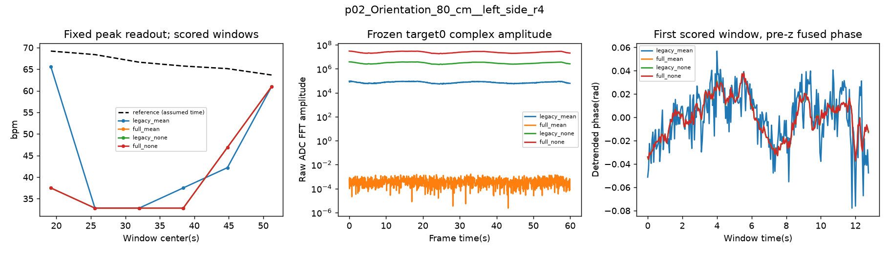

# FTU six-record ADC phase-controlled 2×2

## Decision

真实六记录对照已完成。按协议的联合参考对应规则，两个候选均未达到扩展判据；本轮不扩展54条、不重训。 结论限于六条固定哈希记录、六名原训练受试者的诊断；每人只有一条记录，不能当作跨受试者泛化或稳定的受试者总体证据。

| candidate | records_jointly_improved | pooled_centered_r | pooled_rmse_improved | both_candidates_full_coverage | expansion_criterion_met |
| --- | --- | --- | --- | --- | --- |
| legacy_none | 1 | -0.4324269 | True | True | False |
| full_none | 1 | -0.4323235 | True | True | False |

## Controlled real results

每臂原定36个评分窗口，全部标签/窗口相同。以下为融合信号；coverage是超过预定数值幅度门槛且相位有定义的窗口比例，不代表生理信号可信度或准确率。低幅度对照标undefined，不给出虚构HR；各候选与legacy_mean的效果比较使用配对共同有效窗口，见 paired_record_changes.csv / paired_pooled_metrics.csv。

| variant | coverage | n | mae | centered_rmse | centered_r | reference_centered_std | prediction_centered_std | centered_std_ratio | centered_r2 | near_reference_power_fraction |
| --- | --- | --- | --- | --- | --- | --- | --- | --- | --- | --- |
| full_mean | 0 | 0 | undefined | undefined | undefined | undefined | undefined | undefined | undefined | undefined |
| full_none | 1 | 36 | 31.85666 | 12.51447 | -0.4323235 | 1.312241 | 11.89109 | 9.061666 | -89.94893 | 0.1123798 |
| legacy_mean | 1 | 36 | 29.81536 | 17.76705 | 0.3387424 | 1.312241 | 18.16861 | 13.84548 | -182.3172 | 0.1042193 |
| legacy_none | 1 | 36 | 32.24729 | 12.37324 | -0.4324269 | 1.312241 | 11.74909 | 8.953453 | -87.90775 | 0.1094563 |

候选去均值RMSE虽然降低，预测波动仍约参考的9倍，且相关性为负；旧对照正相关也伴随约14倍波动和强负R²，不能据正相关宣称恢复跟踪。full_mean为DC均值消除的预期机制对照，全部窗口低于数值幅度门槛而弃权；不是把有限浮点残差的相角解释为生理相位，也不是对全部Doppler输出的信息否定。

| candidate | sample_tag | n_common | delta_mae | delta_centered_rmse | delta_near_reference_power |
| --- | --- | --- | --- | --- | --- |
| legacy_none | p02_Orientation_80_cm__left_side_r4 | 6 | 4.6875 | -1.560964 | -0.01348901 |
| legacy_none | p03_Distance_40_cm_r3 | 6 | -21.3401 | 22.22463 | 0.1137398 |
| legacy_none | p04_Distance_40_cm_r4 | 6 | -1.5625 | -0.1907917 | 0.02508964 |
| legacy_none | p05_Distance_160_cm_r1 | 6 | -0.005859375 | -26.97139 | -0.002105108 |
| legacy_none | p07_Angle_45_deg__80_cm_r4 | 6 | 0 | 0 | -0.03364379 |
| legacy_none | p09_Angle_30_deg__80_cm_r2 | 6 | 32.8125 | -11.07937 | -0.05816933 |
| full_none | p02_Orientation_80_cm__left_side_r4 | 6 | 4.6875 | -1.560964 | -0.01023709 |
| full_none | p03_Distance_40_cm_r3 | 6 | -21.3401 | 22.22463 | 0.1143142 |
| full_none | p04_Distance_40_cm_r4 | 6 | -3.90625 | 2.1475 | 0.02852917 |
| full_none | p05_Distance_160_cm_r1 | 6 | -0.005859375 | -26.97139 | 0.01042915 |
| full_none | p07_Angle_45_deg__80_cm_r4 | 6 | 0 | 0 | -0.03374357 |
| full_none | p09_Angle_30_deg__80_cm_r2 | 6 | 32.8125 | -11.07937 | -0.06032901 |

排除缺设备日志的p03后，候选MAE及参考附近功率反而更差；总体功率的小幅增加主要由p03贡献，没有一致收益。

| variant | n | mae | centered_rmse | centered_r | near_reference_power_fraction |
| --- | --- | --- | --- | --- | --- |
| full_mean | 0 | undefined | undefined | undefined | undefined |
| full_none | 30 | 33.23414 | 7.979058 | -0.545365 | 0.08390157 |
| legacy_mean | 30 | 26.51656 | 19.42528 | 0.3798361 | 0.09697184 |
| legacy_none | 30 | 33.70289 | 7.710223 | -0.5572274 | 0.08050832 |

跨记录联合改善要求：同一候选至少5/6条记录在≥4个共同有效窗口上，同时降低MAE、降低去均值RMSE、提高正确参考附近功率，且合并去均值相关性>0、RMSE优于legacy_mean。单纯幅度增大、曲线平滑或有峰不能通过。R²只作合并诊断，不平均逐记录R²。参考动态波动小、256点峰值分辨率4.6875bpm、窗口重叠，均限制动态评价；未做独立窗口显著性检验。

## Fixed region and pipeline

原六条选样不变；各记录最初256帧校准，不评分与其重叠的窗口。共同物理Doppler为DC（两FFT shifted index4），使用相同历史64chirp索引、250ADC、4RX；非零Doppler下标不互当物理频率。

按full_none校准段DC能量确定固定8-bin range ROI（排除原始range0/1），在ROI中固定三个幅度最大的beam/range及归一化幅度权重。四臂共享这些身份和权重，全程未调用EDACM/HR打分器。P2→float32累积→原函数线性去趋势→相位加权→原函数z-score→Hann功率→固定0.5–2.75Hz最大bin；单目标和融合均保存。该校准规则未证明选中了胸壁，range/beam在此仍是索引；TX同时启用的实际波束解释仍有限。

保存了共同ROI全部beam的标准化前复数序列、三个固定目标复数序列、原始增量/累积/去趋势相位/融合信号、参考时间轴和标签。幅度可由保存的复数逐值恢复；reliability_masks.npz 保存每窗口每目标有效标记。低幅度保留原始复数/数值增量，但下游物理相位、融合和评分以NaN显式标记。时间沿用frame/20+0s，未搜索延时。此次校准与旧54记录audit不同，所以不能把其MAE与旧报告直接作单因素配对。

## Independent layout check

依据 [TI SWRA581B](https://www.ti.com/lit/an/swra581b/swra581b.pdf) 第6节图11、§9.2（pp10,16–17）独立翻译MATLAB读取顺序：双lane、每chirp按RX0→RX3块排列、两I后两Q，16-bit有符号。与现有loader不是同一份实现；本轮在全部六条真实bin、全部1200帧逐块严格核对，均逐值一致。新读取器还在所有合成量化ADC上与生产读取器一致。

已有日志支持AR1642、DCA1000、四RX、双lane；官方README也确认设备为AWR1642BOOST，但p03缺少单记录设备日志，继续标记为配置未核实，未用其他人的日志顶替。原始文件均需匹配1200×128×4×250×4字节。厂商说明要求去包头、按序的ADC负载；文件大小和现存capture日志提供一致性证据，仍不是硬件已知信号注入的绝对证明。逐记录日志存在性、零填充/乱序记录见 raw_verification.csv，完整原文在evidence/。排除p03的五记录指标另列 metrics.csv 的 five_with_config_logs，供检查结论是否依赖缺日志记录。

初次Kaggle执行因五个镜像分片缺少原定p03 Distance ADC而停止（日志kaggle_v1_missing_input.txt），没有换记录。官方4TU API和原始README已归档；通过原始非solid RAR的Quick Open目录和CRC校验，定位同一记录并只下载425660324字节压缩区段，libarchive校验解压为614400000字节，在第二次执行补回。输入恢复补充记录为e776469；选样、校准规则、后处理、候选门槛及六记录扩展规则均未变。恢复原始哈希/耗时见official_recovery_execution.json，目录证据在official_recovery/。官方数据来源：[4TU DOI](https://doi.org/10.4121/48acba04-96bc-4131-b52f-9e18458ad92b)。

## Synthetic candidate gate and corrections

协议53a1be7在新结果生成前冻结；两个不减均值候选通过基线及三组非整频弱微动检查，旧臂仅作机制对照。

| case | variant | role | phase_amplitude | rmse_chirp0_rad | rmse_mean_time_rad | rmse_coherent_phase_rad | peak_bpm | pass |
| --- | --- | --- | --- | --- | --- | --- | --- | --- |
| baseline72 | legacy_mean | mechanism_control | 0.2 | 2.22518 | 2.224483 | 2.224483 | 72 | False |
| baseline72 | full_mean | mechanism_control | 0.2 | undefined | undefined | undefined | undefined | False |
| baseline72 | legacy_none | candidate | 0.2 | 0.0007419203 | 1.419961e-05 | 1.429556e-05 | 72 | True |
| baseline72 | full_none | candidate | 0.2 | 0.006633586 | 1.811886e-05 | 8.08965e-06 | 72 | True |
| offgrid_weak1 | legacy_mean | mechanism_control | 0.05 | 8.718063 | 8.71795 | 8.71795 | 48 | False |
| offgrid_weak1 | full_mean | mechanism_control | 0.05 | undefined | undefined | undefined | undefined | False |
| offgrid_weak1 | legacy_none | candidate | 0.05 | 0.0001867762 | 3.353574e-05 | 3.355894e-05 | 69 | True |
| offgrid_weak1 | full_none | candidate | 0.05 | 0.001484804 | 9.363467e-06 | 8.775943e-06 | 69 | True |
| offgrid_weak2 | legacy_mean | mechanism_control | 0.02 | 7.809923 | 7.809889 | 7.809889 | 75 | False |
| offgrid_weak2 | full_mean | mechanism_control | 0.02 | undefined | undefined | undefined | undefined | False |
| offgrid_weak2 | legacy_none | candidate | 0.02 | 6.881905e-05 | 3.205092e-05 | 3.201922e-05 | 99 | True |
| offgrid_weak2 | full_none | candidate | 0.02 | 0.0006214315 | 1.940143e-05 | 1.674625e-05 | 99 | True |
| offgrid_weak3 | legacy_mean | mechanism_control | 0.01 | 19.29223 | 19.29221 | 19.29221 | 33 | False |
| offgrid_weak3 | full_mean | mechanism_control | 0.01 | undefined | undefined | undefined | undefined | False |
| offgrid_weak3 | legacy_none | candidate | 0.01 | 4.729907e-05 | 3.028874e-05 | 3.032331e-05 | 132 | True |
| offgrid_weak3 | full_none | candidate | 0.01 | 0.0004190343 | 1.396667e-05 | 1.201053e-05 | 132 | True |

按配置质心修正后，基线两候选的相位误差约1.4e-5/1.8e-5rad；不能说完整FFT更破坏相位。旧报告0.1564是带分母下限的统计量，修正和complex128逐条件复核见 [CORRECTIONS.md](CORRECTIONS.md)。此报告纠正旧措辞，保留历史版本和原始结果。

## Execution and verification

本地uv合成耗时30.934秒；缺少本地原始数据，真实六记录仅在Kaggle CPU运行，处理耗时165.231秒，另有官方p03范围下载及校验解压耗时208.453秒；没有训练。逐块TI-port与生产loader一致、选点权重重算、全部保存后处理数组/峰值/标签重算、原始RDA哈希与上轮清单核对均通过；本地复核耗时记录在validation.json。运行配置、输入哈希、逐窗口表、六条完整轨迹图和源码均归档。
