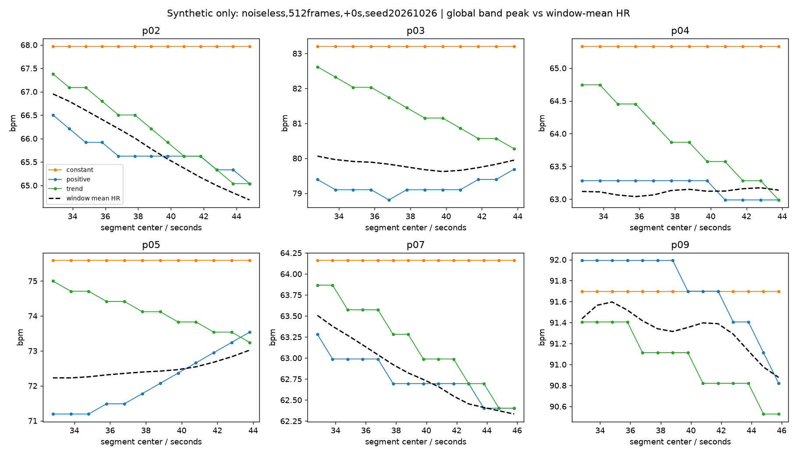
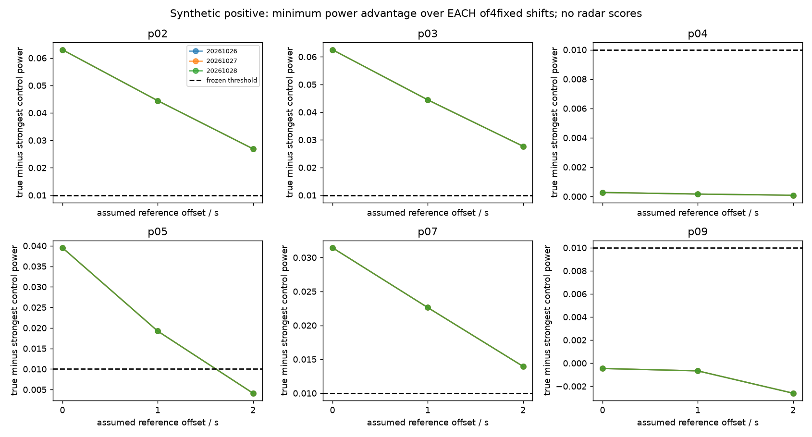

# FTU 评估灵敏度正负对照（开发用合成校准）

**现有完整评分规则未通过此次灵敏度校准。** 无噪声、已知HR驱动的正对照，在正确时间原点下每个种子仅4/6条通过，要求0/1/2秒全部通过时为3/6，未达预定5/6。恒频/趋势对照在正确原点下均未通过完整规则，但所有记录的±5bpm命中率仍为100%。因此不能靠该命中率或小MAE证明动态跟踪，也不能把理想正对照的失败归咎于雷达bin。

此前参考准入**0/6结论保持不变**；本轮只校准评分器，未读取新雷达数组，未重跑旧雷达谱图，未训练或扩大信号区域。合成分数不是雷达性能。

## 冻结协议与合成方法

结果前协议`a37e447`。六条既有参考和共同窗口保持不变，20Hz、512/768帧、Hann、4096点FFT显示、45–150bpm。直接调用`audit_ftu_structure.spectrum/scalar_metrics`，保持逐窗线性去趋势、最大band峰、±一个原生Fourier bin参考附近功率定义。512/768原生bin为2.34375/1.5625bpm；0.29296875bpm零填充网格不是额外分辨率。这里检验的是representation级周期信号与评分，**不是ADC/RDA/胸壁相位恢复**。

三类信号均为`cos(φ0+2π∫f(t)/60 dt)`：正对照`f=线性插值HR(t)`；恒频`f=整条参考HR算术均值`；趋势`f=整条参考HR对时间的OLS直线`，去除残差。积分采用20Hz梯形规则，不外推、不跨缺口。记录均值和趋势故意使用整条参考，是带标签信息的诊断对照，不是可部署基线。趋势本来就可能与HR相关；它检验的是细节动态是否有额外价值，不能称为与HR独立的纯噪声。

三个预定种子20261026/27/28，单位幅度余弦；噪声标准差0和0.25。每条记录/种子跨生成器配对初相位和同一高斯噪声。保存180条合成trace、生成频率、噪声和完整参数。主实验固定生成原点0，报告所有三个评分偏移；次分析仅对正对照按+1/+2秒重新生成并用对应偏移评分，以区分已知原点错配和评分灵敏度，不能替代主分析。没有搜索初相位、噪声、频点或延时。

512帧使用此前冻结的共同窗口（每条12–14个），对照−20/−15/−10/−5秒，所有偏移与对照同窗口。768帧仍仅0–1个共同窗口，不允许作为通过判断或缩短窗长补救。

## 评分规则与准入门分开报告

评分器通过条件仍为：覆盖率≥.9、±5bpm峰值命中率≥.6、参考附近功率比**每个**对照至少高.01、MAE小于**每个**对照；至少5共同窗口。`score_rule_pass`是这些条件的合成诊断，**不绕过此前标签可辨别性准入门**。`formal_real_data_pass`始终False。

此次校准预定要求：无噪声正对照每个种子在正确原点及全偏移判定均≥5/6；恒频/趋势在正确原点不得有任一记录通过。只做开发校准，不选择替代阈值或删除难通过对照。

## 无噪声完整规则通过数

| generator | seed | offset0_passes | all_offsets_passes |
| --- | --- | --- | --- |
| constant | 20261026 | 0 | 0 |
| constant | 20261027 | 0 | 0 |
| constant | 20261028 | 0 | 0 |
| positive | 20261026 | 4 | 3 |
| positive | 20261027 | 4 | 3 |
| positive | 20261028 | 4 | 3 |
| trend | 20261026 | 0 | 0 |
| trend | 20261027 | 0 | 0 |
| trend | 20261028 | 0 | 0 |

正对照按匹配原点另行生成的次分析：

| seed | offset | passed_records |
| --- | --- | --- |
| 20261026 | 1 | 4 |
| 20261026 | 2 | 4 |
| 20261027 | 1 | 4 |
| 20261027 | 2 | 4 |
| 20261028 | 1 | 4 |
| 20261028 | 2 | 4 |

匹配原点后仍只有4/6，说明问题不只是把已知0秒信号拿去对+1/+2秒假设评分。正确原点失败的正对照是p04/p09；主分析+2秒下p05另因功率优势不足而失败。恒频在所有单偏移均无通过；趋势在+2秒有1条记录（每个种子相同）通过单偏移规则，但无记录通过全偏移完整规则。因此本次直接证据是**灵敏度不足**；不能宣称完整规则已出现恒频/趋势假阳性。

## 单指标为何会“看起来很好”

主512帧、正确原点，先逐记录/种子计算再等权平均；命中率是比例：

| generator | noise_sigma | mae | within5 | near_power | centered_rmse | std_ratio |
| --- | --- | --- | --- | --- | --- | --- |
| constant | 0.0000 | 2.0963 | 1.0000 | 0.5398 | 0.2870 | 0.0000 |
| constant | 0.2500 | 2.0963 | 1.0000 | 0.5289 | 0.2870 | 0.0000 |
| positive | 0.0000 | 0.3882 | 1.0000 | 0.8631 | 0.2925 | 1.9221 |
| positive | 0.2500 | 0.3887 | 1.0000 | 0.8457 | 0.2947 | 1.9292 |
| trend | 0.0000 | 0.8394 | 1.0000 | 0.7977 | 0.4001 | 4.3409 |
| trend | 0.2500 | 0.8406 | 1.0000 | 0.7817 | 0.4118 | 4.3666 |

所有条件的命中率均1.0。恒频无噪声MAE约2.096bpm、预测动态标准差比0，却也全部命中；趋势MAE约0.839bpm。不能把这种小MAE/命中率解释为细节动态恢复。分布收缩、慢趋势和宽容差在此都可能产生表观良好成绩。

正对照逐记录动态诊断（种子20261026；其余种子同向结论）：

| record | mae | centered_rmse | r | std_ratio | near_power |
| --- | --- | --- | --- | --- | --- |
| p02 | 0.4062 | 0.4270 | 0.9108 | 0.4996 | 0.8553 |
| p03 | 0.6225 | 0.2135 | 0.3383 | 1.6573 | 0.8502 |
| p04 | 0.1745 | 0.1642 | -0.5855 | 3.5132 | 0.9134 |
| p05 | 0.6010 | 0.5775 | 0.9678 | 3.3628 | 0.7937 |
| p07 | 0.1463 | 0.1686 | 0.9340 | 0.6669 | 0.9083 |
| p09 | 0.3786 | 0.2039 | 0.9066 | 1.8326 | 0.8579 |

例如p04的正对照MAE仅约0.1745bpm，峰值与窗均值的相关性却约−0.5855。它是已知HR驱动信号，不是没有生理对应；微小窗均值变化与有限谱峰读数不完全一致，会使相关性/方差比变得不稳定。p09恒频MAE约0.3705bpm，略低于正对照约0.3786bpm，差异远小于原生bin。不能以此声称恒频模型学会了动态。

## 窗均值与最大谱峰并非同一统计量

正对照中`f(t)`由参考确定，窗内信号可能是变频波形。全窗算术平均HR不必等于Hann谱最大峰；Hann还改变了时间权重。另保存Hann平方权重的频率均值，仅用于解释，并没有据此替换评分标签或选择新规则：

| record | peak_vs_mean | peak_vs_hann_energy_mean |
| --- | --- | --- |
| p02 | 0.4062 | 0.0776 |
| p03 | 0.6225 | 0.1076 |
| p04 | 0.1745 | 0.0608 |
| p05 | 0.6010 | 0.0843 |
| p07 | 0.1463 | 0.0766 |
| p09 | 0.3786 | 0.0590 |

原规则正对照的逐记录/偏移最小功率与MAE优势（相对最难超过的固定对照）：

| record | offset | minimum_power_advantage | minimum_mae_advantage | power_pass | mae_pass | score_rule_pass |
| --- | --- | --- | --- | --- | --- | --- |
| p02 | 0 | 0.0630 | 0.5700 | True | True | True |
| p02 | 1 | 0.0445 | 0.4306 | True | True | True |
| p02 | 2 | 0.0269 | 0.2672 | True | True | True |
| p03 | 0 | 0.0625 | 0.3260 | True | True | True |
| p03 | 1 | 0.0444 | 0.2267 | True | True | True |
| p03 | 2 | 0.0277 | 0.1175 | True | True | True |
| p04 | 0 | 0.0003 | -0.0270 | False | False | False |
| p04 | 1 | 0.0002 | -0.0222 | False | False | False |
| p04 | 2 | 0.0001 | -0.0105 | False | False | False |
| p05 | 0 | 0.0395 | 0.2395 | True | True | True |
| p05 | 1 | 0.0192 | 0.1780 | True | True | True |
| p05 | 2 | 0.0041 | 0.1002 | False | True | False |
| p07 | 0 | 0.0314 | 0.4228 | True | True | True |
| p07 | 1 | 0.0226 | 0.3367 | True | True | True |
| p07 | 2 | 0.0140 | 0.2207 | True | True | True |
| p09 | 0 | -0.0005 | -0.0199 | False | False | False |
| p09 | 1 | -0.0007 | -0.0434 | False | False | False |
| p09 | 2 | -0.0026 | -0.0806 | False | False | False |

负优势不是生成频率没有采用HR，而是当前窗口统计/峰读数/对照难度组合未稳定识别已知对应。0.25噪声结果完整保存，没有根据结果调噪声或阈值。重叠窗口不作为独立样本；三个种子是相位/噪声重复，不是新增受试者。

## 同步与参考生成资料：具体查到了什么

1. **触发关系：**[数据论文VI-A](https://arxiv.org/html/2405.12659v1)描述一名操作员运行mmWave Studio，另一名操作员通过Polar Beat确保同步测量。这提供人工协调采集的过程说明，但未给出共享硬件触发、共同事件ID、逐记录时钟映射及偏差不确定度。VI-C2的“Polar Flow synchronization”描述记录保存/访问链路，不能据此认定雷达与Polar时钟同步成立。
2. **原始RR/ECG：**[Polar官方H10 SDK产品文档](https://raw.githubusercontent.com/polarofficial/polar-ble-sdk/master/documentation/products/PolarH10.md)列出RR间期（ms）和130Hz ECG能力。论文VI-C2只描述约2KB、时间+HR的分钟CSV；目前没有本次六采集实际录制/保存/发布RR或ECG的证据。当前SDK能力不证明2023年Beat/固件记录了这些流。呼吸频率参考中的RR缩写不等于心搏R–R间期。
3. **HR导出与平滑：**论文明确Beat→Flow网站Diary→Export session CSV，前三行为元数据，随后为时间与HR，停止时间59–62秒。这与已有原CSV一致。[Polar官方Flow导出说明](https://support.polar.com/en/export-training-sessions-flow)也说明CSV/TCX/FIT等导出选项。检查到的资料未规定本数据集HR究竟为60/RR、多少拍/多少秒均值、伪迹剔除、平滑方式、时间锚点或延迟。**1Hz输出不等于瞬时、未平滑的逐搏HR。**

原网页、正文、URL/重定向及SHA256保存在`provenance/`。初次旧Polar链接转到404，正确链接随后一次超时再成功；失败请求不作为算法证据。未重下雷达、未把顶层清单/QuickOpen缺项当作不存在证明，也未联系作者。`provenance/followup_questions.json`列出可向数据持有者核对的具体问题：同次触发/时间映射、原始RR/ECG及session匹配、Beat/Flow/固件版本、HR计算平滑与延迟、是否有同次更长参考。

## 决策

保留上一轮0/6；本轮合成校准也未达预定标准，暂停真实动态跟踪主张、更多bin搜索及训练。下一步若设计新规则，应仅在明确标记的开发数据上研究窗口统计、参考时间锚点和动态信息增益，再冻结到独立记录验证；不能用本轮结果删除困难对照或宣称新规则已获独立验证。本轮没有自动重设计/上线新评分规则。

若最终仅能取得短时、1Hz、微小变化的参考，仍可限定条件研究平均HR及频谱结构；动态跟踪需要更合适的同步参考验证数据。这不证明原始回波缺少心跳，也不把传感器能力当作已取得的参考信号。

## 执行与独立核验

本地uv主诊断2.496s，独立核验4.679s。验证180条合成信号、10560项指标、396项可评分门控；独立梯形累加与SciPy periodogram重算，最大trace差3.41e-13，指标差1.11e-15。此前decision文件哈希保持不变。未进行NN训练或读取新雷达数据。所有配置、生成参数、trace、逐窗结果、源代码与哈希归档。
