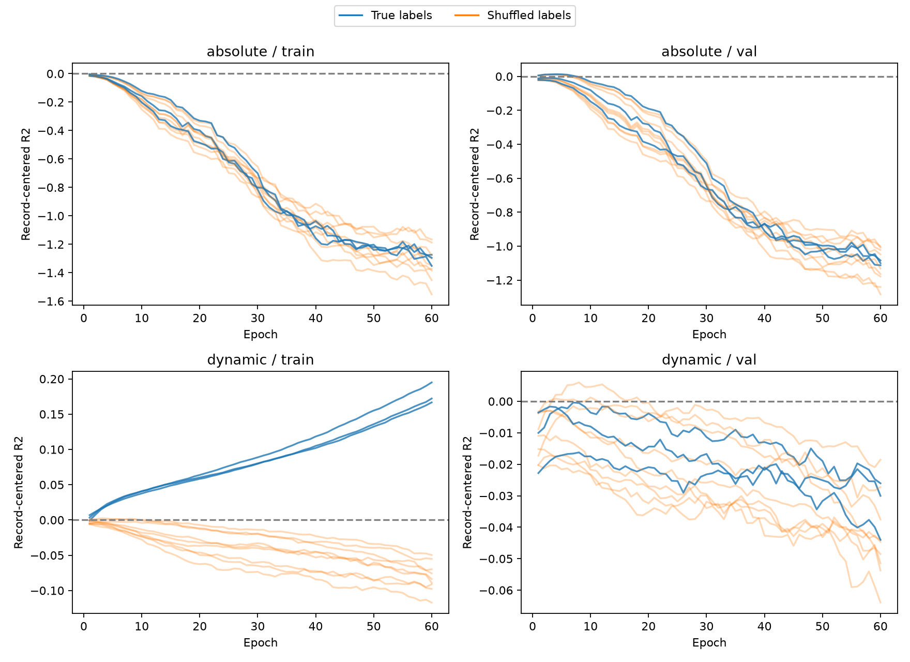
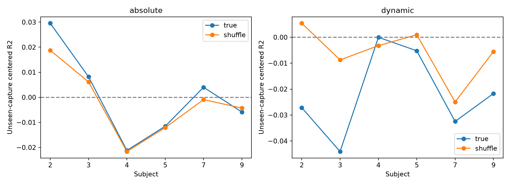

# 绝对 HR 与记录内动态目标：24 次固定预算对照

2026-10-18。**动态目标能够改善训练记录内拟合，但未恢复未见采集上的动态预测。**第 60 轮动态真实标签组的受试者等权去均值 R² 为 **0.17075**，打乱组为 **−0.08754**；验证选中的动态模型在未见采集上分别为 **−0.02177** 和 **−0.00602**。符合“只改善训练，跨采集稳定性不足”的预设解释，不支持立即研究绝对 HR 校准或继续扩大 MLP 调参。

## 冻结与执行

协议在查看结果前提交为 `5fcc2ab`；Kaggle version 1 的协议与该提交逐字段一致。24 次训练全部完成 **60 轮**，没有早停或事后追加预算。

- D 输入、216 次去重采集、108/54/54 划分和 MLP129→64→32→1 保持不变；无合成预训练。逐窗口标准化后，保留同一 29-bin 掩码，不做逐 bin StandardScaler 或再次归一化。
- 每批 8 条完整训练记录，每记录 8 个窗口；末批 4 条记录。按记录随机排序；同模型种子的两目标/四标签条件使用完全一致的初始化、记录顺序和批次形状。
- 两组同用 SmoothL1(beta=0.5)、AdamW(weight_decay=0.0001)、梯度裁剪1，固定学习率 **0.0003** 贯穿60轮。取消验证驱动降学习率，避免两目标产生不同学习率轨迹。
- 两目标共用新训练集标签均值 **73.59535** 和标准差 **10.84903 bpm**。绝对目标为标准化预测减标准化标签；动态目标分别减去当前训练记录内预测均值和标签均值后计算同一损失。去均值在可微计算图中完成。
- 种子42/43/44，每个真实标签加记录内置换101/202/303，共24次训练。置换映射与上一轮逐项一致，验证及评估标签正确。
- checkpoint 只按验证记录去均值 RMSE 选择。另存 epoch60 checkpoint 和其训练/验证预测；**没有生成 epoch60 未见采集预测用于另行挑选模型**。

本轮两目标之间只有损失目标不同。相对上一轮早停实验，完整记录组批、固定60轮及固定学习率都是共同变化，因此历史对比不能单独识别“取消早停”的因果效应。

## 第60轮：是否能拟合训练动态

以下先逐模型、逐受试者评分，再按六人等权及模型重复平均，不是预测集成。

| 目标 | 标签 | 训练去均值 RMSE | 训练 R² | 训练去均值 r | 验证 R² |
|---|---|---:|---:|---:|---:|
| 绝对 HR | 真实 | 3.3011 | −1.38697 | 0.04107 | −1.43978 |
| 绝对 HR | 打乱 | 3.3164 | −1.38826 | 0.00404 | −1.51031 |
| 动态 | 真实 | **1.9686** | **0.17075** | **0.43606** | −0.03195 |
| 动态 | 打乱 | 2.2578 | −0.08754 | −0.00843 | −0.06658 |

动态目标真实组的训练改善分布于六名受试者，而非单人驱动：

| 受试者 | 动态真实训练 R² | 动态打乱训练 R² |
|---|---:|---:|
| p02 | 0.22996 | −0.07670 |
| p03 | 0.14732 | −0.07702 |
| p04 | 0.25012 | −0.06200 |
| p05 | 0.16573 | −0.06795 |
| p07 | 0.19338 | −0.14618 |
| p09 | 0.03802 | −0.09538 |

这支持目标设计影响当前固定流程对训练动态关系的拟合，但不是生理信息可泛化的证明。相比之下，绝对目标继续训练时原始训练 MAE 下降（epoch60为8.7708），去均值误差却增加，说明优化绝对误差与动态目标可以明显分离。

曲线为合并窗口指标，表格为受试者等权指标；二者不能混用。蓝线为三个真实标签模型，橙线为九个打乱模型，均以正确标签评分。动态真实组训练曲线上升，而验证曲线没有形成相应改善。训练仍在改善不构成追加预算的理由。

## 验证选中模型：未见采集

真实组绝对目标的最佳 epoch 为 **3/1/4**，动态目标为 **7/8/3**。评估始终使用这些验证选中 checkpoint。

| 目标 | 标签 | 评估原始 MAE | 去均值 RMSE | 去均值 R² | 去均值 r | 去均值标准差比 |
|---|---|---:|---:|---:|---:|---:|
| 绝对 HR | 真实 | 9.4803 | 2.5958 | 0.00053 | 0.04512 | 0.10888 |
| 绝对 HR | 打乱 | 9.4929 | 2.5985 | −0.00233 | 0.03222 | 0.10351 |
| 动态 | 真实 | 9.5571 | 2.6166 | −0.02177 | −0.05794 | 0.09587 |
| 动态 | 打乱 | 9.5524 | 2.5980 | −0.00602 | 0.00944 | 0.09062 |

**动态目标不约束记录预测均值。**上表动态模型原始 MAE 只作完整诊断；统一反标准化只是单位转换，不表示绝对 HR 已校准。评估记录标签均值只用于离线评分，从未提供给模型。

动态目标九个配对中，真实组的评估受试者等权 RMSE 全部差于对应打乱组：改善值（打乱−真实）范围 **−0.04789 至 −0.00096 bpm**，平均 **−0.01863 bpm**。不能据训练拟合宣称未见采集收益。

绝对目标平均 RMSE 优势仅 **0.00270 bpm**，九个配对范围 **−0.00041 至 +0.00634 bpm**；近零正的平均 R² 不构成稳定且有实际幅度的动态跟踪证据。

### 六人评估 R²

| 受试者 | 绝对真实 | 绝对打乱 | 动态真实 | 动态打乱 |
|---|---:|---:|---:|---:|
| p02 | 0.02957 | 0.01880 | −0.02714 | 0.00540 |
| p03 | 0.00818 | 0.00613 | −0.04407 | −0.00874 |
| p04 | −0.02120 | −0.02163 | −0.00003 | −0.00325 |
| p05 | −0.01153 | −0.01208 | −0.00523 | 0.00097 |
| p07 | 0.00401 | −0.00090 | −0.03247 | −0.02495 |
| p09 | −0.00588 | −0.00432 | −0.02169 | −0.00553 |

动态真实组在六名受试者上平均 R² 均为负，仅 p04 相对打乱组有很小平均改善。没有一致且有实际幅度的未见采集优势。

## 解释与路线决策

1. 不再说“当前 MLP 完全不能拟合真实记录内动态”：本轮动态目标在训练集上已有明确且跨六人的正 R²，真实标签对应关系影响训练拟合。
2. 也不能说“目标设计已解决瓶颈”：验证选中的动态模型没有未见采集收益，表现仍与近常数/打乱组接近或更差。训练动态拟合可能包含记录特有或不稳定的统计关联。
3. 按预设决策，**结束这条 MLP 调参路线**，不追加 epoch、不换损失/网络或尝试绝对 HR 校准。后续转向连续记录前端与时间对应审计：窗口间目标单元是否跳变、连续相位是否稳定、参考时间轴以及 HR 附近频率结构。

该结论仍限于同受试者、同次到访、跨触发采集。p03 部分 radar-start 日志缺失；窗口重叠与时间相关使这些标签打乱只能作为诊断，不作严格置换显著性检验。不能宣称 FTU 不可学习，或认定前端/同步是已证实的唯一原因。连续记录审计尚未在本轮执行。

## 追溯与复核

- [Kaggle FTU Objectives Controls](https://www.kaggle.com/code/goldfish9901/ftu-objectives-controls)，version1，24次训练全在Kaggle，实测总流程 **99.055秒**，不含排队。
- 本地 uv 预检查1.148秒，结果复核约8.895秒；没有本地训练。
- 验证全部24次正好60轮、相同模型种子的初始化及全部60轮记录顺序哈希一致、原D特征/划分/置换映射不变、冻结协议不变。
- 校验60个Kaggle原始产物哈希，独立重算72组最佳模型指标，最大差异约1.21e-6；保留普通及去均值指标、逐受试者/逐记录/等权结果、配对目标差异和标签差异。
- 保存24个最佳checkpoint及24个epoch60 checkpoint、全部曲线与目标损失、预测、输入、配置、源码和哈希。`kaggle_artifact_manifest.json` 校验原始训练产物，`artifact_manifest.json` 覆盖最终归档（自身除外）。
