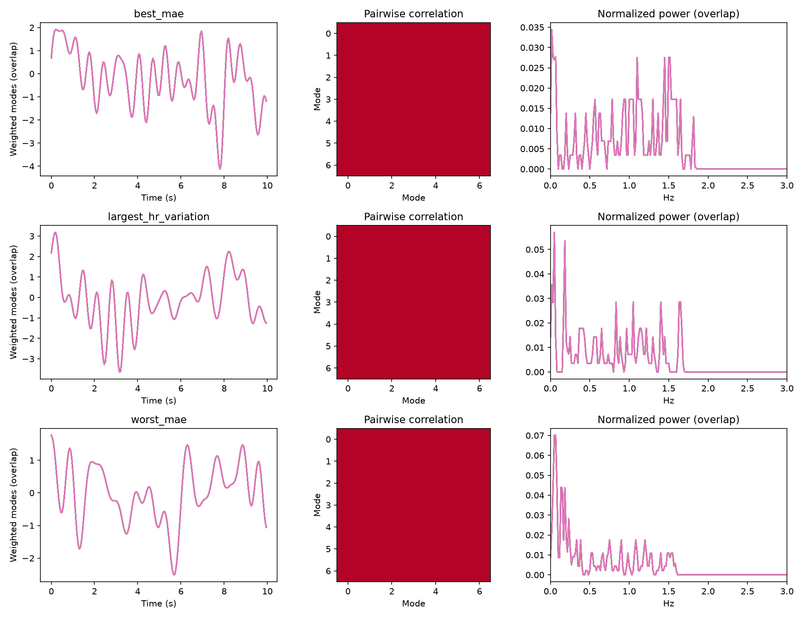

# FTU P0：模态独立性与时间轴审计

实验于 2026-10-14 运行，2026-10-16 完成下载核验和归档。**模态 P0 不通过；时间轴 P0 未通过；P1 未启动。**

本轮确认了前端数值退化，不能再用旧导出上的模型表现判断原始雷达是否缺乏心跳信息，或判断哪个 backbone 更合适。
生产特征代码与既有 checkpoint 未修改；下面的一行更新实验只用于定位问题。

## 范围与身份

- 模型输入来自已找回的 [E2a FTU notebook](https://www.kaggle.com/code/goldfish9901/nn-bench-e2a-hr-adavmd-proposed-ftu)。
  不是历史 MAE 为 4.989 / 3.425 / 4.034 的三个未找回 checkpoint。
- [P0 CPU notebook](https://www.kaggle.com/code/goldfish9901/ftu-p0-mode-time-audit)，v1，私有，无训练。
- 全量读取既有 3,520 个窗口；与原始 training manifest 逐条匹配，无遗漏、重复或新增。
  manifest SHA256：`c3e9e2f0e60d06d087476e63c3942293629c56ca2cfb3b97e72173dea8d86cc2`。
- 检查五个 FTU 原始数据分卷中的 1,312 个小文件：428 份雷达配置日志、428 份采集日志、456 份 HR CSV。
  逐文件核对下载内容与 Kaggle 端记录的 SHA256。没有读取整批 ADC 或启动特征重导出。
- 本地检查上轮三条连续记录，以及 0.25 / 1.2 / 2.1 Hz 的三频合成信号。
  特征源码与 E2a 归档一致；加入迭代记录后，原算法输出逐元素一致。

## P0-1：七个模态退化为同一数组

| 输入集合 | 窗口数 | x_time 七通道完全相同 | x_freq 七通道完全相同 | 七个权重均为 1 |
|---|---:|---:|---:|---:|
| train | 2,112 | 2,112 | 2,112 | 2,112 |
| val | 704 | 704 | 704 | 704 |
| test | 704 | 704 | 704 | 704 |

全部窗口数值秩为 1，七个通道均非零；两两相关系数的最小值为 0.9999999999999981。
这里是**同一个窗口内部七个数组完全重复**，并不表示不同窗口之间也完全相同。
因此，模型仍可能利用退化信号中的某些变化，但不能把这些输入视为七个独立生理模态。

三个连续记录的七通道也逐元素相同。同一记录内，七个功率谱中心与峰值一致：

| 连续记录类别 | 每个模态的频谱中心 Hz | 每个模态的全频峰 Hz | 权重 |
|---|---:|---:|---|
| best_mae | 0.930501 | 0.016667 | 全部 1 |
| largest_hr_variation | 0.744991 | 0.050000 | 全部 1 |
| worst_mae | 0.522294 | 0.050000 | 全部 1 |

频谱中心使用去均值后加 Hann 窗的单边功率重心；不是求解器内部的 omega。
内部 omega 的逐次轨迹另存于 `iterations.csv`。24 个实际模型窗口的七模态数组、频谱中心及原始权重元数据已导出，供独立检查。



### 退化机制与诊断干预

`src/features/hr_adavmd.py::vmd_decompose` 在每轮外循环计算 `sum_modes`，
内循环更新各模态后没有刷新这个总和。因此后续残差仍使用该轮开始时的其他模态。
这实现了同步更新，而非顺序使用最新模态的更新方式。在本轮信号上，它导致增长、裁剪和振荡。

- 三条真实记录分别在第 8 / 9 / 7 次迭代开始触发实部/虚部 ±1e6 的裁剪。
- 120 次迭代结束时，相对更新量约为 2，远高于 1e-5 的停止阈值。
- 三频合成信号第 9 次迭代开始裁剪，也产生七个相同输出。
- 每模态 z-score 隐藏了异常幅度；相同模态产生相同评分，评分归一化的等分回退又把七个权重全部置为 1。
  权重乘法确实执行了，但在这些输入上没有任何差异化加权效果。

只在诊断副本中加入 `sum_modes += new_mode - old_mode`，四个信号的裁剪计数均降至 0；
三条真实记录的数值秩恢复为 7，最大模态相关性分别约为 0.364 / 0.400 / 0.444。
这为残差更新问题提供直接数值证据。

**该修改尚不是正式修复。**真实记录在 120 次迭代内仍未达到原停止阈值，
标准化之前的重构相对误差仍约为 0.494 / 0.362 / 0.111；三频信号仍存在模态共享同一频率。
下一步需要对照可信 VMD 实现，核对解析谱、共轭重构、边界处理、收敛及归一化。
三频信号本来就只有三个独立成分，不能机械地要求七个正交输出。

旧连续谱图中 HR-AdaVMD 的频带能量变化包含这一数值退化，不能作为有效心跳增强证据。
旧模型的预测收缩统计仍成立，但其成因需要在修复前端后重新检验。

## P0-2：标签可复现，但动态时间轴未获验证

456 份原始 HR CSV 都是严格递增的 1 秒采样，没有非有限 HR 或重复时间点。
440 条进入模型的数据记录全部与原始 HR 成功匹配。复现全部 3,520 个历史窗口均值，
最大误差仅 **0.00000763 bpm**。这排除了本轮审计采用了另一套标签的可能，
但不证明历史雷达与 HR 已经正确同步。

428 份雷达日志都配置了 1,200 帧、帧周期计数 10,000,000。
依据 [TI Radar Programming Model](https://www.ti.com/content/dam/videos/external-videos/en-us/2/3816841626001/5427375477001.mp4/subassets/mmWave_Radar_Programming_Model.pdf)
的 5 ns 计数单位，对应 50 ms、20 Hz；首末帧名义跨度为 59.95 秒。
428 份采集日志均未报告乱序或补零包，但它们不是逐帧时间戳，不能据此证明实际采样无抖动或设备时钟同步。

模型使用的 440 条记录中，412 条有上述原始配置日志，另 28 条缺少日志，集中在 p03 的距离和角度场景。
这 28 条的敏感性计算仅使用历史 loader 的 1,200 帧与 20 Hz 常数，并在逐记录表中标注为未独立验证。

历史 `build_frame_times` 使用 `linspace(min(HR_time), max(HR_time), 1200)`，
实际雷达采样率不参与该映射。原始 HR 参考跨度分布如下，均包含在本次逐记录审计中：

| HR 首末时间跨度 s | 原始记录数 |
|---|---:|
| 59 | 192 |
| 60 | 82 |
| 61 | 148 |
| 62 | 22 |
| 63 | 5 |
| 64 | 7 |

这使标签映射隐含的帧率从约 18.734 到 20.322 Hz 变化，而频谱和模型特征仍固定使用 20 Hz。
相对于相同起点的 20 Hz 时间轴，末端偏差为 −0.95 至 +4.05 秒。

把映射改成相同起点的 `arange(1200)/20`，仅作为敏感性计算，所有保留窗口仍有完整标签覆盖。
全体窗口的最大 HR 均值变化为 **0.972 bpm**；各记录最大变化的中位数为 **0.142 bpm**。
这说明时间拉伸值得修正，但这一项敏感性结果不足以解释全部模型塌缩，也不包含未知设备起始偏移。

匹配雷达最后一次 `SensorStart` 与 HR CSV 日期/开始时间，得到如下秒级表头差值：

| HR 开始 − 雷达开始 s | 记录数 |
|---|---:|
| −1 | 1 |
| 0 | 125 |
| 1 | 213 |
| 2 | 87 |
| 3 | 1 |
| 4 | 1 |

这些差值来自两个设备的秒级记录，尚无共同硬件时钟、标定偏移或逐帧时间戳支持。
不能直接作为真实生理信号延时，也没有使用测试 HR 搜索最优滞后。
因此时间轴结论是：**配置帧率有证据、历史插值可复现、时间拉伸存在、跨设备同步仍未验证。**

## 执行、验证与下一步

Kaggle CPU 审计计算用时 **54.79 秒**，平台启动等待另计。
已有本地信号的诊断用时约 **1.64 秒**；全量原始时间核对约 **1.02 秒**。
数值复核检查了数组重复、相关性、频谱中心、实际权重、manifest 完整性及标签复现。
`numerical_validation.json` 的通过仅表示审计证据自洽，**不表示 P0 科学检查通过**。

结论和后续顺序：

1. **P0 模态：FAIL。**修复并验证 VMD 数值实现，再重新导出窗口；不能直接复用旧 checkpoint 评价新前端。
2. **P0 时间轴：未通过。**使用物理帧周期建立雷达时间，明确起始偏移、覆盖及同步证据；不再以 HR 序列端点推算帧率。
3. **P1：未启动。**两项 P0 通过后，才在相同新版导出上训练小 TCN、Transformer 与 CycleFormer。
   与训练集均值/中位数常数基线比较，同时报告组内相关性、预测方差和轨迹。

详细门槛见 [执行协议](../../docs/FTU_P0_AUDIT.md)。原始雷达是否可恢复有效 HR 跟踪，仍待修复后的实验回答。

## 产物与复现

- `exported_window_modes.csv`：全部模型窗口的重复性、秩、权重和文件哈希。
- `exported_examples.npz` / `exported_example_metadata.json`：24 个实际窗口的双分支数组及七模态频谱/权重。
- `mode_arrays.npz` / `modes.csv` / `mode_pairs.csv` / `iterations.csv`：连续记录与合成信号的原算法及单项诊断干预。
- `raw_timing_audit.csv`：456 条记录的时间参数、来源哈希、包状态及 440 条模型记录的标签复算。
- `validation.json` / `numerical_validation.json` / `artifact_manifest.json`：校验结果与归档哈希。
- `sources/`、`kernel-metadata.json`、`kaggle_source_manifest.json`、`kernel.log`：执行代码快照与 Kaggle 来源。

原始 1,312 个小文件保存在本地 `tmp/ftu_p0_result/ftu_p0/raw_time_evidence/`，也可从上述 P0 notebook 输出下载。
归档表保留时间字段与来源哈希，不复制 HR CSV 表头的姓名和身体资料。

```powershell
uv run --locked --no-sync python -m src.data.audit_ftu_p0
uv run --locked --no-sync python summarize_ftu_p0_audit.py
uv run --locked --no-sync python validate_ftu_p0_audit.py
```
