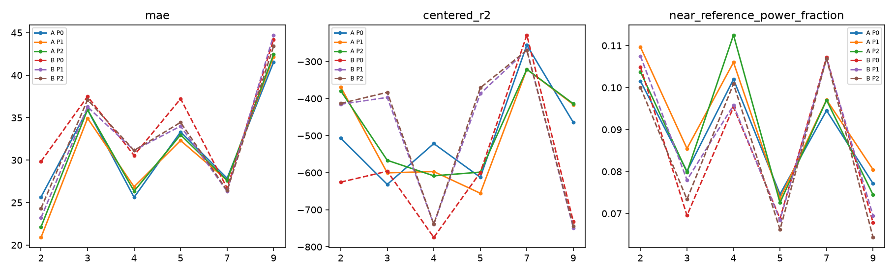
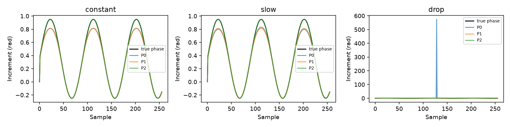

# FTU frozen-target phase increment audit

54 条原训练采集、六名受试者，A/B 身份及权重完全复用上轮。每个条件 324 个共同评分窗口；没有重新选目标、调整频带、搜索延时或训练模型。

## 结果与决策

去除幅度比显著限制了异常增量，但未恢复可靠的记录内 HR 跟踪。P1/P2 对固定峰值 MAE 有小幅改善，仍约 31–33 bpm；去均值 R² 均远小于零、相关性接近零。按预先给出的决策，**不重导出、不重训，继续向上游审计复数 RDA 的相位含义、构建方式与参考时间轴**。这不是证明真实信号中不存在心跳信息。

融合信号汇总（bpm；相关性与 R² 是合并记录内去均值后的指标）：

| arm | method | mae | centered_rmse | centered_r2 | centered_r | near_reference_power_fraction |
| --- | --- | --- | --- | --- | --- | --- |
| A | P0 | 31.6564 | 25.6793 | -474.722 | -0.0259129 | 0.0883005 |
| A | P1 | 30.7993 | 25.2777 | -459.956 | -0.00465772 | 0.0920383 |
| A | P2 | 31.2452 | 25.0566 | -451.929 | 0.014753 | 0.0900223 |
| B | P0 | 34.3397 | 27.9742 | -563.546 | -0.00973857 | 0.0856066 |
| B | P1 | 32.6149 | 25.5281 | -469.136 | 0.0148072 | 0.0876804 |
| B | P2 | 32.8098 | 25.3947 | -464.233 | 0.021363 | 0.0852794 |

记录内参考标准差只有约 1.177 bpm，因此巨大负 R² 表明峰值起伏远大于标签变化，不能只凭相关性符号判断成功。窗口重叠且仅六人，不按独立窗口做显著性检验。

## 数值正对照与真实增量

| envelope | method | undefined | max_error_vs_phase | max_error_vs_expected |
| --- | --- | --- | --- | --- |
| constant | P0 | 0 | 0.136583 | 0.136583 |
| constant | P1 | 0 | 0.136583 | 6.21639e-08 |
| constant | P2 | 0 | 7.0271e-08 | 7.0271e-08 |
| slow | P0 | 0 | 0.153014 | 0.153014 |
| slow | P1 | 0 | 0.136583 | 6.7286e-08 |
| slow | P2 | 0 | 6.65325e-08 | 6.65325e-08 |
| drop | P0 | 0 | 573.805 | 573.805 |
| drop | P1 | 0 | 0.136583 | 5.24169e-08 |
| drop | P2 | 0 | 6.28584e-08 | 6.28584e-08 |
| zero | P0 | 2 | 0.136583 | 0.136583 |
| zero | P1 | 2 | 0.136583 | 6.21639e-08 |
| zero | P2 | 2 | 7.0271e-08 | 7.0271e-08 |

正对照使用完全相同的已知相位轨迹，最大绝对增量小于 1 rad；P1 校验 sin(真实增量)，P2 校验真实增量。恒幅、缓变和骤降均通过 2e-6 容差。P0 在骤降时受幅度比显著放大。零幅度使相邻两个增量未定义，三种方法均显式保留 NaN，不进入后续处理；首样本零仅是窗口边界约定。真实数据共同有效窗口仍为 324，无额外排除。

P0 满足 delta = (前幅度/当前幅度) × sin(相角增量) / (1+epsilon/当前幅度²)。独立重算的最大浮点残差 2.9583103e-06；P1/P2 独立相角差校验最大误差 1.1901881e-07。这证明幅度变化会进入现有公式，不证明它是 HR 失败的唯一原因。

| arm | method | max_abs_delta | median_window_target_max | median_cumulative_span | max_cumulative_span | median_abs_slope |
| --- | --- | --- | --- | --- | --- | --- |
| A | P0 | 59.4747 | 0.0714701 | 0.156318 | 99.5213 | 0.00238435 |
| A | P1 | 1 | 0.0723212 | 0.14307 | 46.6883 | 0.00098306 |
| A | P2 | 3.14102 | 0.0723844 | 0.143082 | 58.4144 | 0.000968874 |
| B | P0 | 59.4747 | 0.0692948 | 0.14674 | 107.361 | 0.00226868 |
| B | P1 | 1 | 0.070653 | 0.135938 | 40.7228 | 0.000946478 |
| B | P2 | 3.13971 | 0.0707119 | 0.136058 | 49.1881 | 0.000940313 |

累计跨度和斜率仅是异常趋势诊断，不是真实位移。P1 有界于 ±1，P2 有界于 ±π；上限下降部分来自公式本身，不能作为生理信息改善证据。

## 配对收益及单目标/融合

下表变化均为新方法减 P0；改善计数按 MAE 越小、R²/参考附近功率越大计算。最后一列排除上轮已识别的最大异常记录，仅作敏感性分析，主结果保留全部 54 条。

| arm | method | metric | mean_change | records_improved | subjects_improved | mean_change_without_prior_max_spike_record |
| --- | --- | --- | --- | --- | --- | --- |
| A | P1 | mae | -0.857089 | 18 | 4 | -0.729196 |
| A | P1 | centered_r2 | -139.504 | 21 | 3 | -123.912 |
| A | P1 | near_reference_power_fraction | 0.00373775 | 28 | 5 | 0.00383343 |
| A | P2 | mae | -0.411133 | 18 | 3 | -0.389409 |
| A | P2 | centered_r2 | -126.717 | 20 | 4 | -128.851 |
| A | P2 | near_reference_power_fraction | 0.00172176 | 24 | 3 | 0.00190467 |
| B | P1 | mae | -1.72482 | 23 | 4 | -1.68366 |
| B | P1 | centered_r2 | 1652.96 | 22 | 4 | 1689.31 |
| B | P1 | near_reference_power_fraction | 0.00207375 | 27 | 4 | 0.00216366 |
| B | P2 | mae | -1.52989 | 21 | 5 | -1.55875 |
| B | P2 | centered_r2 | 1660.72 | 23 | 4 | 1692.22 |
| B | P2 | near_reference_power_fraction | -0.00032717 | 24 | 2 | 1.98499e-05 |

此处 mean_change 是逐记录指标差的等权均值，尤其记录 R² 的平均变化不等于上表合并去均值 R² 的变化；低变化记录的分母很小，不能把这列的巨大数值解释为实质恢复。

三个单目标的合并结果：

| arm | method | kind | mae | centered_r | near_reference_power_fraction |
| --- | --- | --- | --- | --- | --- |
| A | P0 | single0 | 34.4826 | 0.00292638 | 0.0820996 |
| A | P0 | single1 | 33.5837 | -0.0128091 | 0.0830787 |
| A | P0 | single2 | 31.9749 | 0.0136443 | 0.0839601 |
| A | P1 | single0 | 33.7477 | 0.0270311 | 0.0872654 |
| A | P1 | single1 | 34.2188 | -0.0100324 | 0.0857612 |
| A | P1 | single2 | 32.1947 | 0.0153406 | 0.0853011 |
| A | P2 | single0 | 34.1161 | 0.0373828 | 0.0851279 |
| A | P2 | single1 | 34.4166 | 0.000550386 | 0.0822935 |
| A | P2 | single2 | 32.2768 | 0.0238206 | 0.0834688 |
| B | P0 | single0 | 36.2506 | -0.0278405 | 0.0839486 |
| B | P0 | single1 | 36.7232 | 0.0205202 | 0.0772381 |
| B | P0 | single2 | 34.414 | -0.0536422 | 0.0806906 |
| B | P1 | single0 | 34.7651 | -0.0181589 | 0.0885507 |
| B | P1 | single1 | 36.1756 | 0.0282828 | 0.0779027 |
| B | P1 | single2 | 34.9646 | -0.10134 | 0.0828225 |
| B | P2 | single0 | 35.0787 | -0.0168342 | 0.0863943 |
| B | P2 | single1 | 36.0744 | 0.031162 | 0.0783001 |
| B | P2 | single2 | 35.1305 | -0.0919147 | 0.0790665 |

全部三个单目标及融合的统计在 metrics.csv、record_metrics.csv、paired_changes.csv；没有按 HR 挑最佳单目标。六张示例图按每位受试者固定最小选样哈希取记录，分别显示三个单目标和融合。参考附近功率沿用旧定义（参考 ±1 个频率 bin 的功率除以固定 HR 频带功率），只作事后评分。

## 复现与边界

P0 的增量、累积、去趋势、融合、标准化及频谱逐项核对旧 NPZ，容差 2e-5；实际误差见 p0_reproduction.csv。最初严格逐位校验在频谱出现约 1e-7 级平台差异后停止，记录容差后重跑；没有改变科学协议。P0 峰值和标签完全复现旧表。输入 56 个文件哈希通过上轮清单验证，保存所有新增量/累积/相位/融合/频谱及冻结身份权重。

P2 是复数观测的主值相角增量，不自动等于胸壁位移。低幅度噪声、多散射体、混叠、导出相干性及未实测同步仍未排除。沿用 frame/20+0s 时间假设，未利用 HR 选择目标、峰或延时。该实验是六名已知受试者的记录诊断，不是跨受试者泛化评价。

本地 uv CPU 主运行 11.49 秒，无训练。协议及代码与结果在本次一起归档，未做结果前独立提交，不宣称时间戳预注册。完整可重运行命令：`uv run --locked --no-sync python run_ftu_phase_increments.py`，然后运行 `summarize_ftu_phase_increments.py`。
