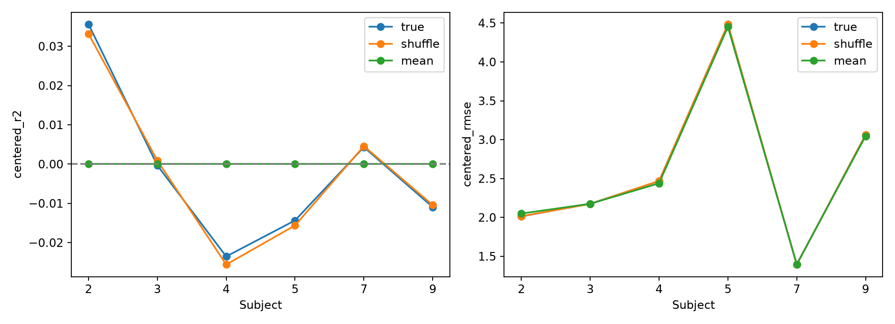
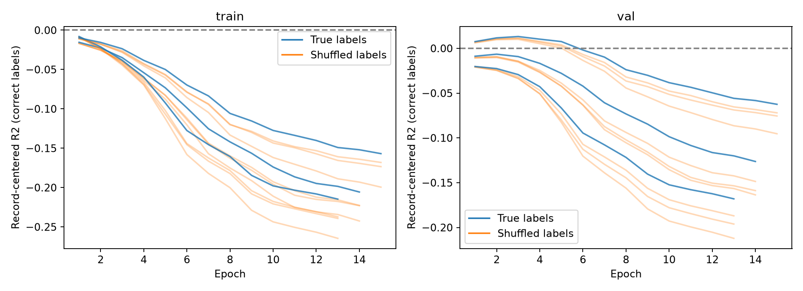
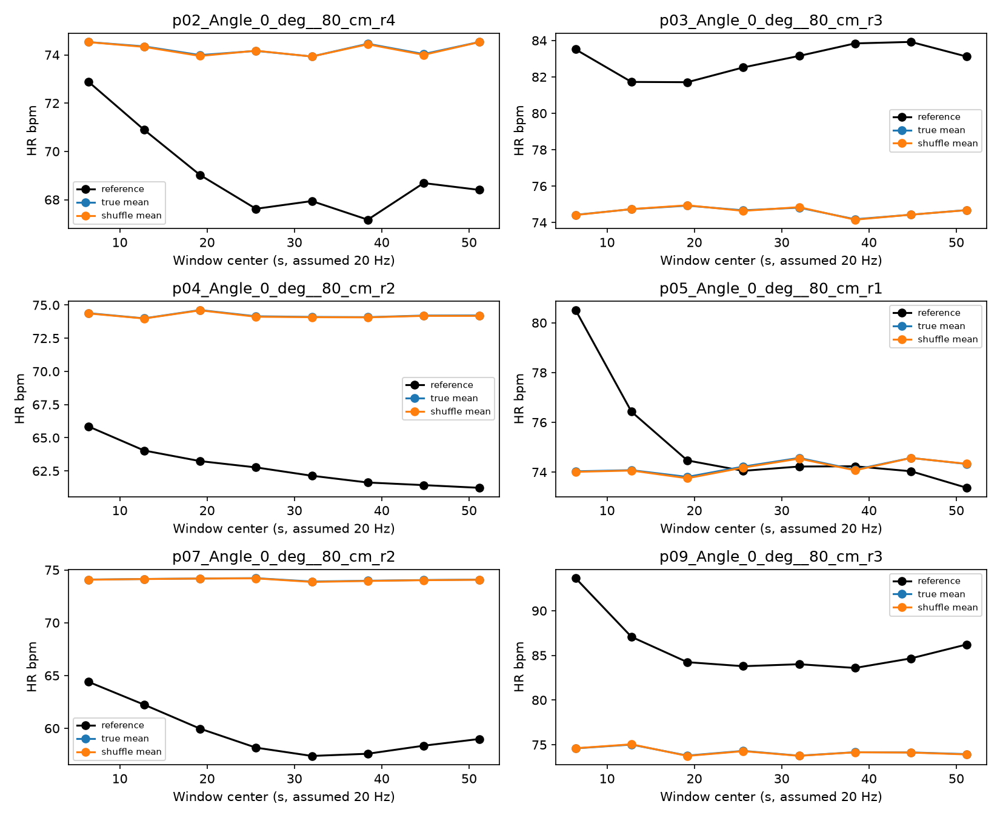

# 固定 D 预处理：真实 FTU 跨采集可学习性对照

2026-10-18。**12 次训练完成，但没有恢复记录内动态 HR 跟踪。真实标签组与记录内打乱标签组表现几乎相同，未见采集上的受试者等权去均值 R² 仍为负。**合成读出流程通过，不等于真实雷达中的逐窗口监督关系已被利用。

## 协议执行与证据边界

实验设置在看到训练结果前提交为 `b04aa8e`，Kaggle version 1 使用提交时打包的源码。下载协议与该提交逐字段一致（文件换行差异不改变设置）。

- 仅原训练受试者 p02/p03/p04/p05/p07/p09，剔除重复别名后 216 次采集、1,728 个窗口。原 108/54/54 次采集划分保持不变，训练/验证/评估为 864/432/432 个窗口。每名受试者评估有 9 次采集、72 个窗口。
- 输入固定 D：保留原逐窗口标准化，不用逐 bin StandardScaler；保留 bin 中心位于 0.5–2.75 Hz 的 29 个 bin，其余置零，不再归一化。网络输入仍为 129 维。
- 全新初始化 MLP 129→64→32→1，GELU、dropout 0.15，无合成预训练。AdamW lr 0.0003、weight decay 0.0001、SmoothL1 beta 0.5、batch 64、梯度裁剪 1；60 epoch 上限，early-stop patience 12。标签归一化仅使用新训练集。
- 三个模型种子 42/43/44，每个配对真实标签及三个固定记录内打乱种子 101/202/303，共 12 次训练。初始化哈希一致、批次顺序配对；每条训练记录的八个标签保留同一多重集合。验证与评估始终使用正确标签。
- 按验证记录去均值 RMSE 选择 checkpoint，不使用评估结果改选模型、频带或轮数。没有沿用合成任务成功阈值。

范围仍是**同受试者、同次到访、跨触发采集**。p03 部分 radar-start 日志缺失；本轮没有新证据确认同步或跨 session 独立性。窗口重叠、记录内时间相关存在，因此打乱对照不是严格置换显著性检验。

## 主要结果：受试者等权平均

先分别对每个模型计算六名受试者指标，再等权平均；真实组最后平均三个模型种子，打乱组平均九次训练。以下不是预测集成的指标。

| 集合 | 模型 | 原始 MAE | 去均值 RMSE | 去均值 R² | 去均值 r | 去均值标准差比 |
|---|---|---:|---:|---:|---:|---:|
| 训练 | 真实标签 | 9.5742 | 2.1881 | −0.01744 | −0.00377 | 0.12814 |
| 训练 | 打乱标签 | 9.5726 | 2.1903 | −0.01938 | −0.00715 | 0.13209 |
| 验证 | 真实标签 | 10.0022 | 2.2440 | −0.01006 | 0.03442 | 0.12961 |
| 验证 | 打乱标签 | 10.0013 | 2.2468 | −0.01330 | 0.02667 | 0.13356 |
| 评估 | 真实标签 | 9.4683 | 2.5991 | −0.00153 | 0.03800 | 0.11460 |
| 评估 | 打乱标签 | 9.4683 | 2.6000 | −0.00216 | 0.03734 | 0.11767 |

评估受试者等权去均值 RMSE 的平均改善（打乱−真实）仅 **0.000920 bpm**，九个配对的范围为 **−0.000527 至 +0.002901 bpm**；R² 平均改善仅 **0.000628**。没有稳定且有实际幅度的跨受试者优势。

若合并窗口评分，真实标签组评估 MAE 为 9.4683、去均值 RMSE 为 2.7776、R² 为 −0.00803、r 为 0.01085、标准差比为 0.09711。打乱组对应为 9.4683、2.7787、−0.00883、0.00996、0.09985。合并与受试者等权的结论一致，数值不能混用。

## 六名受试者的未见采集

| 受试者 | 真实组 MAE | 真实组去均值 RMSE | 真实组 R² | 打乱组 R² | 真实组去均值 r | 真实组去均值标准差比 |
|---|---:|---:|---:|---:|---:|---:|
| p02 | 5.8936 | 2.0128 | 0.03563 | 0.03318 | 0.19981 | 0.15002 |
| p03 | 8.3990 | 2.1756 | −0.00033 | 0.00093 | 0.08439 | 0.12260 |
| p04 | 12.0760 | 2.4669 | −0.02352 | −0.02559 | −0.07780 | 0.09282 |
| p05 | 3.9142 | 4.4827 | −0.01433 | −0.01561 | −0.06717 | 0.06374 |
| p07 | 11.7105 | 1.3935 | 0.00432 | 0.00458 | 0.09509 | 0.16612 |
| p09 | 14.8162 | 3.0627 | −0.01095 | −0.01044 | −0.00635 | 0.09227 |

p02、p07 有微小正 R²，但打乱组也有相近结果；其余四人真实组 R² 为负。真实标签组平均 RMSE 优势在 p02/p04/p05 为正，在 p03/p07/p09 为负。不能将个别正值解释为可复现动态学习。

## 训练过程：不只是选中 checkpoint 没学到

种子 42/43/44 的四个配对组分别都选中 epoch **2/1/3**，分别实跑 **14/13/15** epoch 后触发冻结的早停规则。60 是上限，不是实际全部运行 60 轮。

真实标签组在实际运行的所有 epoch 上，训练集**合并窗口的记录去均值 R² 均为负**；各种子的最佳训练 R² 分别为 −0.01544、−0.00809、−0.00987。到最后一轮分别恶化为 −0.20565、−0.21468、−0.15689。训练原始 MAE 小幅下降，却没有形成正确的记录内对应关系。

这削弱了“主要是未知受试者迁移失败”的解释，也不能只归咎于验证选择早期 checkpoint。但它仍只说明这套固定有限预算训练流程没有学到，不能排除其他目标、优化设置或表示在不同实验中有效。没有为改善数字追加轮数或改损失。

## 信号与常数参照

常数使用新训练集全局均值/中位数；固定信号基线在原始频谱同一 29-bin 频带取最大值，返回 bin 中心频率×60，无插值或事后调参。

| 评估参照 | MAE | 受试者等权去均值 RMSE | 受试者等权去均值 R² |
|---|---:|---:|---:|
| 训练均值 | 9.4118 | 2.5930 | 0 |
| 训练中位数 | 9.4039 | 2.5930 | 0 |
| 频带内最大峰 | 27.7502 | 23.2589 | −108.9894 |
| 真实标签 MLP | 9.4683 | 2.5991 | −0.00153 |

模型未超过正式常数基线。常数的去均值评分对应零动态偏离，是离线动态零基线；没有向模型提供评估记录均值。频带内最大峰也未恢复 HR，说明合成单正弦上的峰值读出成绩不能外推到真实雷达。此结果不证明频带内没有心跳成分，峰可能受呼吸、谐波或其他成分影响；本轮未验证具体归因。

各受试者真实记录内变化尺度仅约 1.40–4.45 bpm，因此 RMSE 小于合成阈值在这里没有成功意义。原始 MAE 与历史 6/2/2 测试结果不能直接横比，本轮评估来自原六名训练受试者，标签分布和任务不同。

轨迹选取不依据 HR 或误差，展示三个真实模型和九个打乱模型的平均预测，仅作可视化；表格指标均先单模型评分再平均。时间轴仍使用导出的 20 Hz 假设，图不构成同步验证。

## 可支持的结论与后续边界

本轮没有获得“正确逐窗口标签对应关系带来稳定未见采集动态预测收益”的证据。合成读出检查排除了接口完全失效这一极端情形，但真实训练及评估仍接近常数，不能把失败主要命名为跨受试者域偏移。

不据此宣称 FTU 不可学习，也不确定前端、标签同步或优化中的唯一原因。下一步更适合回到连续记录中核对参考标签、雷达时间轴及表征中的可追踪频率结构，或另行预注册针对动态目标的训练诊断；本轮没有启动新的模型搜索或跨域适配。

## 产物与验证

- [Kaggle FTU Real D Controls](https://www.kaggle.com/code/goldfish9901/ftu-real-d-controls)，version 1，12 次训练全部在 Kaggle；流程实测 34.128 秒（不含排队）。
- 输入 archive SHA256：`24dd08e8c8fda3fd438df37305cfc8dfefd845f3c0297e1ef06995d30fc91810`。
- 本地 uv 预检查约 0.79 秒；下载后指标复核与图形生成低于 10 秒，详见 `local_validation.json`。
- 核验 23 个原始产物哈希、36 组预测指标、原始划分和冻结协议、29-bin 掩码、记录内置换的双射/组归属及跨模型种子的一致映射。CSV 复算最大指标差异约 7.10e-7。
- 保存 12 个 checkpoint、输入及掩码、逐窗口预测、逐 epoch 训练/验证指标、逐记录/逐受试者指标、等权汇总、配对差异、基线、配置和源码快照。常数相关性等未定义指标保持空值。
- `kaggle_artifact_manifest.json` 对应原始训练输出；`artifact_manifest.json` 对应最终归档文件（自身除外）。
