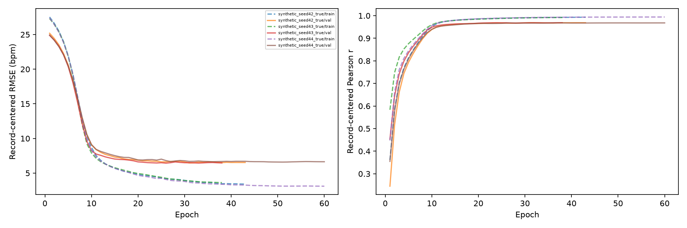
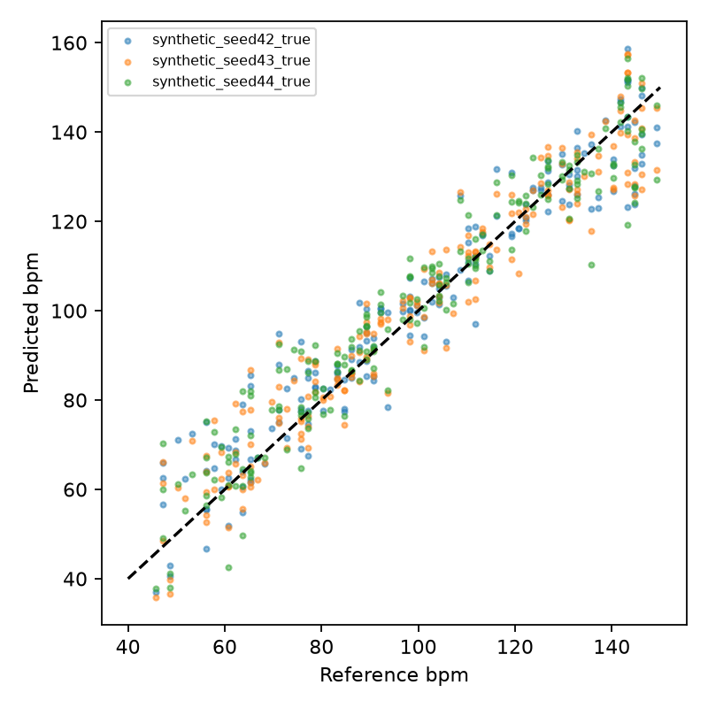

# FTU 同受试者跨采集诊断：合成门控未通过

2026-10-17。本轮实际完成三个种子的合成正对照；**真实标签/记录内打乱标签的 12 次真实数据训练均未启动**。不得将本轮结果解读为真实雷达不可学习。

## 主要结果

固定 MLP 129→64→32→1、GELU、dropout 0.15，保留 Hann/log 频谱及逐窗口标准化，再使用训练集拟合的逐 bin StandardScaler。AdamW、SmoothL1、60 epoch 上限、patience 12；验证记录去均值 RMSE 选择 checkpoint。预先冻结门槛为三个种子的验证与评估 RMSE 均 ≤4.6875 bpm（一个 FFT bin），且去均值 r ≥0.9。

| 种子 | 最佳 epoch / 实跑 | 验证去均值 RMSE | 评估去均值 RMSE | 评估去均值 r | 评估 MAE |
|---|---:|---:|---:|---:|---:|
| 42 | 31 / 43 | 6.4638 | 7.4917 | 0.9636 | 6.1775 |
| 43 | 26 / 38 | 6.4336 | 7.4779 | 0.9633 | 6.1039 |
| 44 | 51 / 60 | 6.5878 | 7.6148 | 0.9620 | 6.2997 |

相关性达标，但精度门槛未通过。训练集去均值 RMSE 为 3.1207–4.2529 bpm、r 为 0.9886–0.9939。因此模型不是完全没有频率响应；当前训练流程在未见频率/信号上的读出精度不足。不能据此确定是优化、归一化、有限样本还是正则化造成，更不能归因于真实 FTU 的前端或同步。

## 合成设置与评分边界

随机生成种子 20261017，20 Hz、256 点，训练/验证/评估分别 96/24/24 个人工组，每组 8 条独立正弦信号。幅度 0.5–2、随机相位、相对噪声标准差 0–0.3。训练频率为 0.75+0.05k Hz；验证为间隔中点，评估为四分之一/四分之三位置，详见 protocol.json。未用评估指标选择 epoch；评估指标仅参与预先声明的训练放行门控。

人工组不是连续生理记录。组内去均值仅用于离线评分，没有将真实组均值提供给网络。三个种子是优化重复，不能作为三个独立受试者。

### 事后、无训练的频谱读出检查

不修改门槛、不追加训练。直接从保存的同一 129 维频谱取最大 bin，另做三点抛物线峰值插值：

| 评估方法 | MAE | 去均值 RMSE | 去均值 r |
|---|---:|---:|---:|
| 最大频谱 bin | 1.0752 | 1.1671 | 0.999130 |
| 三点抛物线插值 | 0.0754 | 0.0918 | 0.999995 |

这支持“合成输入的频谱仍保留可读频率信息”，将后续排查重点放在学习读出流程。此诊断是事后补充，不能替代冻结 MLP 的通过标准，也不是雷达 HR 基线结果。

## 真实数据划分准备：发现重复采集别名

仅使用原训练受试者 p02/p03/p04/p05/p07/p09，不接触原验证/测试受试者。264 条命名记录中，Distance_80_cm、Angle_0_deg__80_cm 与 Orientation_80_cm__Front_side 存在相同采集别名：相同受试者/日期/HR 起始时间对应的时域与频域数组逐字节一致。移除 48 条重复别名后剩 216 次采集、1,728 个窗口。原受试者划分未因此跨集合泄漏，但按文件名重新切分会引入泄漏。

每名受试者 9 条件×4 次采集；每个受试者×条件按 SHA256(20261017|capture_key) 排序，2/1/1 分配至训练/验证/评估，共 108/54/54 次采集。同一采集的八个窗口保持同组，划分不使用 HR 数值或模型误差。完整映射见 capture_audit.csv、record_split.csv。

**范围限制：同受试者、同次到访、跨触发采集；不是跨 visit/session 验证。**每人仅一个采集日期，唯一采集起始间隔至少 80 秒，有日志时为独立的有限 1,200 帧触发；p03 的 20 次规范采集缺少 radar-start 日志。不能宣称所有 session 独立性均已完全核实，HR 同步仍未获得新验证。

已冻结真实数据方案为三个模型种子×真实标签及三个打乱种子（101/202/303），训练标签仅在记录内置换；验证/评估均正确标签。初始化、批次顺序配对，scaler 和标签归一化仅拟合新训练集。由于门控未通过，这部分代码尚未在 Kaggle 实际执行验证，未生成真实数据模型或结果。

## 追溯与复核

- Kaggle [FTU Record Learnability](https://www.kaggle.com/code/goldfish9901/ftu-record-learnability)，version 1，Tesla T4，训练 17.879 秒。全部模型训练在 Kaggle。
- 输入 archive SHA256：`24dd08e8c8fda3fd438df37305cfc8dfefd845f3c0297e1ef06995d30fc91810`。
- 本地划分审计约 0.814 秒；下载后哈希/预测重算及无训练峰值检查约 0.289 秒，使用 uv。
- 独立从逐窗口预测复算 9 组 train/val/evaluation 指标，与 Kaggle 输出一致；核验全部 13 个原始结果文件哈希。门控逻辑重新计算一致。
- 保存三个 checkpoint、合成特征与标签、逐窗口预测、逐 epoch train/val 指标、配置、源码快照和哈希。`kaggle_artifact_manifest.json` 核验原始训练产物，`artifact_manifest.json` 覆盖本地整理产物（自身除外）。

下一步应单独预注册合成读出流程的受控排查，先定位精度未达标原因；本轮不放宽门槛、不扩大真实模型。A–D 的谨慎结论保持不变。
