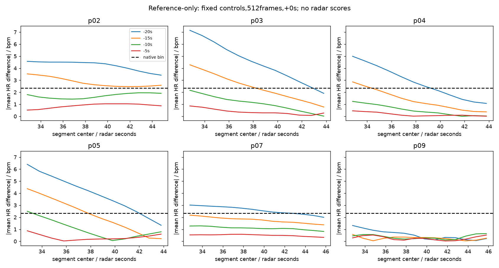

# FTU 非循环错位对照：参考支持与可辨别性审计

本轮只执行第一步。**512帧下六条记录均恢复共同时间支持，但没有记录同时通过冻结四个错位对照的标签可辨别性条件（0/6）；768帧下共同窗口不足。第二步完整Range/Doppler重建不启动。** 这不是雷达性能失败，也不是证明所有可能的负对照都无法构造。

## 结果前固定的协议

协议提交`6d763c0`；仅根据时间戳选出的位移与窗口表提交`2da13ee`，之后才计算HR差异。未读取雷达数组、上一轮雷达评分或新增雷达分数；未重复`cda2ede`多Range/Beam分析。

保持原六记录、20Hz假设、首256帧校准、512/768帧窗长、20帧步长以及+0/+1/+2秒偏移。对照候选为±5、±10、±15、±20秒，**无循环、无外推**。在全部四位移组合中，按协议固定的纯时间支持排序选出每种窗长共用的一组；两种窗长均得到−20/−15/−10/−5秒。标签差异不参与位移选择。四个对照用于保留此前“超过每个对照”的要求，不因某个对照较弱而事后删除。

时间支持至少5个共同窗口只是预先固定的可用性下限，不代表5个独立样本。最终共同窗口同时满足三偏移、正确标签及四个错位标签。对每个选定对照、每个偏移，至少60%的共同窗口需满足平均HR差异**严格大于**该窗长原生Fourier间隔（512:2.34375bpm；768:1.5625bpm）。这是本轮新增、在结果前声明的标签可辨别性规则；不能将其解释为频率估计的理论极限，Hann的有效谱响应还更宽。主门固定512帧，不以768帧或单个较好偏移替代。

## 真实参考覆盖与原CSV核对

| record | original_points | original_first | original_last | declared_duration | original_equals_archived_reference |
| --- | --- | --- | --- | --- | --- |
| p02 | 61 | 0.000 | 60.000 | 00:01:01 | True |
| p03 | 60 | 0.000 | 59.000 | 00:01:00 | True |
| p04 | 60 | 0.000 | 59.000 | 00:01:00 | True |
| p05 | 60 | 0.000 | 59.000 | 00:01:00 | True |
| p07 | 62 | 0.000 | 61.000 | 00:01:00 | True |
| p09 | 62 | 0.000 | 61.000 | 00:01:00 | True |

六条归档参考的全部时间与HR数值均与已有原始Polar CSV逐值相同，文件SHA256也核对通过。因此p03/p04/p05到59秒**不是本次NPZ导出截断造成**。60个1Hz样本覆盖0–59秒本身与一分钟导出相容，不能仅据此声称缺失了一个应存在的60秒样本。p07/p09的CSV标称时长与样本范围并不完全相同；本轮一律按实际时间列评分，不按Duration补齐。

原CSV完整源路径和哈希见`original_csv_provenance.csv`；本轮仅核查这六条已有文件，不跨记录拼接或将相邻采集当成同一条更长参考。插值只允许在实际观测范围内；禁止跨超过中位采样间隔两倍的空洞，实际六条均连续1Hz且标签有限。

## 时间支持：共同窗口已经与旧循环问题分离

下表为同时满足全部三偏移和四对照的共同窗口数量，评分区间完全在校准之后：

| record | windows_512 | windows_768 |
| --- | --- | --- |
| p02 | 13 | 0 |
| p03 | 12 | 0 |
| p04 | 12 | 0 |
| p05 | 12 | 0 |
| p07 | 14 | 1 |
| p09 | 14 | 1 |

完整逐窗口表`window_support.csv`列出每条记录、窗长、偏移、候选位移的真实/对照支持和共同有效性。`pair_support_summary.csv`保存每组共同窗口的起点与中心；`selected_support.csv`同时保存逐偏移及三偏移交集的实际窗口列表。未通过缩短窗口、换偏移或外推来增加支持。

768帧下，在固定候选网格的全部四位移组合中，没有组合能让任一记录达到5个三偏移共同窗口；该事实只针对此网格、四对照数量和固定采样定义。512帧时间支持则六条均通过，不能继续把这六条称为“没有共同时间段”。

## 标签可辨别性

512帧，下面按记录和选定对照列出跨0/1/2秒偏移的最小/最大“超过原生间隔的窗口比例”，以及平均绝对标签差范围。全条件需minimum_fraction≥0.6。

| record | shift | minimum_fraction | maximum_fraction | minimum_mean_difference | maximum_mean_difference |
| --- | --- | --- | --- | --- | --- |
| p02 | -20 | 1.000 | 1.000 | 4.011 | 4.219 |
| p02 | -15 | 1.000 | 1.000 | 2.697 | 2.836 |
| p02 | -10 | 0.000 | 0.000 | 1.701 | 1.708 |
| p02 | -5 | 0.000 | 0.000 | 0.870 | 0.897 |
| p03 | -20 | 0.750 | 0.917 | 3.547 | 4.483 |
| p03 | -15 | 0.333 | 0.500 | 1.794 | 2.424 |
| p03 | -10 | 0.000 | 0.000 | 0.766 | 1.071 |
| p03 | -5 | 0.000 | 0.000 | 0.324 | 0.382 |
| p04 | -20 | 0.417 | 0.583 | 2.154 | 2.816 |
| p04 | -15 | 0.000 | 0.167 | 0.936 | 1.347 |
| p04 | -10 | 0.000 | 0.000 | 0.318 | 0.503 |
| p04 | -5 | 0.000 | 0.000 | 0.085 | 0.155 |
| p05 | -20 | 0.667 | 0.833 | 3.021 | 3.940 |
| p05 | -15 | 0.250 | 0.417 | 1.626 | 2.181 |
| p05 | -10 | 0.000 | 0.083 | 0.785 | 1.004 |
| p05 | -5 | 0.000 | 0.000 | 0.323 | 0.344 |
| p07 | -20 | 0.571 | 0.714 | 2.417 | 2.580 |
| p07 | -15 | 0.000 | 0.000 | 1.652 | 1.770 |
| p07 | -10 | 0.000 | 0.000 | 1.010 | 1.089 |
| p07 | -5 | 0.000 | 0.000 | 0.457 | 0.498 |
| p09 | -20 | 0.000 | 0.000 | 0.405 | 0.529 |
| p09 | -15 | 0.000 | 0.000 | 0.242 | 0.269 |
| p09 | -10 | 0.000 | 0.000 | 0.368 | 0.378 |
| p09 | -5 | 0.000 | 0.000 | 0.263 | 0.284 |

全部六条均未满足四对照、三偏移的联合标签条件。**这不表示每一个对照都没有区分度。** 例如p02的−20/−15秒在全部偏移下可区分，但−10/−5秒不满足规则。每条记录通过的选定位移数（要求三偏移全通过）为：p02:2/4; p03:1/4; p04:0/4; p05:1/4; p07:0/4; p09:0/4。不可将“联合不可评估”改写为“参考完全没有HR变化”。

`control_distinguishability.csv`也保留未选定位移的描述性结果；它们使用自己的逐偏移成对支持，**不能直接替换联合共同支持上的选定对照结果**，也未用于事后重选。`label_window_differences.csv`保存全部实际均值标签、差值、窗口及支持类型。该可用性筛查不是显著性检验，不把重叠窗口计为独立样本。

## 更完整参考与同步证据查询

核对已有原始CSV后，当前归档中没有发现这六条更长的对应参考。现有Polar文件头只提供日期、开始时间、标称Duration；单独的雷达主机日志与Polar头部时钟不构成测得的跨设备同步。+0/+1/+2秒仍为敏感性假设，没有从HR/雷达相关性拟合延时。p03实际雷达日志缺失，既有选择表继承的radar_start不作为可信同步证据。

本轮重新查询[官方4TU文件清单](https://data.4tu.nl/v2/articles/48acba04-96bc-4131-b52f-9e18458ad92b/files)，HTTP200，仍仅列`Human_Vital_Signs_Detection.rar`与`Read_me.txt`，未列独立的长参考或同步文件。另离线解析此前缓存的完整QuickOpen块，457条缓存文件头逐条CRC通过，参考关键词仅命中`Human/BR_Ref_Values/BR_ref_human.ods`；它是呼吸参考文件名线索，不是更长Polar HR证据，也未用其替代HR。QuickOpen只是文件头缓存，可能不包含较小成员，**不是对194.6GB RAR全部成员的穷尽清单，不能声称完整HR或同步资料从未发布**。已有官方README说明Polar H10为参考，但未给出可测量的逐记录同步映射。保存了`official_files.json`、`cached_official_headers.json`及查询/缓存哈希记录；后续若继续找资料，应查RAR内未缓存参考文件/同步说明或取得采集元数据，而不是先扩大雷达算法搜索。

## 决策与下一步边界

第一步数据门：主512帧可评估记录数0/6，要求至少5/6。因此不启动完整Range/Doppler重建、54条扩展、训练或跨域；不降低覆盖率、命中率、功率优势及每个错位对照比较的后续标准。

可继续报告上一轮限定DC ROI的描述性频谱；当前不能据这套标签条件声称已验证雷达动态HR跟踪，也不能把不可评估记为雷达失败。未来若取得更长对应参考或同步证据，须先冻结更新后的支持/对照协议，再进入相同六条记录的完整信号区域检查；不沿用本轮结果事后挑对照。

## 本地执行与独立核验

纯时间支持0.626s，标签检查0.495s，独立核验0.840s；均使用本地uv，无训练。独立路径用原CSV、均匀时间端点支持和SciPy插值重算：核对8208条支持行、1602条标签窗口，最大标签差1.42e-14bpm；枚举组合排序独立复现。源代码、协议、数据来源哈希及全部产物哈希随报告归档。
