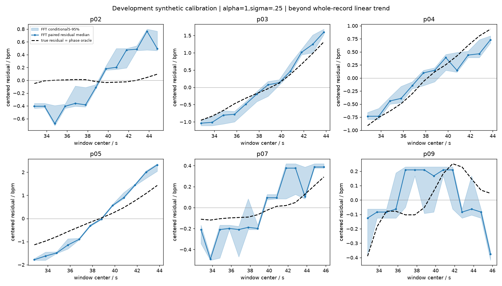
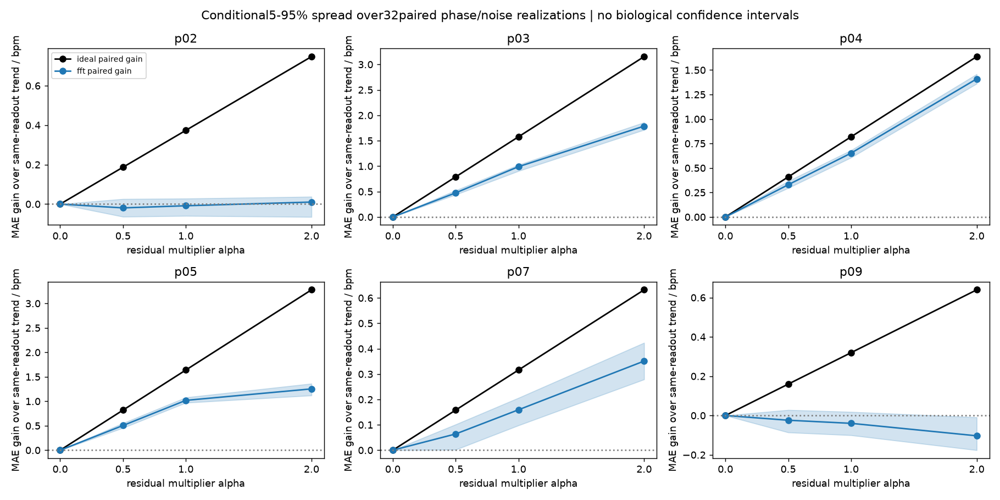

# 全窗平均HR与趋势之外动态：有限开发校准

完成日期2026-10-27。**全窗平均目标的已知相位理想读数通过；FFT的趋势外增益具有记录依赖，不能概括成普遍动态跟踪能力。** α=1时p03/p04/p05在本合成实验中有稳定配对残差增益；p02被预定操作性精度规则标记为当前FFT下动态不可评价；p07/p09未显示稳定残差恢复。全部六条仍完整报告，不以5/6计数作为出口，不排除p04/p09。

这不是新雷达结果、不是独立验证。原参考准入0/6、旧移位与0.01门槛均保持。研究主张继续限定为待真实验证的窗口平均HR及频谱结构；合成可读出不证明实际回波含有同样结构。

## 结果前固定的目标和相位读数

协议`5623878`。保留以前的全窗逐帧算术平均：

`Y_alpha(s,L) = (1/L) sum[k=s..s+L-1] h_alpha[k]`，`h_alpha=m+alpha*r`，`m`为整条参考样本对时间的OLS线性趋势，`r=HR-m`。只使用现有参考范围内插值，无外推或循环。

已知生成相位定义在帧边界：`phi[k+1]-phi[k]=2*pi*h_alpha[k]/(60*fs)`，所以

`ideal(s,L)=60*(phi[s+L]-phi[s])/(2*pi*(L/fs))=Y_alpha(s,L)`。

这里L个采样间隔对应L个目标样本，而不是用首末样本之间L−1个间隔代替全窗。为与旧的离散目标精确对应，本轮采用每0.05秒频率保持的已知生成器；上一轮使用梯形相位积分，因此**不能把跨轮差异全部归于一个读数改动**。本轮两个读数共享同一个生成信号，内部比较仍配对。

理想读数使用潜在已知相位，不从含噪余弦估计相位；它是目标定义/读出上限的检查，不能当作可部署算法或真实Polar同步准确的证明。最大窗均值误差 **1.96e-12bpm**，低于预定1e-9容差。

FFT保持已有逐窗去趋势、Hann、4096点显示FFT、45–150bpm全局最大峰。原生bin为2.34375/1.5625bpm（512/768帧），零填充网格0.29296875bpm，不是额外物理分辨率。相位理想值和FFT各自与同一个全窗目标比较。

## 配对设计和相对趋势的增量

固定α=0、0.5、1、2；**只有α=1对应观测参考残差幅度**，放大或缩小均只用于检测能力诊断。单位幅度余弦加噪声σ=0或0.25，32个固定种子20261026–20261057；每记录/种子跨α和噪声水平共享初相位和标准高斯序列。前3个随机对与上轮一致，但生成器相位积分约定按上文改变。

`M`为窗均趋势，`R_alpha=Y_alpha-M`。对每个读数分别定义：

- 配对误差增益：`MAE(pred_0,Y_alpha)-MAE(pred_alpha,Y_alpha)`，正值有利于包含残差的信号。
- 另报告相对已知趋势`M`的误差增益，避免把FFT趋势读出本身的偏差藏起来。
- 配对残差估计：`D_alpha=pred_alpha-pred_0`，与`R_alpha`比较；同时报告原始偏差/RMSE。
- 动态残差R²：对同一记录共同窗口内的`D_alpha`和`R_alpha`各自去均值后，`1-SSE/sum(R_centered²)`。它比较的是**相对趋势后的变化**，而非原始HR总体相关性，也不会把静态残差均值修正称为动态恢复。

窗支持保持原冻结交集：主512帧每条12–14个；768帧仍只有0–1个，不计算有意义的动态R²或拿来替代主分析。保留所有旧−20/−15/−10/−5秒对照与0/1/2秒偏移的FFT诊断，见`unchanged_shift_diagnostics.csv`；没有删除难通过的移位或调整0.01。它们是保留的次要诊断，本轮新问题不重新以旧5/6门判定。

## 不确定性和精度标记的含义

下表每格为中位数`[q05,q95]`，来自每条记录32个**配对相位/噪声**条件，表示条件90%敏感性范围，**不是受试者置信区间**。不对重叠窗口bootstrap，不将种子或窗口计为新的生物样本。参考HR计算/平滑、真实同步及测量误差仍未知，不包含在这些范围内。

结果前固定了FFT操作性精度标记：`max(显示网格/sqrt(12), alpha0跨种子中心化读出抖动的q95)`。网格项约0.08457bpm是此离散读出的报告约定，**不是原生Fourier分辨率、严格误差下界或生理可辨识性定理**。目标中心化残差RMS低于该标尺标为“当前FFT精度下动态不可评价”，仍保存全部原始误差/R²；它不证明参考没有动态，也不用于排除记录或救回5/6。

对于高于标尺的情况，q05(配对MAE增益)>0且q05(残差R²)>0只标注“合成配对增益稳定”；否则报告当前读出未显示稳定证据，而非雷达算法失败。理想读数另行检查，不套用FFT标尺。

## α=1：逐记录结果

含噪σ=.25，所有误差单位bpm；R_rms为目标中心化残差RMS，R²无单位：

| record | R_rms | delta_MAE | delta_MAE_vs_known_trend | residual_RMSE | residual_R2 | interpretation |
| --- | --- | --- | --- | --- | --- | --- |
| p02 | 0.0361 | -0.009 [-0.060, 0.028] | -0.010 [-0.055, 0.000] | 0.426 [0.378, 0.457] | -138.338 [-158.665, -108.344] | 当前FFT精度下动态不可评价（操作性标记） |
| p03 | 0.6899 | 0.989 [0.903, 1.026] | 0.979 [0.906, 1.028] | 0.221 [0.188, 0.287] | 0.898 [0.827, 0.926] | 合成配对残差增益稳定 |
| p04 | 0.5994 | 0.652 [0.606, 0.681] | 0.644 [0.642, 0.646] | 0.188 [0.153, 0.225] | 0.901 [0.859, 0.935] | 合成配对残差增益稳定 |
| p05 | 0.7865 | 1.019 [0.970, 1.079] | 1.014 [1.014, 1.063] | 0.593 [0.540, 0.649] | 0.431 [0.319, 0.529] | 合成配对残差增益稳定 |
| p07 | 0.1249 | 0.159 [0.098, 0.206] | 0.162 [0.120, 0.181] | 0.192 [0.166, 0.227] | -1.359 [-2.311, -0.767] | 此读出未显示稳定残差恢复 |
| p09 | 0.1700 | -0.040 [-0.100, 0.018] | -0.040 [-0.080, -0.019] | 0.219 [0.211, 0.243] | -0.667 [-1.037, -0.547] | 此读出未显示稳定残差恢复 |

无噪声条件，用于区分读出偏差和噪声敏感性：

| record | R_rms | delta_MAE | residual_RMSE | residual_R2 | interpretation |
| --- | --- | --- | --- | --- | --- |
| p02 | 0.0361 | -0.017 [-0.017, -0.017] | 0.440 [0.440, 0.440] | -147.285 [-147.285, -147.285] | 当前FFT精度下动态不可评价（操作性标记） |
| p03 | 0.6899 | 0.952 [0.952, 0.952] | 0.212 [0.212, 0.212] | 0.905 [0.905, 0.905] | 合成配对残差增益稳定 |
| p04 | 0.5994 | 0.651 [0.651, 0.651] | 0.197 [0.197, 0.197] | 0.892 [0.892, 0.892] | 合成配对残差增益稳定 |
| p05 | 0.7865 | 1.019 [1.019, 1.019] | 0.563 [0.563, 0.563] | 0.487 [0.487, 0.487] | 合成配对残差增益稳定 |
| p07 | 0.1249 | 0.180 [0.180, 0.180] | 0.166 [0.166, 0.166] | -0.767 [-0.767, -0.767] | 此读出未显示稳定残差恢复 |
| p09 | 0.1700 | -0.079 [-0.079, -0.079] | 0.231 [0.231, 0.231] | -0.841 [-0.841, -0.841] | 此读出未显示稳定残差恢复 |

理想读数在所有有足够支持、非零残差的条件下恢复已知残差至数值精度；它也说明本合成构造中的残差不是数学上不存在。FFT在p07可降低全窗误差，却未稳定恢复中心化残差；**降低平均误差与恢复细节动态是两个结果**。p02的极负R²受小目标分母放大，主要按残差RMS/RMSE与精度标记解释，不把其数值大小当作生理失败程度。

## 先解释“趋势之外”到底指什么

`m`拟合整条一分钟参考，评分仅覆盖后部共同窗口。全记录OLS残差全局正交于线性趋势，**不保证在这个局部子区间也正交或只包含快速变化**。p03/p04/p05的目标窗间标准差都小于残差标准差，残差可以主要表现为对全记录趋势的局部抵消；尤其p04的原HR窗均值近乎平坦。这些合成增益不能直接宣称为快速心搏细节恢复。没有在结果后另拟合局部趋势来改变主指标。

| record | windows | target_mean | target_window_std | trend_window_std | residual_mean | residual_window_std |
| --- | --- | --- | --- | --- | --- | --- |
| p02 | 13 | 65.7992 | 0.7329 | 0.7511 | -0.3737 | 0.0361 |
| p03 | 12 | 79.8217 | 0.1318 | 0.7480 | -1.5770 | 0.6899 |
| p04 | 12 | 63.1159 | 0.0393 | 0.5736 | -0.7928 | 0.5994 |
| p05 | 12 | 72.4770 | 0.2398 | 0.5575 | -1.6393 | 0.7865 |
| p07 | 14 | 62.8292 | 0.3779 | 0.4890 | -0.3160 | 0.1249 |
| p09 | 14 | 91.3287 | 0.2004 | 0.3091 | 0.3080 | 0.1700 |

## 固定倍率响应（σ=.25）

所有记录与倍率均保留。α=2的成功只说明对更强人工残差的检测能力，不能升级α=1或真实雷达结论；α=0是趋势对照，残差R²不定义。

| record | alpha | R_rms | delta_MAE | residual_R2 | interpretation |
| --- | --- | --- | --- | --- | --- |
| p02 | 0.0000 | 0.0000 | 0.000 [0.000, 0.000] | NA | 趋势对照 |
| p02 | 0.5000 | 0.0181 | -0.019 [-0.064, 0.026] | -197.062 [-240.081, -147.029] | 当前FFT精度下动态不可评价（操作性标记） |
| p02 | 1.0000 | 0.0361 | -0.009 [-0.060, 0.028] | -138.338 [-158.665, -108.344] | 当前FFT精度下动态不可评价（操作性标记） |
| p02 | 2.0000 | 0.0723 | 0.010 [-0.065, 0.037] | -117.907 [-131.795, -104.657] | 当前FFT精度下动态不可评价（操作性标记） |
| p03 | 0.0000 | 0.0000 | 0.000 [0.000, 0.000] | NA | 趋势对照 |
| p03 | 0.5000 | 0.3449 | 0.474 [0.439, 0.523] | 0.797 [0.643, 0.884] | 合成配对残差增益稳定 |
| p03 | 1.0000 | 0.6899 | 0.989 [0.903, 1.026] | 0.898 [0.827, 0.926] | 合成配对残差增益稳定 |
| p03 | 2.0000 | 1.3798 | 1.787 [1.714, 1.860] | 0.902 [0.884, 0.936] | 合成配对残差增益稳定 |
| p04 | 0.0000 | 0.0000 | 0.000 [0.000, 0.000] | NA | 趋势对照 |
| p04 | 0.5000 | 0.2997 | 0.329 [0.296, 0.366] | 0.792 [0.679, 0.926] | 合成配对残差增益稳定 |
| p04 | 1.0000 | 0.5994 | 0.652 [0.606, 0.681] | 0.901 [0.859, 0.935] | 合成配对残差增益稳定 |
| p04 | 2.0000 | 1.1987 | 1.410 [1.361, 1.459] | 0.948 [0.932, 0.965] | 合成配对残差增益稳定 |
| p05 | 0.0000 | 0.0000 | 0.000 [0.000, 0.000] | NA | 趋势对照 |
| p05 | 0.5000 | 0.3933 | 0.505 [0.456, 0.553] | 0.453 [0.186, 0.670] | 合成配对残差增益稳定 |
| p05 | 1.0000 | 0.7865 | 1.019 [0.970, 1.079] | 0.431 [0.319, 0.529] | 合成配对残差增益稳定 |
| p05 | 2.0000 | 1.5731 | 1.253 [1.119, 1.361] | -0.313 [-0.509, -0.139] | 此读出未显示稳定残差恢复 |
| p07 | 0.0000 | 0.0000 | 0.000 [0.000, 0.000] | NA | 趋势对照 |
| p07 | 0.5000 | 0.0624 | 0.064 [0.002, 0.101] | -3.747 [-4.675, -1.771] | 当前FFT精度下动态不可评价（操作性标记） |
| p07 | 1.0000 | 0.1249 | 0.159 [0.098, 0.206] | -1.359 [-2.311, -0.767] | 此读出未显示稳定残差恢复 |
| p07 | 2.0000 | 0.2498 | 0.351 [0.279, 0.423] | -0.814 [-0.972, -0.154] | 此读出未显示稳定残差恢复 |
| p09 | 0.0000 | 0.0000 | 0.000 [0.000, 0.000] | NA | 趋势对照 |
| p09 | 0.5000 | 0.0850 | -0.024 [-0.086, 0.028] | -1.877 [-3.382, -1.177] | 当前FFT精度下动态不可评价（操作性标记） |
| p09 | 1.0000 | 0.1700 | -0.040 [-0.100, 0.018] | -0.667 [-1.037, -0.547] | 此读出未显示稳定残差恢复 |
| p09 | 2.0000 | 0.3400 | -0.103 [-0.176, -0.009] | -0.445 [-0.787, -0.169] | 此读出未显示稳定残差恢复 |

## 明确出口与独立验证边界

目标/相位均值检查已通过，本轮有限实验到此完成。对p03/p04/p05，只能报告已知合成信号下、此固定全记录趋势定义的条件性增益；对p02/p07/p09，不给出稳定FFT细节残差恢复主张。没有所有记录必须过门的新要求，也没有通过排除p04/p09或降低阈值改变旧结论。

**现有FTU真实研究主张继续限定为窗口平均HR与频谱结构。** 这既不是声称真实雷达的平均HR能力已验证，也不是声称原回波没有心跳；本轮没有真实信号测试。

六条记录及其开发受试者已反复使用，不能重划分成“独立验证”。当前没有建立未参与规则开发的封存验证集。若未来采用其他FTU记录/受试者，必须有未查看、未参与开发的证据；优先取得真正未触及受试者的新记录或另一数据集，要求同次触发/时钟映射、原始RR/ECG或可追溯HR生成及延迟，再在看其评分前冻结目标、读出与报告规则。`independent_validation_requirements.json`保存这些要求。本轮不取新数据、不追加模型/参数搜索、不把本开发校准称为独立验证。

此前论文确认的Beat→Flow→CSV链路、原始RR/ECG及HR平滑/同步的未知项仍未解决；32个条件随机种子不能弥补这些生理参考证据的缺失。

## 本地执行、核验和产物

主计算 **8.391s**；独立核验 **9.767s**，均为本地uv，无训练。独立使用中心化闭式回归、另一种相位累计及SciPy periodogram重算：1536条合成信号、20224个窗读数、24576项配对指标、2880项条件分位数，以及精度标尺与全部旧移位覆盖。最大trace差6.37e-12，最大指标差3.66e-13。旧decision哈希保持。

`signals/*.npz`含参考、m/r、α、真实边界相位、所有配对噪声和trace；`generation_parameters.csv`含随机参数；`window_readouts.csv`含目标/趋势、理想/FFT及配对趋势读数；`paired_metrics.csv`、`record_summary.csv`、`precision_annotations.csv`保留所有分解指标和标记。全部协议、代码、来源哈希、执行时间及产物哈希随报告归档。
