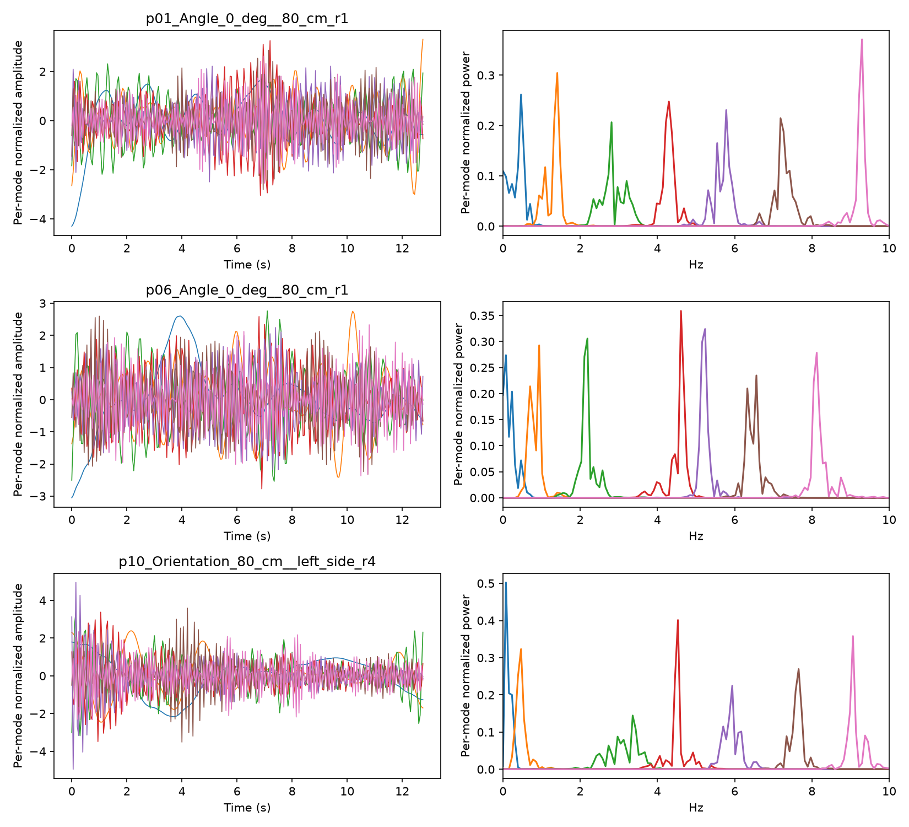
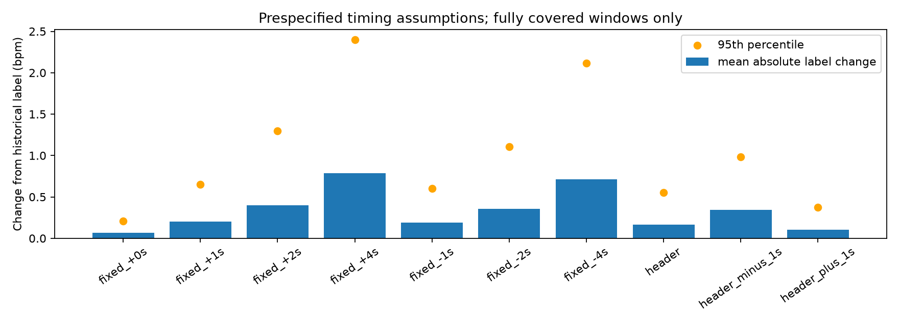

# FTU：官方 sktime VMD 对照与时间偏移敏感性（2026-10-16）

**本轮完成官方包对照和时间映射敏感性实验，没有启动神经网络训练。**
官方 VMD 能否消除七通道重复、它能否恢复 HR 可辨识性、设备时钟是否同步，是三个需要分别判断的问题。
本轮结果是：440 个窗口全部消除了七通道复制，但简单心率谱峰误差未优于旧退化输出，仍不能启动 P1。

## 实现与输入

按用户要求，临时使用 `sktime==1.2.0` 的原始 `sktime.libs.vmdpy.VMD`。
[vmdpy README](https://github.com/vrcarva/vmdpy/blob/master/README.md) 已明确指向 sktime 维护版。
没有引入自写 VMD 求解器，也没有修改项目依赖文件或替换历史 `proposed` 路径。
该路径仍含已发现的退化问题，本轮结果来自独立诊断入口。

固定参数：alpha=2000，tau=0，K=7，DC=False，init=1（均匀初始化），tol=1e-7。
官方实现内部迭代预算为 500。它与旧算法在初始化、解析谱、镜像边界、残差更新及停止规则上都存在区别，
因此这里是**标准 VMD 对照**，不能把差异全部归因于某一行修复，也不是原 HR-AdaVMD 的完整复现。
HR 频带评分另在官方原始模态逐通道标准化之后计算；原始幅度、权重与误差分别保存。

本地与 Kaggle 的 VMD 源码 SHA256 一致：`4933ec9e72f0f7be723fa9be729b0188057a827afc8a48299b5655a607467ee4`。
NumPy 版本分别为 2.5.4 / 2.1.3。

- 本地：3 条连续记录、24 个连续 EDACM 截段、6 个合成/边界控制，共 33 个信号；另有 K=1/K=3 的已知频率检验。
- Kaggle：440 条 FTU 记录各选 manifest 中第一个窗口，256 帧、20 Hz；选样不使用 HR 或模型误差。
  在每个原始 RDA 窗口内重新选择目标并提取 EDACM，再让旧算法与官方算法接收同一份相位。
  这覆盖每条记录，但并非重算全部 3,520 个窗口。
- [CPU notebook](https://www.kaggle.com/code/goldfish9901/ftu-sktime-vmd-baseline)，v2，私有，无训练。

## 数值结果

旧算法在 440 / 440 个重建窗口中七通道完全重复。
官方原始输出中，存在完全重复模态的窗口为 **0 / 440**。

| 官方模态数值秩 | 窗口数 |
|---|---:|
| 7 | 440 |

注意：数值秩或低相关性只能诊断重复/退化，不能证明每个通道是独立生理成分。
官方原始模态求和的重构相对误差，中位数 **0.2817**、最大值 **0.4076**。
tau=0 允许噪声残差，因此不以零重构误差为合格条件；误差仍需结合频谱检查。
**6 / 440** 个窗口返回了 499 行 omega，触及可观测的迭代预算边界。
接口不返回最终更新误差，因此该标记不等价于已证实不收敛，也不能被忽略为已收敛。



已知单频（1.2 Hz，K=1）及三频（0.25/1.2/2.1 Hz，K=3）检验找回对应谱峰。
零信号和常量经输入标准化后产生零模态，这是正常退化，应区别于非零雷达信号的七通道复制。
对单频/三频强行使用 K=7 的部分控制触及迭代上限；奇数长度也作为边界控制单独保留，不能把包调用成功当成所有输入均已通过验证。

### 历史导出一致性

初次 v1 在 `p01_Distance_160_cm_r3` 遇到旧特征最大差异约 0.00183，严格校验停止，日志保留为 `failed_v1.log`。
v2 没有提高阈值或剔除这些记录，而是记录差异并在同一重建相位上完成配对比较。

- 目标单元与历史元数据不一致：**0 / 440**。
- 旧特征在 1e-4 阈值下不一致：**32 / 440**；最大元素差 **0.0974416**。

数值不稳定是差异的可能来源，不能仅据此排除所有输入或环境差异。
本轮不宣称恢复了历史模型输入的逐元素精确复现，也不对旧 checkpoint 输入新特征进行无效比较。
RDA 文件哈希、选中单元、旧特征第一通道及重建通道均保留。

## 无训练频谱检验

在相同 440 个窗口上，统一线性去趋势、Hann 窗、256 点 FFT，在 0.75–2.5 Hz 内取最大功率峰。
不依据标签挑选模态或峰。原始官方模态功率求和与标准化/评分后的功率求和分别报告：

| 方法（含训练集常数对照） | MAE（bpm） |
|---|---:|
| EDACM | 24.675 |
| legacy_rebuilt | 16.782 |
| sktime_raw_power | 22.893 |
| sktime_scored_power | 24.064 |
| train_mean_constant | 9.337 |
| train_median_constant | 10.235 |

这些数值使用历史窗口均值标签，受尚未解决的同步问题影响；256 点 FFT 的频率分辨率为 4.6875 bpm。
每条记录只有第一个窗口，因此不能据此声称恢复了动态跟踪能力，也不能视作 NN 或 subject-level CV 成绩。
它用于检验“消除数值退化”与“获得更好的心率谱峰”是否同时出现。
训练均值和中位数均只由原 manifest 的训练窗口计算，并非当前 440 个标签的拟合值。
各 split 的首窗口结果另见 `spectral_summary_by_split.csv`；它们不是原完整测试集的模型分数。

官方原始模态功率峰 MAE 为 22.893 bpm，旧退化输出为 16.782 bpm，
训练均值常数为 9.337 bpm。
所以本轮证据支持“数值退化被官方基线消除”，不支持“心跳提取已经改进”。
旧退化输出的更低谱峰误差也不能反证其求解正确，可能包含输出频率分布的限制；这里没有进行额外归因实验。

## 时间映射敏感性

新增显式时间函数使用 `offset + arange(n)/fs`，要求调用者提供起始偏移，严格拒绝重复/逆序时间戳。
参考范围之外保留 NaN，不拉伸端点、不夹取边缘值。已通过解析线性插值、越界及无效时间输入检验。
它目前是独立诊断接口，不会静默改变旧导出。

预先固定 −4、−2、−1、0、+1、+2、+4 秒偏移，并检验原始秒级表头差值及 ±1 秒扰动。
表头 HR 开始减雷达开始的差值，转换成雷达在 HR 时间轴上的偏移时取负号。
没有根据 HR、相关性或预测误差选取“最好”的偏移。

覆盖原 3,520 个窗口，固定偏移覆盖 440 条记录；表头条件只覆盖有日志的 412 条记录。
下表只统计标签完整覆盖的窗口，**不同条件的保留窗口数不同**，完整逐窗口覆盖率和 80% 门槛结果另存 CSV：

| 时间假设 | 完整覆盖窗口 | 平均绝对标签变化 bpm | P95 bpm | 最大 bpm |
|---|---:|---:|---:|---:|
| fixed_+0s | 3520 | 0.069 | 0.210 | 0.972 |
| fixed_+1s | 3520 | 0.201 | 0.654 | 2.075 |
| fixed_+2s | 3339 | 0.399 | 1.297 | 4.181 |
| fixed_+4s | 3114 | 0.784 | 2.401 | 7.970 |
| fixed_-1s | 3080 | 0.187 | 0.605 | 2.525 |
| fixed_-2s | 3080 | 0.358 | 1.110 | 4.510 |
| fixed_-4s | 3080 | 0.711 | 2.117 | 8.250 |
| header | 3010 | 0.168 | 0.556 | 2.757 |
| header_minus_1s | 2885 | 0.343 | 0.985 | 4.193 |
| header_plus_1s | 3212 | 0.103 | 0.376 | 2.075 |



单独取消时间拉伸（offset=0）产生的标签变化较小，但秒级起始偏移对部分窗口影响明显。
这些是假设下的敏感性，不是测得的真实延时；仍没有共同硬件时钟或逐帧同步证据。

## 门槛与下一步

1. 官方 VMD 提供了可复现的数值对照，七通道重复的修复方向有了证据；仍需处理迭代上限、模态数与原始能量/标准化的影响。
2. FTU 时间轴检查仍为 **UNVERIFIED**，没有把秒级表头直接当成标定结果。
3. **P1 未启动**：遵守两项 P0 通过后才训练的条件。不能用当前结果宣称源模型已恢复组内相关性。

后续应先明确可验证的同步策略和可用记录范围，再在固定新版表示上进行 TCN/Transformer/CycleFormer 的同输入比较。
此前 [P0 审计](../ftu_p0_audit_2026-10-14/REPORT.md) 与历史证据继续保留。

## 运行与复现

本地官方对照 2.70 秒；本地时间敏感性 3.46 秒；
Kaggle 对照计算 172.24 秒（环境安装/启动另计）。
440 个相位/模态数组已独立复算重构误差、权重和重复计数；manifest 选样完整性已验证。

```powershell
uv run --locked --no-sync --with sktime==1.2.0 python -m src.data.experiment_ftu_sktime
uv run --locked --no-sync python experiment_ftu_timing_sensitivity.py
uv run --locked --no-sync python summarize_ftu_sktime.py
uv run --locked --no-sync python archive_ftu_sktime.py
```

`window_signals.npz` 保存 440 个原始相位及官方原始模态；`window_diagnostics.json` 保存频谱中心、权重和选择元数据。
`timing_sensitivity_windows.csv` 保存全部 34,528 条条件/窗口记录。
源码快照、包版本、源码哈希、运行日志与产物哈希均随报告归档。
