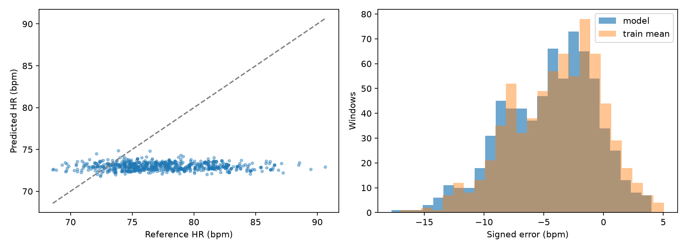
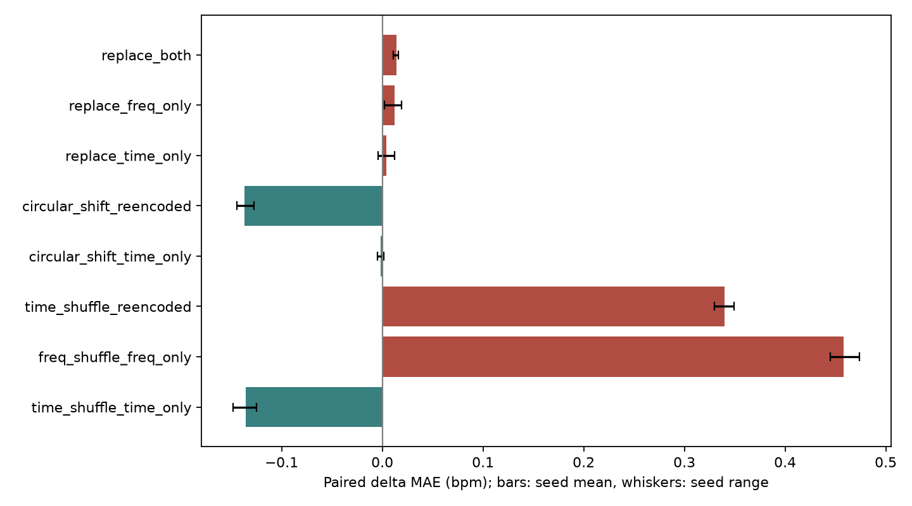

# FTU 源模型审计（2026-10-13）

已完成找回的 E2a CycleFormer 的预测审计和冻结模型特征破坏对照；没有训练。
它显示明显的预测收缩，未显示有效组内 HR 跟踪。此结论只适用于这份 checkpoint。

## 身份和未完成项

- 原始目标：历史 CycleFormer / v3 small / Transformer，FTU MAE 分别为
  4.989 / 3.425 / 4.034。尚未定位这三个 checkpoint，不能声称已复算。
- 已审计补充模型：[E2a notebook](https://www.kaggle.com/code/goldfish9901/nn-bench-e2a-hr-adavmd-proposed-ftu)。
  FTU-only，训练 2112 窗口、测试 704 窗口（p01/p08 各 352）。
- [冻结推理 notebook](https://www.kaggle.com/code/goldfish9901/ftu-source-signal-use-audit)，v1，私有 CPU。
- 公有/私有列表及 notebook 输出的查找清单在 `discovery/`。
  仅有 RDA 导出的 dataset 不是模型 checkpoint。检索错误明确记录，不能视作无产物。

## 预测审计

| 指标 | 结果 |
|---|---:|
| 模型 MAE | 4.805852 |
| 训练均值基线 MAE | 4.324527 |
| 相对均值基线改善（正值更好） | -0.481326 |
| 真实 HR 标准差 | 3.834062 |
| 预测 HR 标准差 | 0.430175 |
| R_var | 0.112198 |
| 整体 Pearson r | -0.015867 |
| 受试者去均值后 Pearson r | -0.009403 |

p01/p08 的组内 r 分别为 −0.0093 / −0.0102，R_var 为 0.169 / 0.090。
两组预测均值约 73 bpm。均值与中位数均只由训练集计算；训练中位数基线 MAE
为 5.979，模型虽优于它，却不如训练均值。不能只挑有利的常数基线。

- [p01 全部记录轨迹](e2a_cycleformer/trajectories_FTU_participant_1.png)
- [p08 全部记录轨迹](e2a_cycleformer/trajectories_FTU_participant_8.png)
- [每受试者统计](e2a_cycleformer/by_subject.csv)；[每记录统计](e2a_cycleformer/by_record.csv)

## 特征破坏

三种子 11/29/47；每次完整 704 窗口、同一 checkpoint、同一标签。
ΔMAE = 破坏条件 MAE − 配对参考 MAE。所有同步重算条件对照 reencoded。
种子范围不是总体置信区间，测试只有两个受试者。

| 条件 | 参考 | MAE | ΔMAE 均值 | 种子最小 / 最大 | 预测绝对变化 |
|---|---|---:|---:|---:|---:|
| original | original | 4.8059 | +0.0000 | +0.0000 / +0.0000 | 0.0000 |
| reencoded | original | 4.8059 | +0.0000 | +0.0000 / +0.0000 | 0.0000 |
| time_shuffle_time_only | original | 4.6700 | -0.1359 | -0.1484 / -0.1251 | 0.3111 |
| freq_shuffle_freq_only | original | 5.2640 | +0.4582 | +0.4449 / +0.4740 | 0.6081 |
| time_shuffle_reencoded | reencoded | 5.1456 | +0.3398 | +0.3296 / +0.3491 | 0.5574 |
| circular_shift_time_only | original | 4.8040 | -0.0018 | -0.0047 / +0.0015 | 0.1118 |
| circular_shift_reencoded | reencoded | 4.6691 | -0.1367 | -0.1446 / -0.1276 | 0.4034 |
| replace_time_only | original | 4.8098 | +0.0039 | -0.0040 / +0.0123 | 0.2863 |
| replace_freq_only | original | 4.8179 | +0.0121 | +0.0018 / +0.0191 | 0.4106 |
| replace_both | original | 4.8201 | +0.0142 | +0.0106 / +0.0160 | 0.4828 |

双分支替换成其他受试者后 ΔMAE 仅约 +0.014 bpm；单独打乱时间甚至改善 MAE。
频率 bin 置乱使 MAE 增加约 0.458 bpm，说明输出仍对频率布局敏感，但这不能证明
学到了真实心跳；原始预测本身没有组内相关，且破坏频谱可能只是引入 OOD 偏移。
循环平移是平移不变性检查，不能把其无影响当作不使用周期信息的证明。

## 校验、计时与下一步

- Kaggle CPU 冻结推理：117.19 秒。因本地缺窗口及 checkpoint，使用 Kaggle。
- 本地 uv 预测审计和绘图：8.08 秒；本地结果复核：0.43 秒。
- checkpoint SHA256：`3510a6a89efabeac9de787c8fd7096b036daca64ab991496bbdb19162e990f9e`。
- manifest SHA256：`c3e9e2f0e60d06d087476e63c3942293629c56ca2cfb3b97e72173dea8d86cc2`。
- 90 个分组统计行 / 21120 个逐窗口条件预测；逐窗口重算 MAE 最大差 0。
- 双分支替换预测与原模型对 donor 的原始预测最大差 7.63e-06 bpm。
- 原始 CPU 推理已逐窗口匹配历史 GPU 导出（绝对容差 0.001 bpm），严格载入权重；
  三次原始推理完全相同。检查 manifest 哈希、标签一致性及 train/test 组隔离。
- 暂不据此重训或启动 PhysDrive Source-Free。继续找回三个历史 checkpoint；
  连续记录的 RDA→EDACM→AdaVMD 图已完成，见下方补充诊断。
  下一步解释样本已按好/差/HR 变化最大写入 `e2a_cycleformer/summary.json`。

## Notebook 输出检索更新（2026-10-14）

当前账号 41 个相关 Notebook 的最新输出清单已完成分页核对；本次汇总未完成项 0。包括混合域 T0、FTU E2a、早期 PhysDrive pipeline/ablation、RDA pool、BGT60 和 mmwave 实验。这些最新输出中未发现 v3 small、FTU Transformer 或历史 4.989 的可验证 checkpoint。这不等于检查了所有旧版本输出、已删除 Notebook 或其他账号。
原始三模型比较仍缺权重和对应数据版本，不能用 E2a 数字覆盖历史结果。公有/私有 dataset 文件索引与每个 Notebook 的 checkpoint 命中路径保存在 discovery。

## 三条连续记录的信号诊断（2026-10-14）

Kaggle CPU 运行 36.36 秒；每条处理完整 1200 帧。使用 E2a 归档的 EDACM/HR-AdaVMD 代码，叠加同一 checkpoint 的原始逐窗口预测。12.8 秒窗、6.4 秒步长，无补零，分辨率 4.6875 bpm。

- best_mae: `p01_Angle_30_deg__80_cm_r2`；[阶段时频图](e2a_continuous/best_mae_stages.png)、[Range–Frequency 图](e2a_continuous/best_mae_range_frequency.png)。参考标签复算最大差 0 bpm。
- worst_mae: `p08_Distance_40_cm_r3`；[阶段时频图](e2a_continuous/worst_mae_stages.png)、[Range–Frequency 图](e2a_continuous/worst_mae_range_frequency.png)。参考标签复算最大差 0 bpm。
- largest_hr_variation: `p08_Orientation_80_cm__left_side_r3`；[阶段时频图](e2a_continuous/largest_hr_variation_stages.png)、[Range–Frequency 图](e2a_continuous/largest_hr_variation_range_frequency.png)。参考标签复算最大差 0 bpm。

| 样本类别 | 阶段 | 主频脊线 MAE | HR 频带功率占比 | 参考最近 bin 功率占比 |
|---|---|---:|---:|---:|
| best_mae | RDA unwrap (top selected bin) | 6.194 | 0.3210 | 0.0504 |
| best_mae | EDACM (same single bin) | 6.194 | 0.3250 | 0.0509 |
| best_mae | EDACM (selected-bin fusion) | 6.194 | 0.2933 | 0.0405 |
| best_mae | HR-AdaVMD (sum of channel powers) | 13.359 | 0.6737 | 0.0574 |
| worst_mae | RDA unwrap (top selected bin) | 7.262 | 0.0230 | 0.0062 |
| worst_mae | EDACM (same single bin) | 9.977 | 0.0326 | 0.0060 |
| worst_mae | EDACM (selected-bin fusion) | 12.906 | 0.0329 | 0.0060 |
| worst_mae | HR-AdaVMD (sum of channel powers) | 12.452 | 0.4152 | 0.0381 |
| largest_hr_variation | RDA unwrap (top selected bin) | 13.748 | 0.0446 | 0.0021 |
| largest_hr_variation | EDACM (same single bin) | 18.965 | 0.0431 | 0.0021 |
| largest_hr_variation | EDACM (selected-bin fusion) | 15.317 | 0.1564 | 0.0126 |
| largest_hr_variation | HR-AdaVMD (sum of channel powers) | 13.500 | 0.5555 | 0.0532 |

功率占比以非 DC 总功率为分母；AdaVMD 使用七通道功率之和，不与原相位比较幅度增益。whole-record 的目标选择和分解与模型逐窗口的预处理不同，因此这些图用于解释，不证明哪一阶段导致模型塌缩。绿色横线标出选择器选中的距离索引，Range–Frequency 固定最优单元的 Doppler/angle，展示的是裁剪后的 8 个距离索引。

时间映射沿用历史导出，并已逐窗口复现标签；它将参考起止时间线性映射到雷达帧，未独立验证雷达与参考时钟。下面列出其时间跨度，不能将标签复现当作同步正确的证明。

- `p01_Angle_30_deg__80_cm_r2`：参考映射跨度 59.0000 s；20 Hz 雷达首尾帧跨度 59.9500 s。
- `p08_Distance_40_cm_r3`：参考映射跨度 61.0000 s；20 Hz 雷达首尾帧跨度 59.9500 s。
- `p08_Orientation_80_cm__left_side_r3`：参考映射跨度 61.0000 s；20 Hz 雷达首尾帧跨度 59.9500 s。

这些样本按测试表现选出，只用于探索解释；不能由三条记录证明 FTU 原始雷达没有心跳信息。

### 这三条记录支持什么

- “预测最好”记录的参考 HR 本身接近 73 bpm 且变化很小，模型输出也接近 73。
  低误差可与近常数输出并存，不是心跳跟踪的充分证据。
- 该记录在原 RDA 相位/同单元 EDACM/融合 EDACM 的主频脊线 MAE 均约 6.194 bpm；
  AdaVMD 后为 13.359。融合 EDACM 的 HR 频带功率占比从 0.293 提高到 0.674，
  但脊线更偏离参考，说明频带强化不能单独作为表征改进指标。
- HR 变化最大的记录中，参考窗口 HR 从约 89 降到约 70 bpm，预测仍约 73。
  AdaVMD 的脊线 MAE 为 13.500 bpm，未展示稳定的参考 HR 跟随。
- 三条记录都复现了原始标签，但历史参考跨度为 59 / 61 / 61 秒，而 1200 帧、
  20 Hz 的首尾帧跨度为 59.95 秒。先审计同步和标签生成，不能靠拟合时延纠正测试误差。

下一轮优先验证真实时间轴、标签生成和可跟踪频谱；本轮未启动重训或跨域适配。
整记录 VMD 与原模型的逐窗口 VMD 不同，以上观察尚不能直接归因模型塌缩于 VMD。
