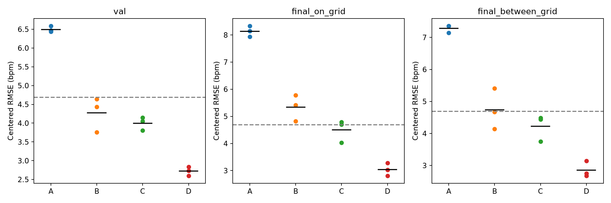
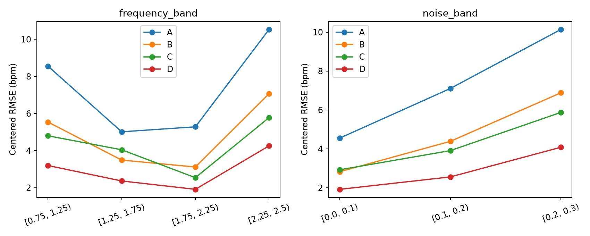

# 频谱范围 × 逐 bin 标准化：受控合成实验

2026-10-17。**在固定训练样本、MLP、损失和预算下，关闭逐 bin StandardScaler、屏蔽频带外输入均改善未见合成信号读出。验证集选出的 D 组表现最好。**这为预处理流程提供了具体证据，但没有单独证明“低方差噪声放大”是唯一机制，也没有证明真实 FTU 动态 HR 可学习。

## 冻结设计

| 组 | 输入频谱 | 逐 bin StandardScaler |
|---|---|---|
| A | 全 129 bin | 开 |
| B | 全 129 bin | 关 |
| C | 0.5–2.75 Hz，其余置零 | 开 |
| D | 0.5–2.75 Hz，其余置零 | 关 |

保留原逐窗口标准化。C/D 在可选逐 bin 缩放**之后**屏蔽频带，按频率 bin 中心保留 29 个 bin，仍输入 129 维。网络始终为 129→64→32→1、GELU、dropout 0.15；SmoothL1 beta 0.5、AdamW lr 0.0003/weight decay 0.0001、batch 64、梯度裁剪 1、60 epoch 上限、early-stop patience 12。调度器及 checkpoint 均依据验证去均值 RMSE，未换损失、加数据或增加预算。

模型种子 42/43/44，各组初始化参数哈希一致，配对批次顺序固定。逐 bin scaler 及标签均值/标准差仅拟合原 768 个训练信号。直接复用上轮保存的全部频谱数组，避免本地/Kaggle 重生成的浮点差异；原训练、验证及开发评估输入逐元素一致。A 的最佳 epoch 与上轮完全一致，去均值 RMSE 最大差异仅 4.42e-7 bpm。

原验证集 192 个信号保持不变。按三个种子的**平均验证去均值 RMSE**选择配置，平局按组名；选定后才生成/评估新的最终信号。旧评估集仅标记为 development，不参与选择。

新评估生成种子 20261018：网格内和网格间各 24 组×8 个独立信号，均使用全新相位与噪声。网格内为原训练频率，网格间为原训练网格的四分之一和四分之三位置。保存每个信号的频率、幅度、相位、相对/绝对噪声标准差及完整特征。两类评估并非同相位/同噪声逐样本配对，不能仅凭两类误差差值推断频率插值难度。

## 结果

以下均为三个优化种子的指标均值，非预测集成；种子不视为独立受试者，不做窗口级显著性检验。

| 组 | 验证去均值 RMSE | 新网格内去均值 RMSE | 新网格间去均值 RMSE |
|---|---:|---:|---:|
| A | 6.4950 | 8.1377 | 7.2867 |
| B | 4.2739 | 5.3416 | 4.7398 |
| C | 3.9997 | 4.5038 | 4.2266 |
| **D：验证选中** | **2.7224** | **3.0351** | **2.8561** |

### 普通与去均值指标

RMSE 单位 bpm；标准差比使用总体标准差。去均值按完整人工组计算，不提供真实组均值给模型。

| 评估 | 组 | RMSE | r | 标准差比 | 去均值 RMSE | 去均值 r | 去均值标准差比 |
|---|---|---:|---:|---:|---:|---:|---:|
| 网格内 | A | 9.0934 | 0.9592 | 0.8859 | 8.1377 | 0.9628 | 0.8938 |
| 网格内 | B | 5.9398 | 0.9834 | 0.9236 | 5.3416 | 0.9846 | 0.9280 |
| 网格内 | C | 4.9817 | 0.9875 | 0.9608 | 4.5038 | 0.9883 | 0.9627 |
| 网格内 | D | 3.3246 | 0.9946 | 0.9681 | 3.0351 | 0.9949 | 0.9693 |
| 网格间 | A | 7.7368 | 0.9678 | 0.9494 | 7.2867 | 0.9659 | 0.9470 |
| 网格间 | B | 4.9811 | 0.9867 | 0.9656 | 4.7398 | 0.9857 | 0.9653 |
| 网格间 | C | 4.4277 | 0.9893 | 0.9845 | 4.2266 | 0.9886 | 0.9839 |
| 网格间 | D | 3.0153 | 0.9952 | 0.9822 | 2.8561 | 0.9949 | 0.9820 |

D 三个种子在验证及两类新评估上均达到旧参考标准（去均值 RMSE≤4.6875、r≥0.9）。网格内 RMSE 范围 2.8039–3.2771、网格间 2.6740–3.1433。三个 D checkpoint 均选在 epoch 60；不据此宣称收敛，也未追加预算。

### 配对比较

新评估上的四个预设对比，在每个种子均同向改善。以下为“前组减后组”的去均值 RMSE 范围：

| 对比 | 网格内改善 | 网格间改善 |
|---|---:|---:|
| A−B：全谱关闭缩放 | 2.5502–3.1101 | 1.9523–3.0030 |
| A−C：开启缩放时屏蔽频带 | 3.3572–3.9117 | 2.8693–3.3915 |
| C−D：屏蔽后关闭缩放 | 1.2188–1.7650 | 1.0790–1.6877 |
| B−D：关闭缩放时屏蔽频带 | 2.0204–2.5048 | 1.4674–2.2617 |

可归因于本轮受控的预处理选择及其与固定训练流程的交互；这不是对模型容量或样本量的独立检验。

## 分层与无训练参照

分层前先按完整人工组去均值，再在子集统计；不会为每个分层子集重新计算组均值。`stratified_metrics.csv` 包含两类最终评估、各频段、每个精确频率和噪声档的样本数及全部指标。单一真实频率的普通 r/标准差比未定义时留空。

新网格间评估，三个噪声档 [0,0.1)、[0.1,0.2)、[0.2,0.3] 的去均值 RMSE：

| 组 | 低噪声 | 中噪声 | 高噪声 |
|---|---:|---:|---:|
| A | 4.5521 | 7.1040 | 10.1401 |
| B | 2.8244 | 4.3846 | 6.8813 |
| C | 2.9225 | 3.9083 | 5.8730 |
| D | 1.9166 | 2.5553 | 4.0808 |

D 相对 A 在四个预设频段的平均指标均改善，但最高频段 [2.25,2.5] 的剩余误差较大（D 4.2555、A 10.5338 bpm）。这些为描述性分层，噪声和频率没有通过分层再次随机配平。

无训练参照始终读取原始逐窗口标准化频谱，不读取 StandardScaler 改写的 bin 幅值：

| 新评估 | 方法 | 普通 RMSE | 去均值 RMSE |
|---|---|---:|---:|
| 网格内 | 最大 bin | 1.3681 | 1.2787 |
| 网格内 | 三点峰值插值 | 0.0881 | 0.0816 |
| 网格间 | 最大 bin | 1.2944 | 1.2077 |
| 网格间 | 三点峰值插值 | 0.0863 | 0.0829 |

即使 D 明显改善，仍弱于简单频谱读出。其成功仅验证当前合成条件下的学习读出能力，不证明对雷达生理信息的利用。

## 对噪声放大假设的证据边界

训练特征中，带外 bin 的标准差中位数为 0.5648，带内为 1.8702；对应缩放乘数中位数为 1.7706 和 0.5347。标准化后所有 bin 的训练方差为 1，100 个带外 bin 占输入总平方和的 77.52%，未做逐 bin 缩放时为 26.96%。这是输入数值平方和，**不是雷达噪声功率或生理 SNR**。

这些描述与带外分量获得较高相对权重一致；结合 A/B、A/C 的配对改善，支持预处理确实影响泛化读出。仍不能分离均值移除、幅值重加权、优化条件和正则化交互各自的贡献，也不能声称带外每个 bin 只含无关噪声。C→D 的进一步改善表明影响并不限于带外保留与否。

本轮只执行这一项合成 2×2 实验，没有重训真实 FTU、扩样本、改损失或取消 dropout。若后续回到真实记录实验，应另行冻结采用 D 的协议；当前新评估集已被报告，后续不再当作未见最终测试集调参。

## 产物与复核

- Kaggle [FTU Spectrum Factorial](https://www.kaggle.com/code/goldfish9901/ftu-spectrum-factorial)，version 1，Tesla T4，12 次模型训练总流程 39.716 秒。
- 本地预检查 0.220 秒，结果复核/绘图 1.823 秒，均使用 uv，无本地训练。
- 校验 24 个 Kaggle 原始文件哈希、60 组逐窗口指标、原始训练输入完全一致以及验证选择结果。CSV 复算与 float32 原值的最大指标误差 4.16e-7。
- 保存 12 个 checkpoint、逐 epoch 训练/验证指标、全部输入/生成参数、逐窗口预测、分层统计、配对对比、scaler、源码快照和哈希。
- `kaggle_artifact_manifest.json` 核验原始训练输出；`artifact_manifest.json` 覆盖整理后的产物（自身除外）。
