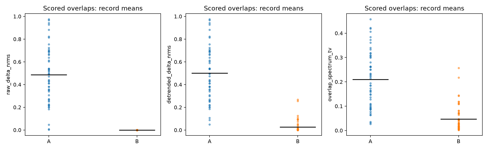
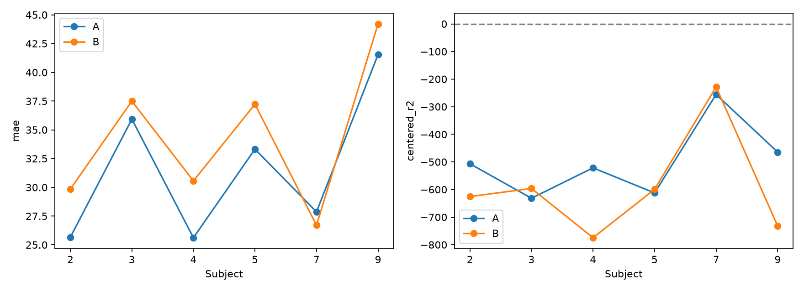

# 54 条连续 FTU 记录：逐窗选目标与固定目标审计

2026-10-18。**B 固定目标显著改善重叠片段一致性，但没有恢复正确 HR 对应关系。**融合信号固定峰值读出的 MAE 从 A 的 **31.6564** 变为 B 的 **34.3397 bpm**；六名受试者中只有 p07 的 MAE 改善。按预设决策，当前没有依据采用 B 重导出并重训，应继续检查相位提取、融合及参考时间轴。

这不是“固定目标必然更好”的实验，也不能将峰值读出失败等同于信号中绝对没有心跳信息。

## 冻结选样和公平比较

协议及选样在结果前提交为 `4ba546d`。只使用原六名训练受试者 p02/p03/p04/p05/p07/p09。每个受试者×规范条件，从原去重划分的训练采集中选 `SHA256(ftu-target-audit-20261018|capture_key)` 最小者，共 **54 条连续记录**，每人9条。选样不使用标签、变化幅度、模型误差或谱图。

- **A**：每个256帧窗口按现有规则从候选中选择3个目标和权重。
- **B**：仅用记录最初256帧（12.8秒）按同一规则选择目标与权重，以后固定；每窗依然独立运行原 EDACM、线性去趋势、z-score及频谱处理。
- 两组都保留原窗口起点、256帧长度和128帧步长；只评分起点≥256、参考有效覆盖≥80%的窗口。实际每记录6个评分窗口，**每组324窗**；相邻且两端均可评分的重叠对为**每组270对**。前两个窗口只用于展示/审计，不进入这些主指标。
- 时间仍为 `frame_index/20 + 0秒`，对原导出 reference time/HR 做插值，不外推。这是未验证同步假设；本轮**没有偏移搜索**。
- 目标选择沿用内部0.75–2.5Hz评分，不用参考HR。读出预先固定为0.5–2.75Hz内最大谱峰，不插值、不按标签选峰或挑最佳单目标。

A 在全部54×8=432个原窗口上的时域/频域特征与标签均通过旧导出的数值复现检查。A/B使用相同评分窗口和标签，冻结协议与选样未变。这里是原训练受试者中的连续信号诊断，不是新的独立泛化测试。

## 1. 目标和权重：逐窗变化确实存在

A 的270个评分重叠对中，目标集合完全相同81对（30%），保留2点146对、保留1点41对、全部换点2对。即 **70% 的相邻窗口至少更换一个目标**，平均每对替换目标比例28.89%。

权重变化按完整 D/A/R 身份在并集中对齐后计算，未将 rank 重排序误作换点。A 的权重L1变化平均 **0.58149**；B为0。导出RDA的索引不直接解释为校准后的实际距离或角度，也不代表本轮重新进行了ADC定位。

## 2. 重叠一致性：稳定性改善不是心率恢复

排除后窗首个被人为置零的EDACM增量，比较同一段127个有效对齐样本。相位片段先去均值，避免把任意相位起点当作不连续；没有用HR对齐。

| 评分重叠对指标（平均） | A | B |
|---|---:|---:|
| 原始融合相位增量 nRMSE | 0.48650 | 0 |
| 窗口去趋势后增量 nRMSE | 0.49991 | 0.02746 |
| 增量各自去均值后的 nRMSE | 0.48769 | 3.46e-7 |
| 相位片段去均值后的 nRMSE | 0.60683 | 0.25137 |
| 同一片段归一化功率谱 TV 距离 | 0.20960 | 0.04683 |

nRMSE 用两信号均方能量平均的平方根归一化；功率谱距离是在相同127点片段上去均值、加Hann窗后计算的总变差距离。

**B 的原始增量完全一致是固定目标/权重及同一复数样本的代数预期，并非独立的生理有效性证据。**本地逐记录确认了重叠复数样本及对应原始融合增量逐元素相同。

B 去趋势后仍有差异；对其增量再去均值后差异降至约浮点精度，与不同窗口线性去趋势斜率导致的差异一致。去除任意相位原点并不会自动去掉这个斜率效应。六名受试者的重叠谱距离均改善，但不能据此说恢复了心率。

## 3. 与正确标签的对应关系没有改善

| 融合读出指标 | A | B |
|---|---:|---:|
| MAE（bpm） | 31.6564 | 34.3397 |
| 合并窗口去均值 RMSE（bpm） | 25.6793 | 27.9742 |
| 合并窗口去均值 R² | −474.7216 | −563.5464 |
| 合并窗口去均值 r | −0.02591 | −0.00974 |
| 合并窗口去均值标准差比 | 21.7622 | 23.7294 |
| 受试者等权去均值 RMSE | 25.5016 | 27.6064 |
| 受试者等权去均值 R² | −498.7088 | −592.6851 |
| 受试者等权去均值 r | −0.01388 | 0.01973 |
| 参考HR附近±1bin功率占频带功率 | 0.08830 | 0.08561 |

去除初始选择区间后，参考HR的合并记录内变化尺度仅 **1.1774 bpm**，而峰值轨迹跳变很大，因此负R²绝对值很大。这不是计算错误或模型MAE，应结合约25–28bpm的动态误差理解。参考附近功率仅作事后评分，不用于选目标或选峰。

| 受试者 | A MAE | B MAE | A去均值r | B去均值r |
|---|---:|---:|---:|---:|
| p02 | 25.6611 | 29.8430 | −0.2372 | −0.2493 |
| p03 | 35.9256 | 37.4977 | 0.0744 | 0.1681 |
| p04 | 25.6158 | 30.5586 | −0.2105 | −0.0394 |
| p05 | 33.3199 | 37.2270 | 0.0766 | 0.0049 |
| p07 | 27.8682 | 26.7004 | 0.1330 | 0.3094 |
| p09 | 41.5476 | 44.2114 | 0.0804 | −0.0752 |

B仅16/54条记录的MAE改善。少数相关性上升不构成跨六人的一致对应关系改善，也不能把事后表现较好记录重新选为主要样本。

## 4. 单目标与融合：没有普遍抵消的证据

保留所有三个原排名单目标，不按标签选择“最佳单目标”。同一固定峰值规则下：

| 信号 | A MAE | B MAE |
|---|---:|---:|
| rank0单目标 | 34.4826 | 36.2506 |
| rank1单目标 | 33.5837 | 36.7232 |
| rank2单目标 | 31.9749 | 34.4140 |
| 加权融合 | 31.6564 | 34.3397 |

在0.5–2.75Hz内，对标准化前去趋势相位计算 `功率(Σw·FFT(phase)) / Σ功率(w·FFT(phase))`。该比值平均为 **A 2.1919、B 2.1158**，中位数2.3059/2.1824；小于1的窗口两组均为 **10/324（3.09%）**。

这不支持“整个心率频带内普遍融合抵消”是主要失败机制；但频带积分会隐藏局部频率抵消，也不能排除共同非心跳成分被增强或弱心跳被掩盖。比值不是SNR或心跳纯度，功率大于单目标和也不是生理结构更有效。

`figures/`保存全部54条记录的A/B谱图、D/A/R身份轨迹及权重。另按每人最小选样哈希固定选择一条，生成6幅单目标/融合详细图，使用共同的标准化前相位功率色标；不按效果选图。原54幅窗口标准化频谱图的颜色自动缩放，不应用于跨面板比较绝对幅度。

## 5. 原始增量的事后异常定位

以下是下载后对保存的全部信号作的**事后数值检查**，不改变54条选样或A/B算法。所有评分目标样本中 `amplitude²≤1e-6` 的比例为0，没有发现当前EDACM分母被eps主导。

但最大EDACM增量估计达到 **59.4747**：`p05_Distance_40_cm_r1`，窗口起点768、rank0、窗口内第177帧。该点前一帧/当前帧幅度比约 **63.4894**，相邻共轭乘积相角约 **1.21327 rad**；当前幅度490.09、上一帧31115.32（导出任意单位）。这不是相位起点差，也不应将59.47直接解释为真实物理相位跳变。

现有公式近似满足 `delta = (amplitude_prev/amplitude_current) * sin(conjugate_angle) / (1+eps/amplitude_current²)`，说明快速幅度下降可放大增量估计。该事件在A/B中都保留，固定目标并未解决。它提供了下一轮相位提取审计的具体入口，但尚未证明这种放大是整体HR失败的主因；本轮未替换EDACM或用参考HR修剪异常。

## 决策与限制

本轮落在预设第二类：**固定目标改善处理一致性，却没有改善正确标签动态对应。**不据此修订生产目标选择流程，不重导出、不重训网络。下一步继续审计相位提取中的幅度变化敏感性、融合中的频率结构和参考时间轴。

本轮仅审计已导出的复数RDA，未重读ADC；连续复数证据包含A/B曾选中过的全部目标单元，并不是保存整个RDA立方体的副本。原RDA源文件哈希与Kaggle数据源均已记录。没有测得新同步结果；原p03日志不完整及同次到访范围限制仍存在。不能据最大峰不跟随HR宣称所有频率结构都不存在。

## 产物和验证

- [Kaggle CPU审计](https://www.kaggle.com/code/goldfish9901/ftu-target-selection-audit)，version1，实测 **90.826秒**，无GPU训练。
- 本地uv选样/代数检查和下载后复核均远低于5分钟；完整计时见`selection_validation.json`、`local_preflight.json`、`local_validation.json`。
- 校验172个原始产物哈希、冻结协议和选样、324共同评分窗口/270共同重叠对、固定目标权重、初始A/B相同、原始重叠复数/增量一致、参考时间映射和融合重算。
- 每记录NPZ保存：连续选中目标复数/幅度/增量、逐窗目标及权重、复数/幅度/原始增量/累积相位/去趋势相位、融合前后z-score信号、频谱、参考时间和HR、评分标记。目标选择的全部评分元数据单独保存JSON。
- `metrics.csv`/`record_metrics.csv`覆盖融合及三单目标；`overlap.csv`、`target_tracks.csv`、`fusion.csv`、`raw_signal_quality.csv`与`posthoc_max_increment_audit.csv`记录对应证据。
- `kaggle_artifact_manifest.json`验证原始产物；`artifact_manifest.json`覆盖最终归档（自身除外）。
