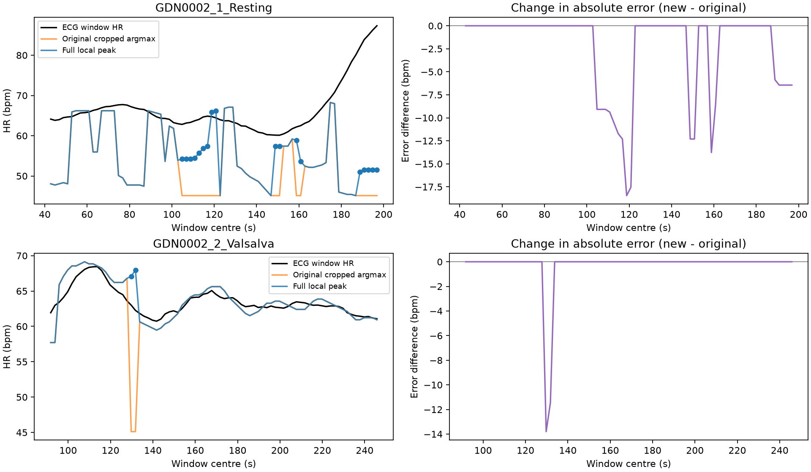

# 完整谱局部峰候选集合的单因素对照

2026-11-07。协议及执行代码在 `420bbe5` 冻结，Windows换行兼容校验修正在 `2366d0e` 提交后执行。首次尝试在文件冻结校验处停止，未读取频谱或产生评分；修正没有改变实验规则。使用此前两条通过校准的GDN0002开发记录，共156个原窗口。

**排除裁剪生成的端点候选，在两条记录上均降低MAE。20个原截断下降沿窗口全部改善，136个原冠军已是完整谱局部峰的窗口完全不变。静息段的相邻窗变化误差略有增加，尚无一致的动态改善证据。**

## 冻结规则及评价定义

唯一变化是先在完整归档功率谱上用 `scipy.signal.find_peaks` 检测内部局部最大值，再保留45–150 bpm内的峰，选择功率最大者。同功率按较小bin优先，平台使用SciPy默认中点。显著度、幅度和功率比全部保存为诊断量，没有参与筛选。候选为空时输出NaN并计入无输出，不使用ECG补选。规则见 [protocol.json](protocol.json)。

原相位、20Hz采样、25.6秒窗口、2秒步长、线性去趋势、周期Hann、4096点FFT和ECG窗参考保持不变。直接复用上一轮保存的完整谱，原45–150 bpm argmax逐窗复现。先在雷达谱上确定候选和新预测，随后合并既有0秒偏移主导联参考。没有重新校准、处理ECG、改同步或读取新受试者信号。

MAE以有限输出窗计算并报告分母。本轮两组均覆盖156/156窗，因此没有覆盖差异。相邻窗变化RMSE定义为预测相邻差与参考相邻差之差的RMSE，每条记录用原时间顺序77对。分层结果仅保留同层内原本连续的2秒邻窗，不跨间隙连接。改善和恶化按绝对误差差值判断，1e-10 bpm以内记相等。全部原预测和误差保留在 [windows.csv](windows.csv)。

## 全部78窗结果

| 指标 | 静息 原→新 | Valsalva恢复 原→新 |
| --- | ---: | ---: |
| MAE，bpm | 13.904711 → 11.523888 | 1.367208 → 1.043520 |
| 相邻窗变化RMSE，bpm，每条77对 | 6.647425 → 6.863720 | 3.170039 → 1.277022 |
| 绝对误差>5 bpm窗数 | 55 → 50 | 3 → 2 |
| 改善／恶化／相等 | 18／0／60 | 2／0／76 |
| 无输出 | 0 | 0 |

静息MAE下降2.380823 bpm，恢复下降0.323689 bpm。静息变化RMSE增加0.216295 bpm，恢复下降1.893017 bpm。删除人工端点候选产生了开发集绝对误差净收益，但静息段仍有50/78窗误差超过5 bpm。相邻窗变化误差的结果不能支持普遍恢复动态跟踪。

## 预先指定的20个截断下降沿窗口

| 指标 | 静息18窗 原→新 | 恢复2窗 原→新 |
| --- | ---: | ---: |
| MAE，bpm | 24.054338 → 13.737438 | 17.517986 → 4.894124 |
| 绝对误差>5 bpm窗数 | 18 → 13 | 2 → 1 |
| 改善／恶化／无输出 | 18／0／0 | 2／0／0 |

20窗均从45.1171875 bpm的截断下降沿端点转为完整谱内的局部峰。总计减少6个>5 bpm错误窗，仍有14/20窗误差超过5 bpm。其余136窗的预测、绝对误差和分层评分逐窗不变，其中静息60窗、恢复76窗。全部分层及相邻窗对数见 [summary.csv](summary.csv)，20窗明细见 [cut_flank_windows.csv](cut_flank_windows.csv)。

## 两个登记错误窗与邻窗

| 窗起点秒 | 原预测 | 新预测 | ECG参考 | 原绝对误差 | 新绝对误差 |
| --- | ---: | ---: | ---: | ---: | ---: |
| 114.965 | 66.796875 | 66.796875 | 63.616717 | 3.180158 | 3.180158 |
| 116.965 | 45.117188 | 67.089844 | 63.004436 | 17.887248 | 4.085408 |
| 118.965 | 45.117188 | 67.968750 | 62.265910 | 17.148723 | 5.702840 |
| 120.965 | 60.644531 | 60.644531 | 61.832371 | 1.187840 | 1.187840 |

两个低值窗按固定规则选中了旧裁剪峰目录中的第二名。此前ECG附近的第三名63.28125和61.81640625 bpm没有被选取。此对照只排除人工端点候选，没有提供自动选择第三名峰的依据。尤其118.965秒窗仍为>5 bpm错误。登记对象见 [registered_focus.csv](registered_focus.csv)。

横轴为原窗口中心时间。蓝点仅标识20个原截断下降沿窗口，全部78窗均保留。图已目视核验。

## 固定72 bpm合成检查与独立复核

复用已归档全部有心跳合成输入，30个条件、真实及恢复相位两来源、3窗，共180窗。新旧读数全部精确相同，均为72.0703125 bpm，保持原72 bpm正对照通过。没有生成新输入或重拟合。该项只检验读峰改动的回归行为，沿用合成实验已经结束的范围，完整输出见 [synthetic72.csv](synthetic72.csv)。

本地uv管理环境主计算0.391秒，首次独立核验及绘图0.773秒，增加产物清单后复核0.739秒。核验时shell未找到uv命令，改用同一uv管理的 `.venv/Scripts/python.exe`。独立路径从上一轮已冻结雷达目录按功率排序复核156个新读数，再从误差差分直接重算全部汇总，最大指标差3.55×10⁻¹⁵。对180个合成窗从归档相位以SciPy periodogram重新构建谱并用严格邻点极大值读峰，最大相对功率差9.42×10⁻¹⁶。111个输入和规则文件哈希核对通过，旧归档保持原样。见 [execution.json](execution.json)、[verification.json](verification.json) 和 [source_hashes.json](source_hashes.json)。

## 决策与边界

本轮支持在这两条开发记录上排除由频带裁剪引入的端点候选，其收益集中在20个下降沿窗口。它没有解决静息段大量真实局部峰读错的问题，也没有证明这些局部峰的生理来源或多峰跟踪的有效性。

两条记录来自同一受试者，窗口高度重叠，结果仅为描述性配对开发证据。4096点补零网格为0.29296875 bpm，原生频率间隔仍为2.34375 bpm。既有ECG自动参考、技术审查及剩余同步误差边界保持原限制。其他27名受试者继续保留，本轮不进行训练、校准修改或后续多峰规则搜索。
