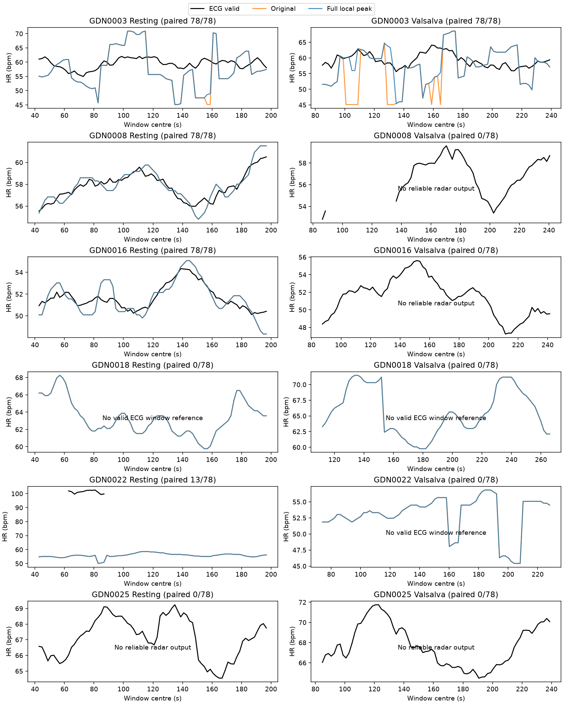

# 六名未见受试者的固定读峰器配对验证

协议于2026-11-07冻结，2026-11-08完成归档。抽样及信号处理在 `b7eaec2` 提交，打包修正在 `50ac850` 和 `577bca9` 提交，结果读取前的本地评分程序在 `ad3a909` 提交。

**端点排除在一名新的受试者上复现了误差改善，但本轮不足以确立跨受试者通用基线。** 12条记录中8条通过校准，最终共同有效覆盖325/936窗，涉及4人；只有GDN0003具有两种场景的完整配对覆盖。改动影响的12窗全部来自该人，其余可评分受试者预测不变。已观察到的共同有效窗口没有MAE或变化RMSE退化，收益跨人的一致性仍缺少证据。

## 结果前固定的抽样与流程

从GDN0001–0030中排除开发受试者0002、0006、0007，对剩余按ID排序的27人使用Python `random.Random(20261107).sample(pool,6)` 一次抽样。结果为 **GDN0003、0008、0016、0018、0022、0025**。其他21人名单保存在 [protocol.json](protocol.json)，未读取其信号。没有按标签、谱图或评分筛选，没有失败替换。

每人固定静息和首个Valsalva恢复段，静息为发布记录起点后[30,210)秒；恢复为第二个干预脉冲中点后[30,210)秒，要求恰有6个脉冲并在第三脉冲前结束。12条记录全部取得指定区间，每条78窗，合计936窗。发布数据的Gold-code同步依据、0秒主分析及±0.5秒敏感性保持，剩余时钟误差仍无逐记录量化界。

前端沿用修复后且未改动的 `synchronized_ellipse_fixed.py`，初始30秒椭圆校准、径向RMSE≤0.2、退化及映射支持检查、P2增量和20Hz重采样均固定。25.6秒窗口、2秒步长、线性去趋势、周期Hann、4096点FFT和45–150 bpm不变。两读峰器的唯一差别仍为候选集合。新读峰器先在完整谱找局部峰，再在带内选择功率最大者，没有显著度门控或ECG选峰，没有多峰跟踪。

## ECG选择及有效性规则

主导联在结果前按官方 `plotData.m` 固定，GDN0022为导联1，其余五人为导联2。NeuroKit2固定0.2.12，沿用250Hz清洗和自动R峰、不修正伪迹、不编辑搏动；RR需在0.3–2秒、窗口有完整支持，按60/RR的时间积分生成窗参考。

导联覆盖率在读取雷达前计算，要求该窗在0、−0.5、+0.5秒三个固定偏移均有有限参考。仅当主导联覆盖<80%且备用导联覆盖≥80%时，整条记录切换，不逐窗切换。本轮没有触发切换。若任一偏移下两导联均有效但相差>5 bpm，该窗在全部偏移上标为参考无效；备用导联缺失本身不否定有效主导联，但单独计数。该规则是事先固定的操作性质量控制，不能保证临床准确性。本轮没有新增人工ECG裁定。

## 全部12条记录的覆盖

| 记录 | 校准 | 参考有效窗/78 | 原输出/78 | 新输出/78 | 共同评分窗/78 |
| --- | --- | ---: | ---: | ---: | ---: |
| GDN0003 静息 | 通过 | 78 | 78 | 78 | 78 |
| GDN0003 恢复 | 通过 | 78 | 78 | 78 | 78 |
| GDN0008 静息 | 通过 | 78 | 78 | 78 | 78 |
| GDN0008 恢复 | 失败 | 55 | 0 | 0 | 0 |
| GDN0016 静息 | 通过 | 78 | 78 | 78 | 78 |
| GDN0016 恢复 | 失败 | 78 | 0 | 0 | 0 |
| GDN0018 静息 | 通过 | 0 | 78 | 78 | 0 |
| GDN0018 恢复 | 通过 | 0 | 78 | 78 | 0 |
| GDN0022 静息 | 通过 | 13 | 78 | 78 | 13 |
| GDN0022 恢复 | 通过 | 0 | 78 | 78 | 0 |
| GDN0025 静息 | 失败 | 78 | 0 | 0 | 0 |
| GDN0025 恢复 | 失败 | 78 | 0 | 0 | 0 |
| 合计 | **8/12** | **614/936** | **624/936** | **624/936** | **325/936** |

校准通过率66.7%。参考至少一窗有效的记录为9/12，即75.0%；参考有效覆盖≥80%的记录为7/12，即58.3%；参考有效窗率65.6%。两个读峰器的雷达输出覆盖率均为66.7%，最终可评分覆盖率均为34.7%。这两个覆盖量分别描述雷达输出与参考约束后的评价机会。所有通过校准的窗口都满足原低幅度规则且有可选峰，没有新增的无峰缺失输出。

4条校准失败的原因均为候选椭圆径向残差超过原0.2限制，失败时仍完成ECG处理。GDN0018两条和GDN0022恢复段全部窗口因双导联参考不一致而不能评分；这表示本次自动参考未满足有效性约定，不证明原始ECG不可用。没有放宽门控或换记录。

## 逐记录配对评分

主分析为0秒偏移。两读峰器在完全相同的有效窗口上评分，MAE与相邻窗变化RMSE单位均为bpm；变化误差比较预测与参考的相邻差分，只保留原本间隔2秒的窗口对，不跨缺口。无共同窗口时指标保留缺失，不填零。

| 记录 | MAE 原→新 | 变化RMSE 原→新 | >5 bpm比例 原→新 | 改善/恶化/相等 |
| --- | ---: | ---: | ---: | ---: |
| GDN0003 静息 | 5.9279→5.8340 | 5.0107→4.7668 | 53.85%→53.85% | 2/0/76 |
| GDN0003 恢复 | 5.8420→4.3769 | 5.8937→4.0884 | 55.13%→47.44% | 10/0/68 |
| GDN0008 静息 | 0.5278→0.5278 | 0.4134→0.4134 | 0%→0% | 0/0/78 |
| GDN0008 恢复 | — | — | — | 无共同窗口 |
| GDN0016 静息 | 0.6813→0.6813 | 0.4941→0.4941 | 0%→0% | 0/0/78 |
| GDN0016 恢复 | — | — | — | 无共同窗口 |
| GDN0018 静息 | — | — | — | 无共同窗口 |
| GDN0018 恢复 | — | — | — | 无共同窗口 |
| GDN0022 静息 | 46.8332→46.8332 | 1.5913→1.5913 | 100%→100% | 0/0/13 |
| GDN0022 恢复 | — | — | — | 无共同窗口 |
| GDN0025 静息 | — | — | — | 无共同窗口 |
| GDN0025 恢复 | — | — | — | 无共同窗口 |

前四条完整可评分记录各有77对相邻窗口，GDN0022静息的13窗构成12对。精确数值和全部偏移见 [record_summary.csv](record_summary.csv)。325个共同窗口中12窗改善、0窗恶化、313窗相等；>5 bpm窗口由98减少到92，这只是描述性窗计数，不能视为325次独立试验。

原冠军不是完整谱局部峰的共同窗口共12个，均来自GDN0003，全部触发固定改动。其余313个完整谱局部峰冠军的预测不变。新读峰器仍有86个>5 bpm窗口的冠军是未变化的真实局部峰，其中73个属于GDN0003，13个属于GDN0022的有限参考窗口。错误也可能来自相位、参考或同步问题，不能把这些数目直接解释为心跳峰已经存在却被选错。

**GDN0022的13个评分窗尤其需要谨慎。** 它们的备用导联全部缺失有效参考，只因主导联满足预定RR/支持规则而保留；其余65窗双导联不一致。主导联HR约99–103 bpm、雷达约50–58 bpm。未经独立ECG审查，这个大差距不能单独归因雷达。GDN0003静息另有15个保留窗缺少备用导联有效参考，全部标记在输出中，没有事后剔除。

## 按受试者汇总

先对各人的可评分记录等权平均，再对有评分者等权平均。记录数与覆盖一起保留，部分场景不能代表该人两种场景。

| 受试者 | 可评分记录/2 | 共同窗/156 | MAE 原→新 | 变化RMSE 原→新 |
| --- | ---: | ---: | ---: | ---: |
| GDN0003 | 2 | 156 | 5.8849→5.1054 | 5.4522→4.4276 |
| GDN0008 | 1 | 78 | 0.5278→0.5278 | 0.4134→0.4134 |
| GDN0016 | 1 | 78 | 0.6813→0.6813 | 0.4941→0.4941 |
| GDN0018 | 0 | 0 | — | — |
| GDN0022 | 1 | 13 | 46.8332→46.8332 | 1.5913→1.5913 |
| GDN0025 | 0 | 0 | — | — |

4名有评分者的等权MAE为13.4818→13.2869 bpm，变化RMSE为1.9877→1.7316 bpm。这项汇总受仅13窗且未有双导联佐证的GDN0022显著影响，不是6人的完整总体性能。双场景均有评分者只有GDN0003，不能形成多人完整场景验证。完整汇总见 [subject_summary.csv](subject_summary.csv) 和 [equal_subject_summary.csv](equal_subject_summary.csv)。

没有观察到共同评分上的动态误差系统退化。但另外三名有评分者均未触发候选集合改动，所以他们的不变结果不能证明端点修正的收益已在多人中重复。

0、−0.5、+0.5秒偏移始终使用同一325窗，全部敏感性结果保留。4人等权ΔMAE分别为−0.1949、−0.1927、−0.1955 bpm，Δ变化RMSE分别为−0.2562、−0.2505、−0.2557 bpm，没有按评分选择偏移。这也不构成剩余同步误差已测得的证据。

每图标题标注共同有效覆盖；失败、参考无效和无输出记录都保留。图已目视核验，空参考曲线表示未满足冻结参考规则。

## 运行、复核与可追溯产物

Kaggle CPU正式计算65.024秒。首次提交在下载信号前因打包转换换行导致协议哈希不匹配而停止，保留 [失败日志](attempt1_preflight_failure.json)，只修复打包；随后按Kaggle实际分配的slug纠正提交标识。正式结果为同一冻结实验的 [Kaggle版本2](https://www.kaggle.com/code/goldfish9901/frozen-peak-subject-validation)。抽样、ECG规则、校准和两读峰器均未随结果修改。

本地uv管理环境独立核验及绘图首次7.085秒，增加覆盖图标识后复核7.316秒。从保存的两导联R峰重新积分全部窗参考，最大差1.28×10⁻¹³ bpm，独立重算了主导联选择和参考有效掩码。从归档相位用periodogram重建624个雷达谱，并用邻点极大值独立读峰，最大相对谱差5.99×10⁻¹⁵，两个读峰器的所有可读输出一致。窗口低幅度掩码、冻结源文件和配置均核对通过，见 [verification.json](verification.json)。

12个原始MAT成员通过官方ZIP CRC检查，保存SHA256和下载来源于 [acquisition.json](acquisition.json)。完整原始ECG评分波形保留在Kaggle版本2产物中；下载曾中断，本地核验使用完整取得的相位、频谱、R峰及CSV，未依赖不完整ECG文件，也没有新增人工ECG质量裁定。归档映射见 [provenance.json](provenance.json)。GitHub保存原始及标记后的逐窗结果、12条失败/覆盖元数据、8条通过校准记录的完整谱与相位、12条双导联R峰、协议、代码快照及产物哈希。

## 本轮出口

端点修正作为简单机制改动，在新的GDN0003上有绝对误差和变化误差收益。但本轮不足以认定收益已在多名未见受试者中稳定保持，暂不把它确立为经跨人验证的通用后续基线。裁剪端点支线到此收尾，不继续在这些记录上增加多峰规则。

当前更直接的瓶颈包括固定椭圆校准的4条失败、自动ECG参考导致的评价覆盖不足，以及有效记录中仍存在的大量真实局部峰读数偏差。进一步归因需独立审查参考与校准适用性，不能由本次评分确定唯一机制。本轮不启动这些后续实验，不训练；剩余21名受试者继续保留。
