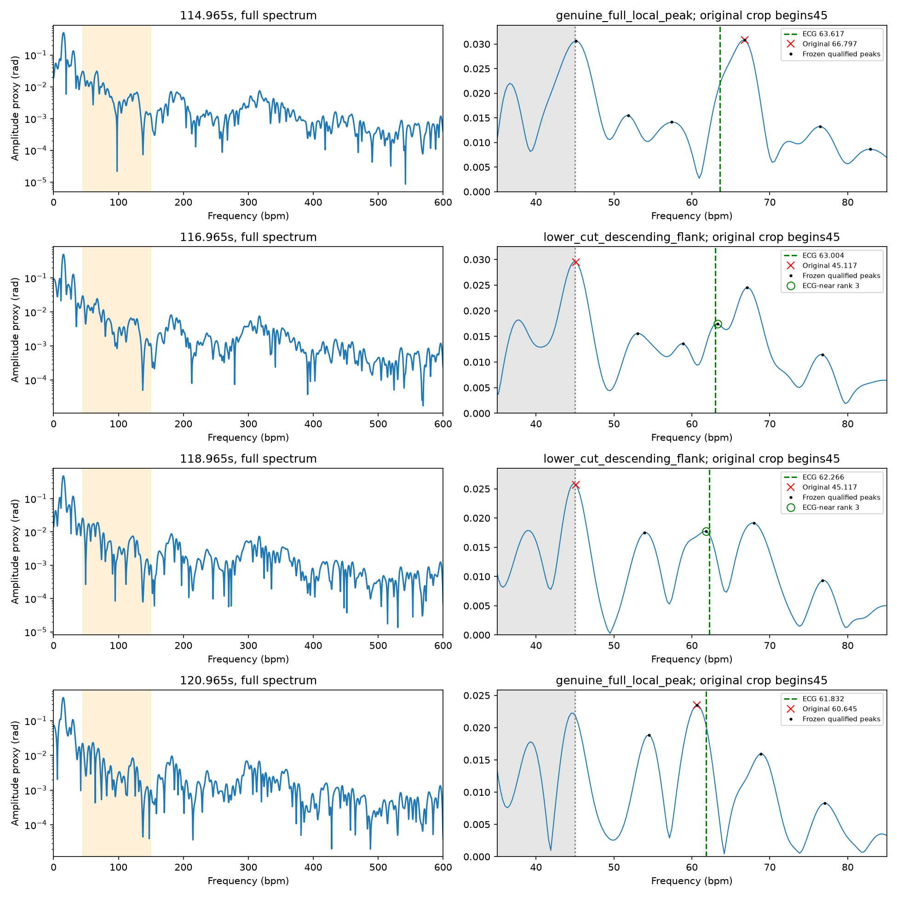
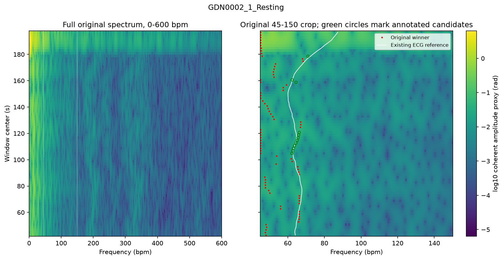
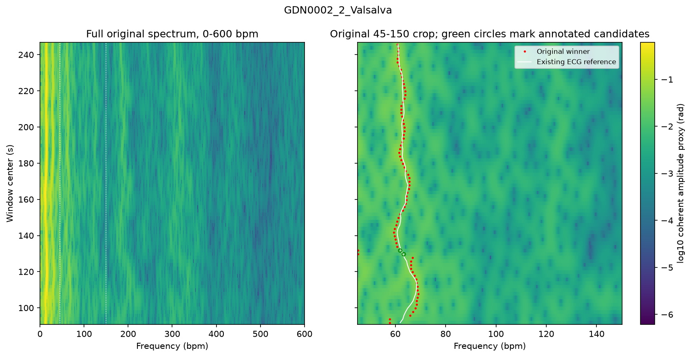

# 两条真实记录的固定窗口频带截断审计

2026-11-06。协议和代码在 `e841d86` 冻结，全部雷达峰目录和频谱在 `132d503` 提交后才读取既有ECG窗参考。

**两个已登记的低值错误窗都存在ECG附近的可辨认候选局部峰，但原冠军是带外峰下降沿裁剪后的端点最大值。** 两个候选分别位于63.2813和61.8164 bpm，距参考0.2768和0.4495 bpm，在冻结的裁剪峰目录中都排第三。静息段另有12个边界错误窗符合预定候选证据，其中11个冠军属于截断下降沿、1个属于真正的边界局部峰。现有证据支持针对这类窗口开展后续单因素读峰研究，自动选择ECG附近候选的雷达规则仍待建立。

## 数据范围与两阶段冻结

使用GDN0002静息与Valsalva恢复段，每条78窗，共156窗，两条均来自同一受试者。原归档保存了20Hz相位、低幅度标记和逐窗预测，缺少独立保存的全谱数组。本轮按原公式从相位重建0–600 bpm完整功率谱。原512点窗、线性去趋势、周期Hann、4096点FFT、45–150 bpm截取及首个argmax全部逐窗复现，156个预测与归档完全一致。

雷达阶段只解码窗口时间、原预测、有效性和支持标记等列。全谱局部极大值、幅度、显著度、宽度、排名、主次峰比及边界分类保存并提交为 `132d503`，随后第二阶段核对该提交及哈希，再接入0秒偏移的原主导联ECG窗参考。原数据中的±0.5秒敏感性结果保存在原归档。本轮用0秒定义开展固定比较。

目录包含13,376个完整谱内部局部峰、80个单侧全谱端点极大值和147个仅因频带裁剪而成为端点极大值的条目，共13,603项。全部原功率值、峰幅度及排名见 [雷达目录](radar/peaks.csv) 和 [窗口诊断](radar/windows.csv)。原功率谱以逐记录NPZ保存。

## 运行前固定的判据

幅度代理为 \(2\sqrt P/\sum w\)，单位为相位rad，端点沿用同一诊断尺度。全谱和裁剪峰均按功率递减排名，同值按bin递增。主次峰的幅度比及功率比均保存。

边界冠军分成全谱中的真实局部峰和裁剪端点。若下边界bin不是完整谱局部峰，且左邻功率更大、右邻功率不大于该bin，则归为截断下降沿，同时保存最近带外局部峰和中间单调性。上边界使用对称规则。边界附近区域宽度固定为一个原生频率间隔2.34375 bpm。

“可辨认候选”在雷达侧须同时满足完整谱内部局部峰、位于45–150 bpm、幅度至少为原冠军的10%、全谱显著度至少为自身功率的10%，且功率至少为带内中位功率的3倍。所有失败条件和原始量都保留。这些阈值是本轮实现预先选定的操作性约定。

ECG仅在目录冻结后标注距离。主匹配容差为±2.34375 bpm，错误窗定义为原预测与ECG相差超过2.34375 bpm。边界压过候选证据还要求冠军位于边界附近、候选通过雷达条件、距冠军超过2.34375 bpm。另保存±5 bpm匹配描述和原误差超过5 bpm的分层。完整规则见 [protocol.json](protocol.json)。

## 全部窗口结果

| 指标 | 静息 | Valsalva恢复 |
| --- | ---: | ---: |
| 全部窗口 | 78 | 78 |
| 原MAE bpm | 13.90471 | 1.36721 |
| 原误差>2.34375 bpm | 62 | 9 |
| 原误差>5 bpm | 55 | 3 |
| 冠军位于边界附近的错误窗 | 26 | 2 |
| 其中冠军为截断下降沿 | 18 | 2 |
| 错误窗内有ECG附近的完整谱局部峰 | 37 | 5 |
| 错误窗内有通过雷达条件的ECG附近峰 | 34 | 5 |
| 边界错误窗中有合格且独立于冠军的ECG附近候选 | 12 | 2 |
| 上一行中冠军为截断下降沿 | 11 | 2 |
| ±5 bpm描述下边界错误窗有候选 | 22 | 2 |

静息段60个冠军为完整谱局部峰、18个为截断下降沿。恢复段分别为76和2。20个下降沿冠军均来自下边界45.1171875 bpm，上边界没有此类冠军。静息带外父峰位于41.0156–44.5313 bpm，恢复段两个父峰均为44.82421875 bpm，全部父峰到边界的功率路径单调下降。

主匹配下14个窗口具备边界压过候选证据，另14个边界错误窗缺少这项严格证据。±5 bpm描述得到更多静息候选，主结论仍使用运行前的严格容差。静息62个错误窗中28个缺少通过雷达条件的ECG附近峰，恢复9个错误窗中4个缺少。该分布限制了把全部误差归因于选最大峰的范围。逐记录汇总见 [record_summary.csv](record_summary.csv)。

## 两次预先登记跳峰

以下时间均为窗口起点。25.6秒窗、2秒步长按原归档使用。

| 起点秒 | 原预测 bpm | ECG窗参考 bpm | 冠军类型 | ECG附近合格候选 bpm | 裁剪峰排名 |
| --- | ---: | ---: | --- | ---: | ---: |
| 114.965 | 66.7969 | 63.6167 | 完整谱局部峰 | 主判据下无独立匹配候选 | — |
| 116.965 | 45.1172 | 63.0044 | 截断下降沿 | 63.2813 | 3 |
| 118.965 | 45.1172 | 62.2659 | 截断下降沿 | 61.8164 | 3 |
| 120.965 | 60.6445 | 61.8324 | 完整谱局部峰 | 原冠军已在主容差内 | — |

116.965秒窗的边界冠军幅度0.029498 rad，候选幅度0.017451 rad，即冠军的59.16%。候选显著度占自身功率12.92%，功率为带内中位数的13.21倍。118.965秒窗对应幅度0.025682和0.017705 rad，比例68.94%，显著度比例82.94%，中位功率比28.51。两个候选在读取ECG前均已存在并通过固定雷达条件。

两个冠军所属带外峰幅度分别为0.029527和0.025896 rad，峰中心44.8242 bpm仅略低于45 bpm截点。完整峰中心与45.1172 bpm裁剪端点相隔一个补零bin，相关数值描述的是当前离散谱的形状。原生频率间隔仍为2.34375 bpm，补零网格0.29296875 bpm不增加独立频率分辨率。

两窗排第二的真正局部峰分别在67.0898与67.9688 bpm，距ECG仍有4.0854和5.7028 bpm。第三名候选的参考一致性并未给出无标签自动选第三峰的依据。首个候选还是相对浅的肩峰，显著度宽约1.13 bpm、小于原生频率间隔，需保留其分辨率限制。候选的生理来源需要结合其他证据判断。

重点对象与其他窗口采用相同检测、筛选和参考匹配规则，完整数值见 [registered_focus.csv](registered_focus.csv)。每窗可辨认峰数静息为0–9、恢复为3–9，ECG附近匹配是在这些冻结候选中的事后标注。重叠窗中的连续出现按描述性轨迹保留。

## 原评分、图与核验

原预测、ECG窗参考和原MAE逐条复现。报告中的ECG匹配只评价候选，本轮产物保留原预测作为唯一读数。两条记录沿用此前的主导联自动R峰及技术目视审查，逐记录剩余时钟误差的量化证据仍有限。两条条件记录和重叠窗口的结果以单一受试者开发材料解释。

两张总览左侧保留0–600 bpm完整谱，右侧展示原45–150 bpm裁剪及原预测、ECG和匹配候选。三张图已目视检查。对数幅度图显示范围及1e-12下限只作用于绘图，原谱值全部保存。

本地uv环境雷达阶段0.435秒，参考标注0.471秒，独立核验及绘图2.319秒。用独立periodogram重建功率谱的最大相对差1.01×10⁻¹⁵，156个预测和参考精确一致。候选门控、排名、主次峰比、边界分类、匹配计数和MAE通过复核，最大数值差5.82×10⁻¹¹。此前54、67、40、67、82项归档哈希核对通过，详见 [verification.json](verification.json)。

全部参考标注见 [annotated_peaks.csv](annotated_peaks.csv) 和 [annotated_windows.csv](annotated_windows.csv)，雷达冻结清单见 [radar_manifest.json](radar_manifest.json)，冻结提交见 [radar_freeze.json](radar_freeze.json)。`verify_real_band_truncation.py` 可从归档相位重放核验。本轮在固定窗口和固定频带条件下完成决策证据收集，几何诊断继续采用质量控制定位，原六条作为开发材料，其余27名保留用于后续验证。
