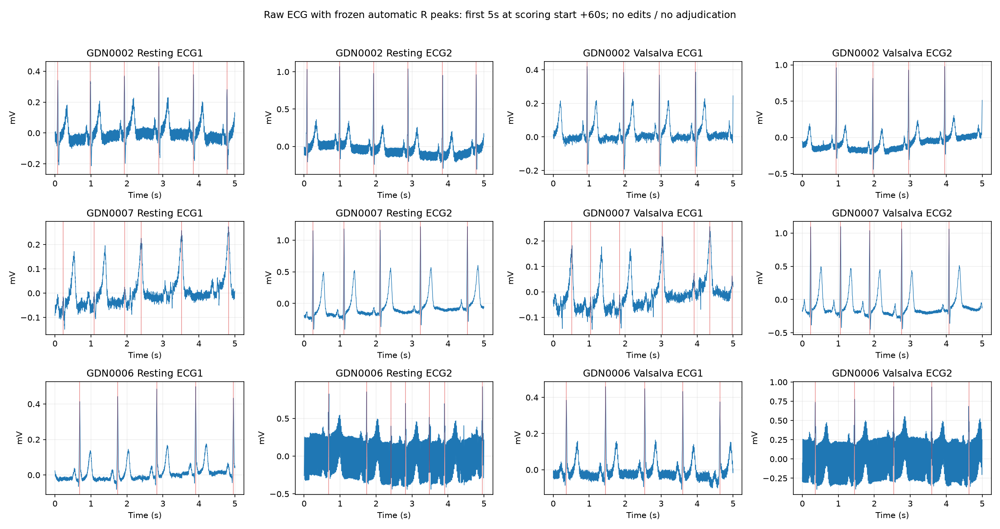
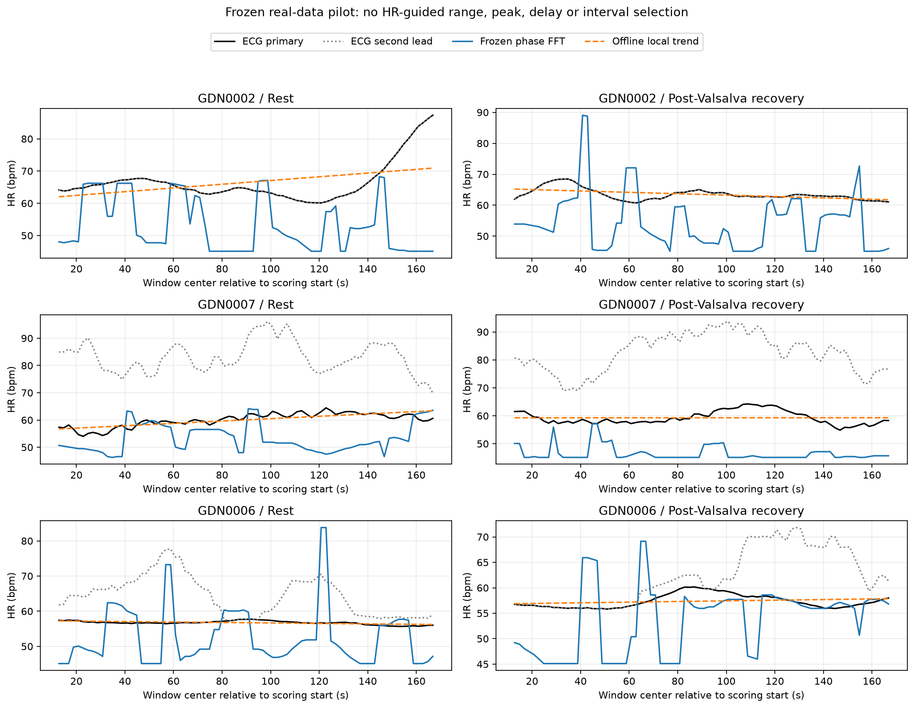

# 同步真实数据：冻结相位/FFT小型试验

2026-10-27。结果前协议提交`46fc91b`。本轮不再使用旧六条FTU记录做合成校准；首次读取公开GUARDIAN临床数据的三个指定受试者、两个固定场景。**当前冻结读数没有显示超过常数/趋势的收益；同时自动参考存在明显双导联不一致，不能把所有分数当作可靠的真实HR性能。** 自动R峰尚未人工裁定，剩余时钟误差无独立数值界，因此也不能宣布细节动态跟踪已确证。

GDN0002两条记录的双导联窗均HR差RMSE约0.005–0.006bpm，其主读数MAE为13.90/11.73bpm，明显劣于同区间均值oracle4.07/1.42bpm，窗间变化和残差误差也更大。这支持此固定读数未显示增量信息，不能推广成所有雷达前端失败。GDN0006/GDN0007的双导联HR差分别约7–9和24bpm，超过参考残差幅度；这些记录的自动参考尚未确立。保留所有描述性分数，不换主导联、调检测器或删除记录来改善成绩。

## 数据、同步与适用范围

来源：[数据论文](https://www.nature.com/articles/s41597-020-00629-5)、[官方数据v2](https://doi.org/10.6084/m9.figshare.12186516.v2)、[官方代码](https://gitlab.com/sven_schellenberger/scidata_phase1)。官方将Gold-code同步序列同时采到雷达与参考系统，依据该序列优化重采样比并校正延时；不通过HR找延时。发布文件已删除同步序列，逐记录剩余时钟误差不能从当前文件独立重测。0秒为主分析，±0.5秒为冻结敏感性，**不是已知误差界，不选最好偏移**。

按首个官方分片ID的固定哈希选GDN0002/GDN0007/GDN0006，选择不查看标签或雷达。原六条FTU和此前已探索Nature2026均不作为新验证；本轮仅有3个独立受试者，其他27名未访问。本地仓库审计未发现这些记录既往分析，这是可追溯的操作性未使用证据，不声称有外部登记证明。

静息在同一仰卧体位；恢复段取Valsalva首轮结束后30–210秒，避开操作本身和下一轮操作。它仍受呼吸/血流动力学恢复影响，不能等同于单独操纵HR，场景说明也不能证明实际没有意外身体运动。不拼接记录。原始数据本地缺失，按运行要求在私有Kaggle CPU取数与计算。

## 固定前端与参考

CW I/Q没有Range/Beam。只用记录开始30秒做直接最小二乘椭圆校准，然后P2主值共轭相位增量累加、抗混叠降采样20Hz。固定校准失败规则，不改算法或换记录；此CW适配器**不同于FTU ADC→RDA，也不是官方加密MATLAB elreko的复现**。每窗25.6秒、步长2秒，线性去趋势、周期Hann、4096点FFT与45–150bpm全局峰；无HR引导的选点/选峰。

参考用发布同步后的原始ECG，固定NeuroKit2 0.2.12自动R峰，主导联按官方源码既定映射，副导联只作诊断。完整窗口目标为每个RR区间的60/RR按时间积分再除窗长，时间锚点为中心；异常RR0.3–2秒之外、缺失值/边界或覆盖不足使该窗口无效，不编辑搏动、填零或外推。两个导联的评分段原始ECG、全部R峰保存在私有Kaggle输出和本地tmp；GitHub保存逐窗参考、R峰与原文件CRC/SHA256。自动峰的正确性不能由目标积分的数学一致性代替。

## 覆盖与失败

指定6条，共下载357,437,510字节，逐成员核对官方ZIP CRC32并记录SHA256，未声称已校验整个2GB分片的MD5。完成6条、失败0条。失败记录保留且不补选：

```json
[]
```

所有偏移取共同参考有效支持，相同雷达窗口与相同有效掩码；相邻变化只计算相邻且连续2秒的窗口。覆盖率见逐记录表，不能把只有较少有效窗口的记录视为完整180秒证据。

## 逐记录主分析（0秒）

误差单位bpm。MAE_gain_vs_mean、change_gain_vs_constant、residual_gain_vs_trend均为“对应对照误差减雷达误差”，正值有利于雷达。常数均值/中位数及OLS时间趋势均使用**同一评分区间标签**离线拟合，是较强的oracle诊断，不是可部署基线。分别对预测/参考在该相同区间去线性趋势，避免上一轮全记录趋势在局部区间抵消的问题。

| subject | scenario | windows_scored | windows_total | mae | mean_oracle_mae | trend_oracle_mae | MAE_gain_vs_mean | change_gain_vs_constant | residual_gain_vs_trend | detrended_r2 |
| --- | --- | --- | --- | --- | --- | --- | --- | --- | --- | --- |
| GDN0002 | Resting | 78 | 78 | 13.9047 | 4.0676 | 4.3402 | -9.8371 | -5.8753 | -4.2873 | -2.1576 |
| GDN0002 | Valsalva | 78 | 78 | 11.7315 | 1.4155 | 1.1696 | -10.3160 | -7.8890 | -7.4783 | -31.9768 |
| GDN0006 | Resting | 78 | 78 | 7.8737 | 0.3892 | 0.3599 | -7.4845 | -7.2867 | -7.8184 | -368.4145 |
| GDN0006 | Valsalva | 78 | 78 | 5.6174 | 1.1479 | 1.0869 | -4.4695 | -4.9453 | -4.7036 | -20.5002 |
| GDN0007 | Resting | 78 | 78 | 7.6056 | 2.0127 | 1.2175 | -5.5929 | -2.8513 | -3.9002 | -11.5696 |
| GDN0007 | Valsalva | 78 | 78 | 12.7622 | 2.0176 | 2.0174 | -10.7446 | -1.9699 | -1.2455 | -1.3189 |

## 参考变化与双导联诊断

| subject | scenario | reference_std | reference_residual_std | ecg_lead_disagreement_rmse | prediction_std | detrended_rmse | trend_detrended_rmse |
| --- | --- | --- | --- | --- | --- | --- | --- |
| GDN0002 | Resting | 6.0983 | 5.5180 | 0.0063 | 8.3648 | 9.8053 | 5.5180 |
| GDN0002 | Valsalva | 1.8727 | 1.5768 | 0.0053 | 9.2019 | 9.0551 | 1.5768 |
| GDN0006 | Resting | 0.5239 | 0.4291 | 9.4488 | 8.2205 | 8.2475 | 0.4291 |
| GDN0006 | Valsalva | 1.3244 | 1.2933 | 7.0196 | 6.5862 | 5.9969 | 1.2933 |
| GDN0007 | Resting | 2.4801 | 1.5323 | 23.8381 | 5.1176 | 5.4325 | 1.5323 |
| GDN0007 | Valsalva | 2.3823 | 2.3823 | 23.9959 | 2.6697 | 3.6278 | 2.3823 |

残差变化很小、双导联不一致或时钟误差尚不能约束时，只描述均值/频谱或标记动态未获证实，不把低误差当成功。双导联一致仍不能排除共同检测偏差；未知同步误差也不包含在双导联差内。每条原始参考及自动峰须质量审查后才可提升主张。

按评分起点后60秒起固定5秒展示两个原始导联及冻结检测峰，没有根据误差挑片段或改峰。50ms匹配只是诊断容差，不是已验证的时钟/标注误差界：

| subject | scenario | ECG1_peaks | ECG2_peaks | ECG1_matched_within_50ms_fraction | ECG2_matched_within_50ms_fraction |
| --- | --- | --- | --- | --- | --- |
| GDN0002 | Resting | 204 | 204 | 1.0000 | 1.0000 |
| GDN0002 | Valsalva | 189 | 189 | 1.0000 | 1.0000 |
| GDN0007 | Resting | 245 | 180 | 0.1184 | 0.1611 |
| GDN0007 | Valsalva | 248 | 179 | 0.0806 | 0.1117 |
| GDN0006 | Resting | 170 | 191 | 0.9765 | 0.8691 |
| GDN0006 | Valsalva | 172 | 185 | 0.9942 | 0.9243 |



## 逐受试者汇总

每名受试者内对已完成场景等权，再在受试者间等权；场景缺失须按覆盖表理解。没有窗口级显著性检验、种子扩样或5/6通过配额。

| subject | records | mae | mean_oracle_mae | trend_oracle_mae | change_rmse | constant_change_rmse | detrended_rmse | trend_detrended_rmse |
| --- | --- | --- | --- | --- | --- | --- | --- | --- |
| GDN0002 | 2 | 12.8181 | 2.7415 | 2.7549 | 7.4916 | 0.6094 | 9.4302 | 3.5474 |
| GDN0006 | 2 | 6.7455 | 0.7686 | 0.7234 | 6.2785 | 0.1624 | 7.1222 | 0.8612 |
| GDN0007 | 2 | 10.1839 | 2.0151 | 1.6175 | 3.2020 | 0.7914 | 4.5301 | 1.9573 |



## 固定偏移敏感性

| subject | scenario | reference_offset_s | windows_scored | mae | detrended_rmse | detrended_r2 |
| --- | --- | --- | --- | --- | --- | --- |
| GDN0002 | Resting | -0.5000 | 78 | 13.8218 | 9.7638 | -2.2214 |
| GDN0002 | Resting | 0.0000 | 78 | 13.9047 | 9.8053 | -2.1576 |
| GDN0002 | Resting | 0.5000 | 78 | 13.9850 | 9.8427 | -2.0934 |
| GDN0002 | Valsalva | -0.5000 | 78 | 11.7117 | 9.0331 | -31.0766 |
| GDN0002 | Valsalva | 0.0000 | 78 | 11.7315 | 9.0551 | -31.9768 |
| GDN0002 | Valsalva | 0.5000 | 78 | 11.7437 | 9.0743 | -32.7227 |
| GDN0006 | Resting | -0.5000 | 78 | 7.8819 | 8.2532 | -370.0991 |
| GDN0006 | Resting | 0.0000 | 78 | 7.8737 | 8.2475 | -368.4145 |
| GDN0006 | Resting | 0.5000 | 78 | 7.8665 | 8.2433 | -367.9691 |
| GDN0006 | Valsalva | -0.5000 | 78 | 5.6290 | 5.9922 | -20.4880 |
| GDN0006 | Valsalva | 0.0000 | 78 | 5.6174 | 5.9969 | -20.5002 |
| GDN0006 | Valsalva | 0.5000 | 78 | 5.6069 | 6.0047 | -20.6009 |
| GDN0007 | Resting | -0.5000 | 78 | 7.5848 | 5.4281 | -11.4339 |
| GDN0007 | Resting | 0.0000 | 78 | 7.6056 | 5.4325 | -11.5696 |
| GDN0007 | Resting | 0.5000 | 78 | 7.6121 | 5.4269 | -11.5448 |
| GDN0007 | Valsalva | -0.5000 | 78 | 12.7795 | 3.6307 | -1.3443 |
| GDN0007 | Valsalva | 0.0000 | 78 | 12.7622 | 3.6278 | -1.3189 |
| GDN0007 | Valsalva | 0.5000 | 78 | 12.7574 | 3.6150 | -1.3222 |

## 核验与出口

Kaggle主任务（取数+处理）46.134秒；本地uv环境独立数值核验0.316秒。使用分数搏动计数差独立重算参考窗均值，使用SciPy periodogram重算FFT，另用闭式线性投影重算对照/残差误差；1404个读数，最大参考差9.24e-14bpm、FFT差0bpm、汇总差4e-14。核验通过只证明实现一致，不证明ECG检测、同步剩余误差或生理有效性。

这次一次性试验按冻结配置结束，不在观察结果后追加前端/窗口/阈值搜索，也不扩展受试者追逐通过数。下一决策须同时依据原始误差、窗间变化、残差增量、覆盖及参考质量；条件不足时保留“尚未验证超过常数/趋势的信息”的结论。既有FTU0/6保持，本轮不得用新数据成绩倒改旧结论。
