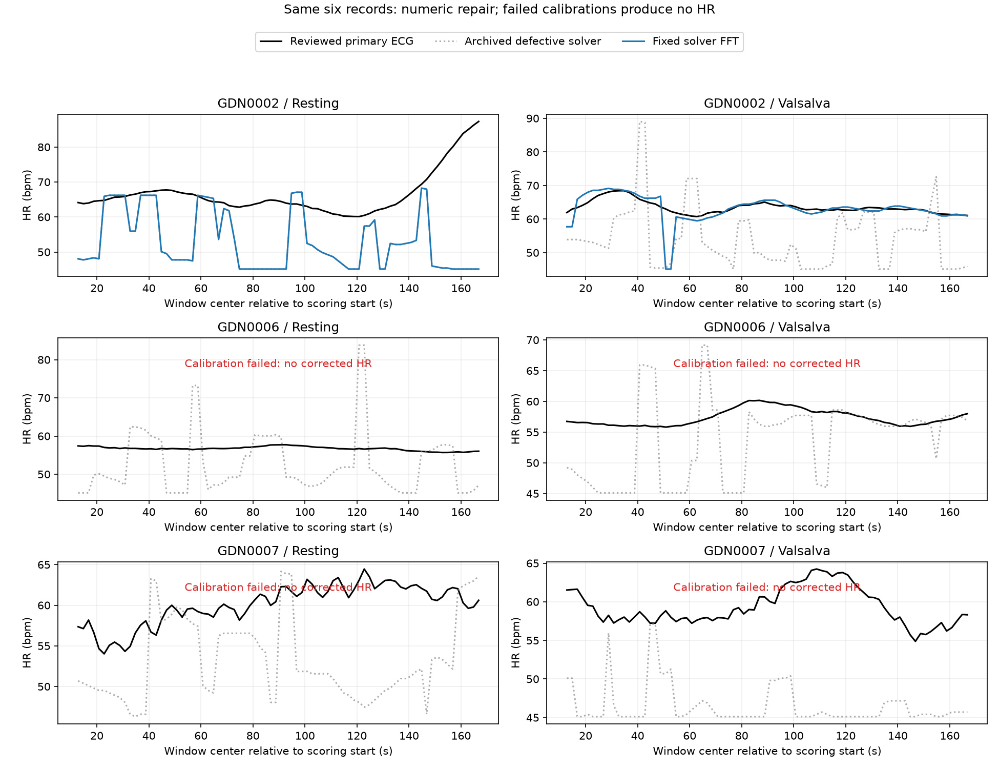

# 椭圆校准数值修复：同六条复跑与ECG-only审查

归档完成日期2026-10-28。修复冻结`0e745ca`；ECG-only结论冻结`47153ed`，此后才下载/查看修正版雷达结果。原协议、结果和54项产物哈希全部保留。其余27名受试者未访问，无训练。

**原实现存在可复现的数值错误。此前五条记录的退化校准输出不能作为有效前端性能证据。修复后2条有效、4条按原残差上限校准失败，不输出HR。** 有效的GDN0002恢复段MAE由11.73降至1.37bpm，但尚无充分的常数/趋势外动态收益；不能用这个低MAE宣称跟踪成功。

## 数值错误与解析验证

原代码只保留广义特征向量，丢弃特征值；奇异约束矩阵产生的无穷特征值候选因此进入椭圆评选。其中心可达1e15–1e16，变换几乎为零，将整个校准点云压到单位圆上一点，径向误差却接近机器零。错误由实现造成，不应因原协议冻结而保留。

修复保留广义特征值齐次alpha/beta，排除非有限/近零beta、复特征对、近零二次项、非正定或退化level；检查特征对后向误差，并补充映射点云中心化奇异值、圆方差、相角跨度检查。原0.2径向残差上限、轴比100上限及最初30秒校准不变。不放宽失败条件，不改拟合目标或用HR选解。

解析测试本地uv环境0.0114秒：完整椭圆相位RMSE1.36e-14rad，部分弧5.68e-15rad；固定带噪椭圆中原实现相位RMSE254.626rad、径向残差1.11e-16，修复后相位RMSE0.002086rad。恒点、直线、非有限输入和“单位圆上单点”全部拒绝。最后一例径向误差正好为零，直接证明只查径向残差不足。所有门槛在修复后真实评分前冻结，是数值支持护栏，不保证椭圆可辨识或生理正确。

## 同六条的校准覆盖

| record | calibration | old_center_norm | old_radial_rmse | old_mapped_spread_upper_bound | fixed_radial_rmse | fixed_mapped_largest_std |
| --- | --- | --- | --- | --- | --- | --- |
| GDN0002_1_Resting | valid | 1.4978 | 0.1362 | 0.9844 | 0.1362 | 0.5712 |
| GDN0002_2_Valsalva | valid | 1.859e+15 | 9.180e-16 | 1.125e-15 | 0.1565 | 0.6094 |
| GDN0006_1_Resting | failed; no HR | 3.635e+15 | 2.938e-16 | 6.610e-16 | NA | NA |
| GDN0006_2_Valsalva | failed; no HR | 9.528e+15 | 1.776e-16 | 3.116e-16 | NA | NA |
| GDN0007_1_Resting | failed; no HR | 3.460e+15 | 8.188e-16 | 4.819e-16 | NA | NA |
| GDN0007_2_Valsalva | failed; no HR | 1.084e+16 | 2.698e-16 | 2.165e-16 | NA | NA |

旧映射spread上界为sqrt(2)*变换Frobenius范数：校准输入两轴经逐轴标准化后总方差为2，因此可在不重读旧原始I/Q的情况下界定映射点云变化。五个退化输出的上界接近数值零。四条失败均为**有限候选的径向残差超过原0.2上限**，无穷候选已排除；失败不等于原雷达没有心跳。校准覆盖2/6只描述工程可用性，不是通过记录数配额。

## ECG-only技术质量裁定

全部主导联保持原映射：GDN0002/0007用ECG2，GDN0006用ECG1。只用原始主导联、自动峰、固定时间定义制作24页材料，逐10秒条带检查全部184秒/记录，共1104秒，并检查边界。

六条均未发现明确的主导联漏检/误检，未增删峰、未换导联。GDN0002静息188–208秒有基线漂移/瞬态，但窄QRS仍可辨且与标记对应；GDN0007窄QRS与后续宽T波可分。全部页、逐记录说明和reviewed_beats随报告归档。

**这是助手完成的研究级技术目视审查，不是独立临床专家裁定。** 修正版雷达输出在审查结论提交前未打开，但审查者此前看过缺陷版预测，不能声称对旧研究回溯完全盲法，也不声称得到逐搏临床金标准。上一轮双导联不一致只说明需要查参考，不能单独否定清晰的主导联。本轮因此接受指定主导联用于有限窗口平均HR分析，不判定副导联所有异常的机制。

保留原自动峰对照；审查未改峰，reviewed与automatic在共同支持上目标差最大7.11e-14bpm。审查接受并非重新运行另一个检测器来追求更好雷达分数。

## 冻结评分的有效记录（0秒）

| subject | scenario | windows_scored | mae_old | mae_fixed | mean_oracle_mae | median_oracle_mae | trend_oracle_mae | change_rmse | constant_change_rmse | detrended_rmse | trend_detrended_rmse | detrended_r | detrended_r2 |
| --- | --- | --- | --- | --- | --- | --- | --- | --- | --- | --- | --- | --- | --- |
| GDN0002 | Resting | 78 | 13.9047 | 13.9047 | 4.0676 | 3.6888 | 4.3402 | 6.6474 | 0.7721 | 9.8053 | 5.5180 | -0.0467 | -2.1576 |
| GDN0002 | Valsalva | 78 | 11.7315 | 1.3672 | 1.4155 | 1.3381 | 1.1696 | 3.1700 | 0.4467 | 3.0679 | 1.5768 | 0.6736 | -2.7852 |

恢复段虽比均值oracle1.415bpm略好（MAE1.367），仍差于中位数1.338、时间趋势1.170。去趋势相关性0.674为正，但残差RMSE3.068高于趋势零残差基线1.577，R²=-2.785；窗间变化RMSE3.170也高于常数0.447。说明相关方向与幅度准确性不能混为一谈。静息段13.905bpm与旧版相同，因该记录原先选择的是有效有限解。

其余四条无有效校准，不填常数、不沿用旧预测、不计算伪造HR误差。有效两条均来自同一受试者，不能用条件MAE当六记录/三受试者整体性能或跨受试者证据。78个重叠窗口不是78个独立样本；不计算窗口级显著性。

## 固定时间偏移

| subject | scenario | reference_offset_s | mae | detrended_rmse | detrended_r2 |
| --- | --- | --- | --- | --- | --- |
| GDN0002 | Resting | -0.5000 | 13.8218 | 9.7638 | -2.2214 |
| GDN0002 | Resting | 0.0000 | 13.9047 | 9.8053 | -2.1576 |
| GDN0002 | Resting | 0.5000 | 13.9850 | 9.8427 | -2.0934 |
| GDN0002 | Valsalva | -0.5000 | 1.3768 | 3.0878 | -2.7481 |
| GDN0002 | Valsalva | 0.0000 | 1.3672 | 3.0679 | -2.7852 |
| GDN0002 | Valsalva | 0.5000 | 1.3541 | 3.0464 | -2.8007 |

仍为0秒主结果、±0.5秒全部报告，不选最优偏移。这不是测得的同步误差界；公开Gold-code同步方法仍有依据，但删除的原同步序列使逐记录剩余误差无法独立约束。ECG质量审查不解决这个问题。

## 核验与决策

Kaggle CPU下载+复跑30.647秒；本地独立不变量/评分核验1.897秒。六个原文件SHA256与旧版一致；有效记录窗口/偏移/主导联参考逐行一致；独立cycle积分与periodogram复算468个读数，失败记录无HR输出。原54个产物哈希均未改变。执行源码与修复冻结哈希一致。

本轮修复与研究级参考审查已完成，**暂不进入其余27名受试者验证**：当前固定校准只支持2/6记录，有效记录尚未恢复幅度正确的动态；数值修复不等于前端已具备稳定适用性。下一步若研究校准对真实I/Q的适用条件，继续限于这六条、先冻结诊断，不降低0.2上限追求覆盖，不同时搜索读数/标签/峰值规则。进入独立受试者前还需可追溯的参考质量流程与同步误差预算。
